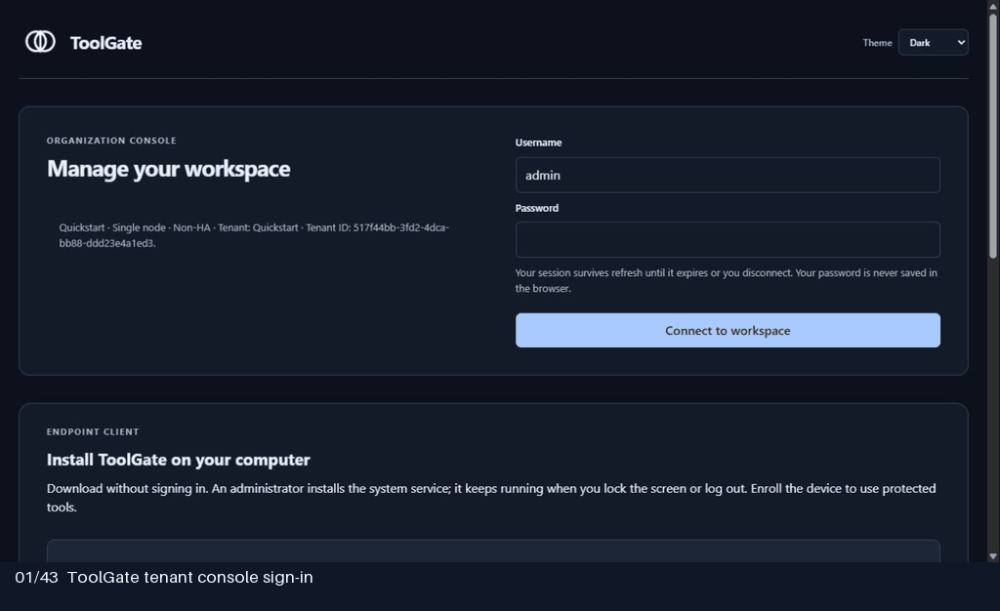
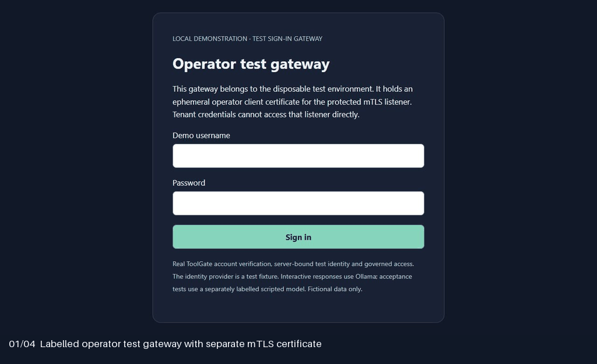

# OLO ToolGate

> **Control what AI can do.**

OLO ToolGate is a self-hosted control plane for building, distributing and governing
AI tools across people, agents and devices. It combines group-based access,
ALLOW / ASK / BLOCK policies, reviewed configuration, device enrollment and
auditable execution.

[Get started](docs/getting-started/one-minute-quickstart.md) ·
[Documentation](docs/README.md) · [Build a tool](TOOL-SDK-GUIDE.md) ·
[Contribute](CONTRIBUTING.md) · [Enterprise evaluation](docs/enterprise-access-control/README.md) ·
[Multitenant deployment](docs/deployment/multitenant.md)

  

[Watch the captioned overview](https://github.com/olo-labs/olo-toolgate/raw/refs/heads/main/docs/media/toolgate-overview.mp4)
or read the [transcript and screenshot guide](docs/media/README.md).

## Run ToolGate

Use the [Quickstart walkthrough](docs/getting-started/one-minute-quickstart.md)
for a local, single-node evaluation. The [Compose helpers](deploy/compose/QuickStart/README.md)
manage deployment and retain the data volume. For a source build, follow the
[development guide](docs/development/README.md).

Fresh installations create management identities and protected default groups.
Tools and agents require explicit enablement, grants and execution bindings.
Device approval alone never grants permission to run a tool.

## What is available

| Area | Start here |
|---|---|
| Console, users, teams, groups and reviewed configuration | [Administration](docs/control-plane/README.md) |
| Current authorization, approvals and single-use permits | [Security model](docs/security/README.md) |
| Device enrollment, package tools on devices and the files area | [Endpoint client](docs/client/README.md) |
| Java tool authoring, packaging and standalone MCP | [Java SDK](tool-sdk/java-sdk/README.md) |
| Server Java tools, placement and direct or queued dispatch | [Tool Host](apps/tool-host/README.md) |
| Deployment, recovery and diagnosis | [Operations](docs/operations/README.md) |

This repository is a development release. Tool Host sandbox isolation and several
SDK, integration and distribution features remain unfinished. The Marketplace
applications are scaffolds. Each [component guide](docs/README.md) describes its
current behavior and limitations.

## Console and devices

  

  

  

**OLO walkthrough model:** Qwen2.5 7B (`qwen2.5:7b`) through Ollama on four NVIDIA
Quadro P4000 GPUs, with one short fictional RAG runbook. ToolGate governs the calls;
separate deterministic acceptance traffic uses a labelled scripted model.

These tours were captured from a fresh local `0.10.0-dev` installation on October 27,
2026, including the tenant Analytics and tool drilldown changes on `main`.
[Browse every captured page and the verification notes](docs/media/README.md).
Enabled tools and grants are fictional demo configuration, not installation defaults.
The operator tour uses a labelled local test gateway holding an ephemeral operator
client certificate; the operator listener retains its separate mTLS protection.

## Evaluate for your organization

Control evaluates current authority before protected effects. Gateway routes
requests, and registered executors enforce the permit and resource boundary.
Unavailable authority fails closed; cached metadata does not permit offline execution.

Start with the [enterprise evaluation guide](docs/enterprise-access-control/README.md)
for supported scope, implementation evidence, deployment requirements and known
limitations. [Standards alignment](docs/enterprise-access-control/standards-alignment.md)
describes design relationships; it is not a certification claim.

## Contribute

Read [CONTRIBUTING.md](CONTRIBUTING.md), choose a component from the
[architecture map](docs/architecture/component-map.md), and use the
[development commands](docs/development/README.md). Small fixes, tests,
documentation and examples are welcome. Discuss proposed work in GitHub issues.

[Support](SUPPORT.md) · [Report a vulnerability](SECURITY.md) ·
[Governance](GOVERNANCE.md) · [Code of conduct](CODE_OF_CONDUCT.md) ·
[Changelog](CHANGELOG.md) · [Apache-2.0 license](LICENSE)
