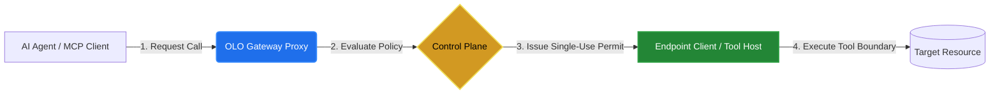

# OLO ToolGate

> **Zero Trust for Agentic AI.**
> **Secure Every Tool Boundary.**

Govern every tool call with identity, policy enforcement, least-privilege access,
and end-to-end auditability.

[Get started](docs/getting-started/one-minute-quickstart.md) ·
[Documentation](docs/README.md) · [Security model](docs/security/README.md) ·
[Enterprise evaluation](docs/enterprise-access-control/README.md) ·
[Build a tool](TOOL-SDK-GUIDE.md) · [Contribute](CONTRIBUTING.md)

## Why ToolGate

AI agents now act through tools: they write files, call APIs and change systems.
Each tool call crosses a trust boundary. ToolGate is the self-hosted control plane
that sits on that boundary and decides, at the moment of the call, whether it may
proceed.

- **Identity first.** Every call is tied to a verified person, agent and device.
  New users and agents start disabled; device approval alone never grants access.
- **Policy at every call.** ALLOW, ASK or BLOCK is evaluated against current
  authority before any protected effect. ASK routes to independent human approval.
- **Least privilege by default.** Fresh installations grant nothing. Access comes
  only from explicit group grants, delegated scopes and execution bindings, and is
  enforced by single-use permits on the executor.
- **Fails closed.** If Control is unavailable, nothing runs. Cached metadata never
  authorizes offline execution.
- **End-to-end auditability.** Requests, approvals, decisions and outcomes are
  recorded per tenant, with Analytics and Operator Insights on every tool call.

## Who it is for

| You are | Start here |
|---|---|
| Security and platform teams evaluating agent governance | [Enterprise evaluation](docs/enterprise-access-control/README.md) · [Security model](docs/security/README.md) |
| Administrators granting tools to people and agents | [Administration](docs/control-plane/README.md) |
| Operators deploying and running ToolGate | [Deployment](docs/deployment/README.md) · [Multitenant](docs/deployment/multitenant.md) · [Operations](docs/operations/README.md) |
| Tool authors | [Tool SDK guide](TOOL-SDK-GUIDE.md) · [Java SDK](tool-sdk/java-sdk/README.md) |
| Contributors | [Contributing](CONTRIBUTING.md) · [Architecture map](docs/architecture/component-map.md) |

## Try it in a minute

The [Quickstart walkthrough](docs/getting-started/one-minute-quickstart.md) runs a
local, single-node evaluation. The [Compose helpers](deploy/compose/QuickStart/README.md)
manage the deployment and retain its data volume. To build from source, follow the
[development guide](docs/development/README.md).

[Watch the captioned overview](https://github.com/olo-labs/olo-toolgate/raw/refs/heads/main/docs/media/toolgate-overview.mp4)
or read the [transcript and screenshot guide](docs/media/README.md).

## See it work

> 💡 **Tip:** For individual, high-resolution step frames or manual navigation, browse the
> [Step-by-Step Tour Guide](docs/media/TOURS.md). Every snapshot is in the repository:
> console and operator screens in [`docs/media/screenshots`](docs/media/screenshots) and
> device/client captures in [`docs/media`](docs/media).

<strong>🛡️ Audit, approvals and tool calls</strong>: follow one request from ASK to evidence

 

  

**What to look for in the loop:**

- 🛡️ Tool requests arriving at the boundary and queuing in Approval requests.
- 🛑 A live remediation call waiting on an `ASK` policy for independent approval.
- 👤 The reviewer checking the exact delegated invocation before approving it.
- ✅ The original invocation resuming through ToolGate, then its outcome and audit trail.
- 📊 Tenant Analytics per-tool counts and a drilldown, then Operator Insights.

The example uses Qwen2.5 7B through Ollama with one short RAG runbook; scripted
acceptance traffic is labelled.

<strong>💻 Devices and device client</strong>: enroll, verify and approve a device

 

  

**What to look for in the loop:**

- 💻 The device client opening from the tray and reporting its status.
- 🔑 Enrollment pausing until an administrator compares the key fingerprint.
- ✅ The approved device connecting, with its details and activity log.
- 🗂️ Devices, device groups, device evidence and packages in the console.

Earlier enrollment/client captures are labelled in the tour guide.

<strong>🧰 Tools and delegated access</strong>: least privilege from tool to execution binding

 

  

**What to look for in the loop:**

- 🧰 Tools built, packaged and grouped, with resource extractors.
- 🤖 Agents, agent groups and workload identities.
- 🤝 Human and agent delegations constraining what an agent may act on.
- 📜 Grants, ALLOW / ASK / BLOCK policies and execution bindings.
- 🔍 Access simulation showing the final decision before anything runs.

<strong>⚙️ Workspace administration</strong>: people, identities and server settings

 

  

**What to look for in the loop:**

- 🔐 Tenant sign-in and the workspace overview, in dark and light themes.
- 👥 Users, teams, typed roles and human identities.
- 🔌 MCP servers and server settings.
- 💾 Backup/restore, the local vault and the About page.

Screens were captured from a local `0.10.0-dev` installation on October 27, 2026.
Enabled tools and grants are fictional demo configuration, not installation defaults.

## Project status

This repository is a development release. Tool Host container/network isolation
and several SDK, integration and distribution features remain unfinished; each
[component guide](docs/README.md) states its current behavior and limitations.
[Standards alignment](docs/enterprise-access-control/standards-alignment.md)
describes design relationships; it is not a certification claim.

The OLO Marketplace is developed in a separate private repository and hosted at
[olo-labs.org](https://olo-labs.org). Control can import from it through the
[Marketplace integration](docs/control-plane/marketplace-integration.md).

## Contribute

Small fixes, tests, documentation and examples are welcome. Read
[CONTRIBUTING.md](CONTRIBUTING.md), pick a component from the
[architecture map](docs/architecture/component-map.md), and discuss larger work in
GitHub issues.

[Support](SUPPORT.md) · [Report a vulnerability](SECURITY.md) ·
[Governance](GOVERNANCE.md) · [Code of conduct](CODE_OF_CONDUCT.md) ·
[Changelog](CHANGELOG.md) · [Apache-2.0 license](LICENSE)
