# OLO

> **Zero Trust for Agentic AI.**
> **Secure Every Tool Boundary.**

OLO is an open-source, self-hosted platform with two sections: **OLO ToolGate**
governs AI agent tool execution, MCP servers and devices; **OLO Orchestration**
authors and runs bots with configured agents, triggers and model routing.

Start with the [community help](docs/help/README.md) for bot/device/model setup.

Enforce identity, least-privilege access, runtime authorization, human approvals and
auditable execution at every governed tool boundary.

**Status:** OLO is in Beta Release.

**Version and channel:** see this branch's [version configuration](version.json) and the
[published releases](https://github.com/olo-labs/olo-toolgate/releases). For deployment
readiness, see [current limits](#production-and-security-status).

[Quickstart](#quickstart) · [Documentation](docs/README.md) ·
[Security model](docs/security/README.md) ·
[Enterprise evaluation](docs/enterprise-access-control/README.md) ·
[Build a tool](TOOL-SDK-GUIDE.md) · [Contribute](CONTRIBUTING.md)

## Why OLO

AI agents act through tools: they write files, call APIs and change systems. Each
tool call crosses a trust boundary. OLO ToolGate sits on that boundary and decides, at
the moment of the call, whether it may proceed. The executor cannot act without
that decision.

- **Verified identities.** Each call is checked against the identities that apply
  to it: the calling agent or workload, the human it acts for when there is one, and
  the executor (an enrolled device or a Tool Host). New users and agents start
  disabled; device approval alone never grants access.
- **Policy at every call.** ALLOW, ASK or BLOCK is evaluated against current
  authority before any protected effect. ASK routes the call to independent human
  approval.
- **Least privilege by default.** Fresh installations grant nothing. Access comes
  only from explicit group grants, delegated scopes and execution bindings.
- **Enforced at the executor.** Executors run a call only under a single-use permit
  from Control, consumed online. If Control is unavailable, nothing runs; cached
  metadata never authorizes offline execution.
- **End-to-end auditability.** Requests, approvals, decisions and outcomes are
  recorded per tenant and correlated to the identities involved.

## Quickstart

OLO's bot stack has three persistent core services: **Quickstart**, **LangGraph**
and **Device**. Quickstart contains Gateway, backend, Admin UI and SQLite;
LangGraph runs the configured graph; the connected device runs tools/triggers.
Optional Ollama/TLS and observability companions are separate. Package executors
may create additional containers.

**Use the current branch today, from source:** Docker builds the applications;
no host Node, Java or Rust toolchain is required. On Windows the launcher also
bootstraps private Python if needed.

```powershell
git clone https://github.com/olo-labs/olo-toolgate.git
cd olo-toolgate\debug\profiled
.\start.bat
```

**Deploy published development images:** the community launcher is prepared at
[`deploy/docker/quickstart/dev`](deploy/docker/quickstart/dev/README.md).
The new matching `dev` containers are **not published yet**. Once available,
from the repository root:

```powershell
cd deploy\docker\quickstart\dev
.\start.bat
# Linux/macOS with Python 3.11+: sh start.sh
```

It reuses/pulls `ololab/olo-toolgate-quickstart`,
`ololab/olo-toolgate-langgraph-runtime` and `ololab/olo-toolgate-device` images,
without compiling OLO. Use matching versioned tags/digests for repeatability;
missing/incompatible images fail rather than falling back to a source build.
Both launchers ask independently about local Ollama and the collector.
[Deployment settings, ports, credentials and stop/restart](deploy/docker/quickstart/dev/README.md).

Open **http://127.0.0.1:18090/console/**. A fresh installation has the initial
`admin` login and no imported bot. Its password is in `credentials/admin/password.txt`
under the launcher folder. Restarts preserve the account and storage. The two
launchers use separate projects/volumes; stop the other one or select different
ports before using their shared defaults.

Import a self-contained `.olo` in **Bots**; approve/enable the destination device,
assign the bot's groups and provide the model's local vault secret. Resolve the
red readiness bullets, review/provision/prepare/publish, then click **▶ Run** or
place the file described in the bot's README. Containers and Admin credentials
stay unchanged during bot switching; input/output folders remain your responsibility.

Start with [community help](docs/help/README.md),
[the seven file examples and three text bots](bot/README.md),
[device setup](docs/help/device.md), [models](docs/help/models.md) and
[observability](docs/help/observability.md). The older single-container
[ToolGate-only Quickstart](deploy/compose/QuickStart/README.md) remains separate.

## Architecture

The call and the authorization travel separate paths. Gateway dispatches the call;
Control decides and issues the permit; the executor will not act until it redeems
that permit with Control.

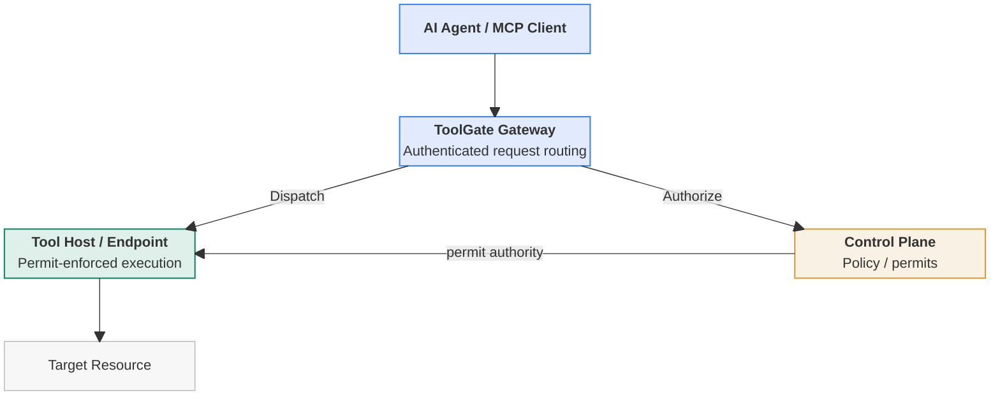

Control never forwards calls, and Gateway never signs permits or authorizes from a
cached policy. See [architecture](ARCHITECTURE.md),
[core data flows](docs/architecture/data-flows.md) and
[trust boundaries](docs/architecture/trust-boundaries.md).

## Capabilities

**OLO Orchestration** defines bots, agent prompts, JSON-configured graphs,
trigger mappings and model order. **OLO ToolGate** governs the tools and devices
those runs can use. Administrator management rights do not replace current
agent/service grants or execution authorization.

| Capability | What it does | Status |
|---|---|---|
| [Portable bots](docs/help/run-bots.md) | Import/export one `.olo` with its referenced configuration and exact tool/trigger packages | Current development branch; published images pending |
| [Graph and agent authoring](docs/help/author-bots.md) | JSON editors for graph configuration, agents, prompts, model groups and trigger mappings | Current development branch; full workflow roadmap qualification pending |
| [Manual and triggered runs](docs/help/run-bots.md) | Published bot Run input, durable progress/result and device trigger dispatch | Ten local examples accepted, including a two-agent handover; full distributed matrix pending |
| [Model routing](docs/help/models.md) | File agents use OLO QLoRA then Qwen3; other agents use Qwen3; premium OpenRouter is unattached standby | Real local-model acceptance; no automatic paid calls |
| [Workflow observability](docs/help/observability.md) | Optional collector to Langfuse, LangSmith and Phoenix with content-free structural spans | Three-cloud local acceptance; installation configuration |
| [MCP governance](docs/gateway/mcp-proxy.md) | Put existing MCP servers behind ToolGate policy, approval and audit without changing them | Available |
| [Runtime policy](docs/security/README.md) | ALLOW / ASK / BLOCK on every tool invocation, against current authority | Available |
| [Delegated authority](docs/security/enterprise-access-control.md) | Constrain what an agent may do on behalf of a person or another agent | Available |
| [Zero-trust execution](docs/control-plane/approvals.md) | Single-use permits, renewable leases and qualified Python OCI containment | Partial; per-effect consent/fencing remain in [#230](https://github.com/olo-labs/olo-toolgate/issues/230) |
| [Human approval](docs/control-plane/approvals.md) | Independent review of sensitive calls before they run | Available |
| [Tool distribution](docs/client/package-deployment.md) | Package, version and deliver signed tools to devices and Tool Hosts | Available; Java and Python authoring; TypeScript [#242](https://github.com/olo-labs/olo-toolgate/issues/242) and .NET [#243](https://github.com/olo-labs/olo-toolgate/issues/243) are specifications |
| [Audit and analytics](docs/control-plane/insights.md) | Correlate identities, decisions and outcomes; tenant Analytics and Operator Insights | Available |

### Governing an MCP server in five steps

1. **Register** the server's HTTPS URL, credential and Tool Host pool. Control contacts nothing.
2. **Scan.** A Tool Host lists the server's tools; Control stores an immutable snapshot with a digest per tool.
3. **Approve** the tools to expose. ToolGate packages them, and each starts disabled.
4. **Grant** them to agent groups like any other tool, under ALLOW / ASK / BLOCK policies.
5. **Execute and audit.** Agents call through the Gateway. The Tool Host runs each call under its
   permit, validates the arguments and connects with the approved key pins; every call is recorded.

Details: [MCP proxy guide](docs/gateway/mcp-proxy.md).

## See it work

These are actual **November 19, 2026** captures from the running debug stack,
using the current OLO Admin UI and real local Ollama inference. The configured
bots, policies and device are demonstration data, not fresh-install defaults.
They are not screenshots of the unpublished Docker deployment.
[Capture details and originals](docs/media/olo-2026-11/README.md).

### One workspace, two sections

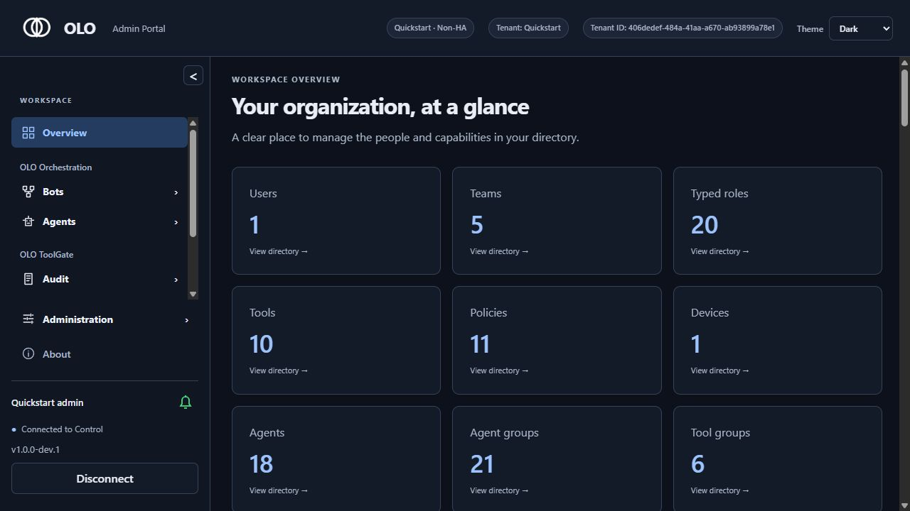

The console puts **Bots** below Overview and **Agents** directly below Bots.
OLO ToolGate groups tools, devices, access and audit controls in the same workspace.

### Import, publish and run bots

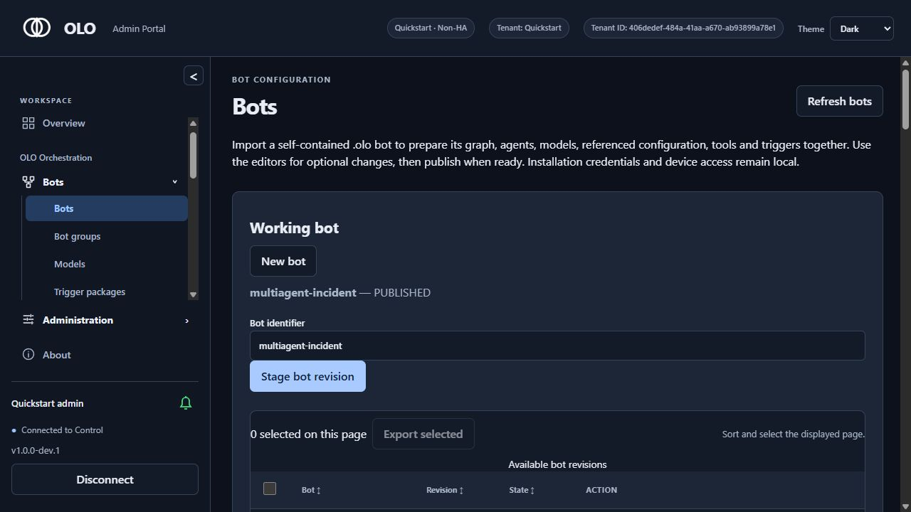

A `.olo` carries the bot and referenced packages/configuration. Review its exact
revision, prepare the graph and dependencies, then publish. Persistent red bullets
explain missing dependencies. Imports retain destination credentials and device
membership and never clean your hot folders.

### Follow two agents from input to result


Click **▶ Run**, enter the input expected by that bot, and follow queue, agent,
model and node progress through the terminal result. File bots can instead start
from a configured device watcher. The [multi-agent incident bot](bot/configurations/multiagent-incident/README.md)
classifies an incident with one agent, then passes the original text and triage
to a second agent for an operations handover. Both call local Qwen3; the result
contains the triage and summary. Seven device/file examples and three text bots
have bounded local end-to-end acceptance. Model output quality and production
reliability are separate from successful execution.

[Open the real two-agent result](docs/media/olo-2026-11/console/multiagent-output.jpg) ·
[Exact run and cloud evidence](docs/media/olo-2026-11/evidence.json).

<details>
<summary><strong>Agents, devices and trigger assignment administration</strong></summary>

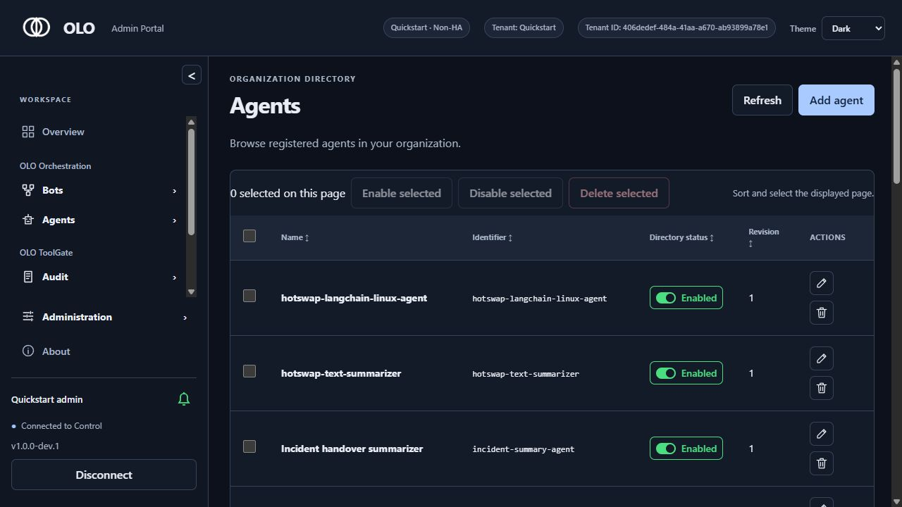

Agent definitions select prompts, model groups and output schemas. Runtime grants
remain separate from the administrator's ability to configure a bot.

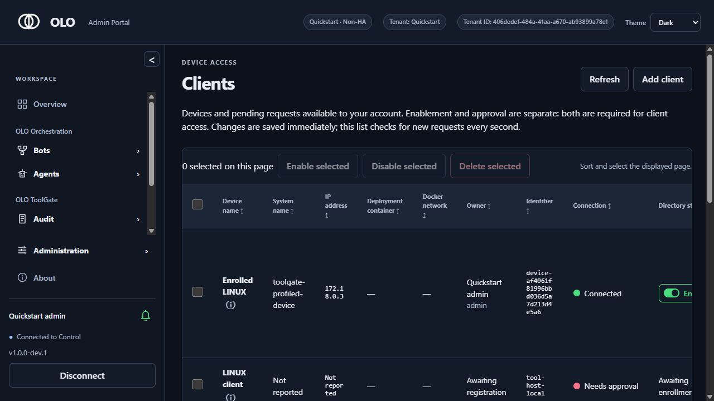

Approve the actual destination device and assign its declared groups. Packages
and watcher settings reconcile over its existing Gateway connection.

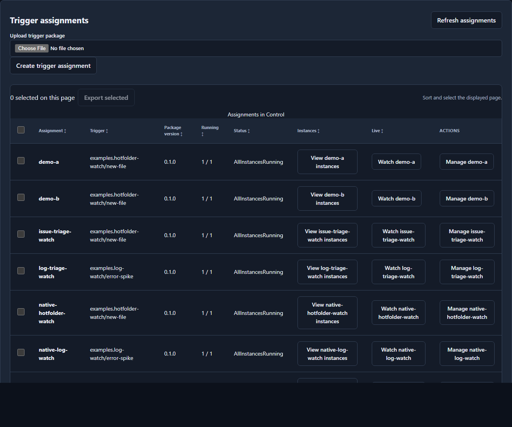

Assignments show package versions, desired/running state and instance actions.
This capture is the administration section; agent-facing subscriptions require
their own runtime authority.

</details>

### Model and monitoring setup

File agents try **OLO QLoRA in Ollama**, then **Qwen3 0.6B** on inference failure;
other agents use Qwen3. Model group/deployment settings live in bot JSON. Premium
OpenRouter is configured as inactive standby until explicitly attached. Local
weights, provider trust and credentials remain installation configuration.

The optional collector sends structural run/agent/model/tool spans to **Langfuse,
LangSmith and Phoenix**. Prompts, completions, tool arguments, credentials and
private thinking are excluded. See [workflow observability](docs/help/observability.md)
for credential creation and configuration. Existing
[Prometheus/Grafana](deploy/prometheus/README.md),
[New Relic](deploy/newrelic/README.md) and [Insights](docs/control-plane/insights.md)
guides cover additional monitoring.

These three captures show the **same successful two-agent run**, trace
`386029e4f45057cfd8c07c24c5a2d628`. Each provider's API readback matched eight
spans. Missing content/token/cost fields are intentional; displayed `$0` values
are not measured model cost.

| Langfuse | LangSmith | Phoenix |
|---|---|---|
| 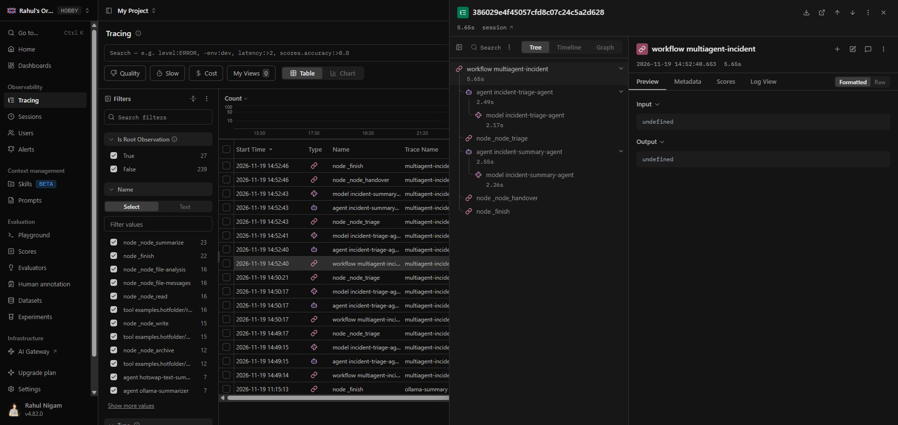 | 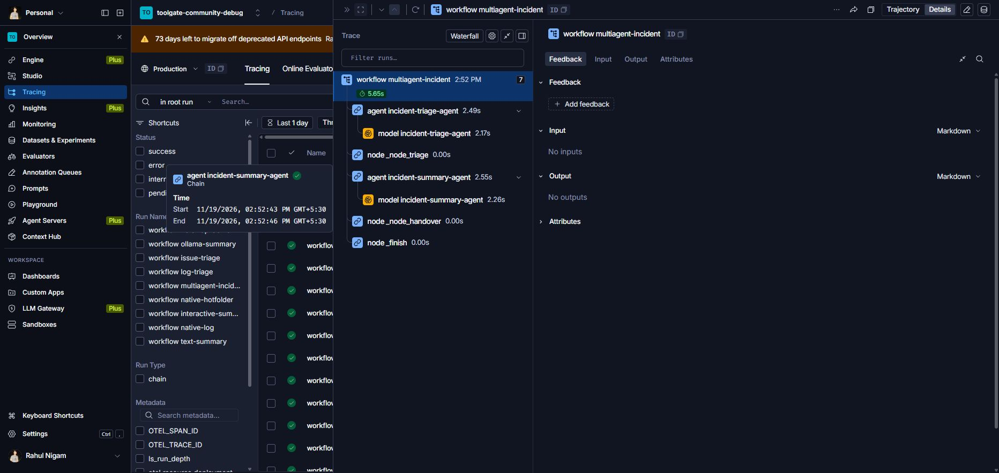 | 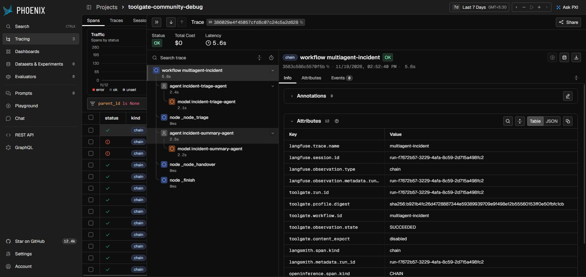 |

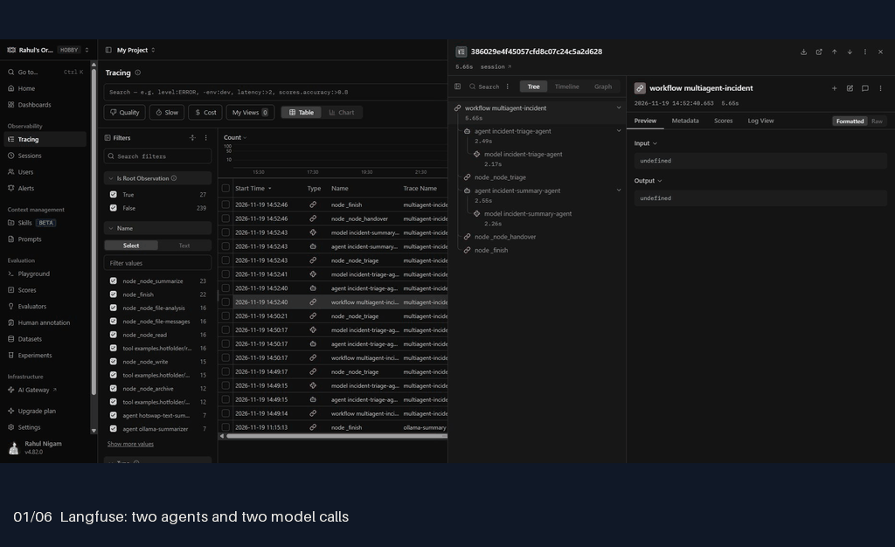

### Console tours and overview video

The original four slideshows now use current OLO console captures. These are
navigation slides, not continuous recordings; empty approval queues remain empty.
[Step-by-step originals and provenance](docs/media/TOURS.md).

| Audit and approvals | Devices and packages |
|---|---|
| 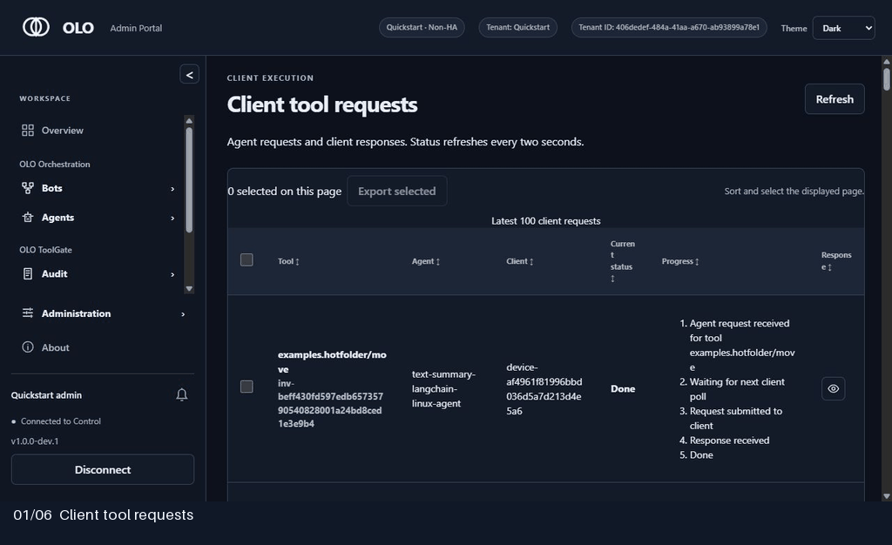 | 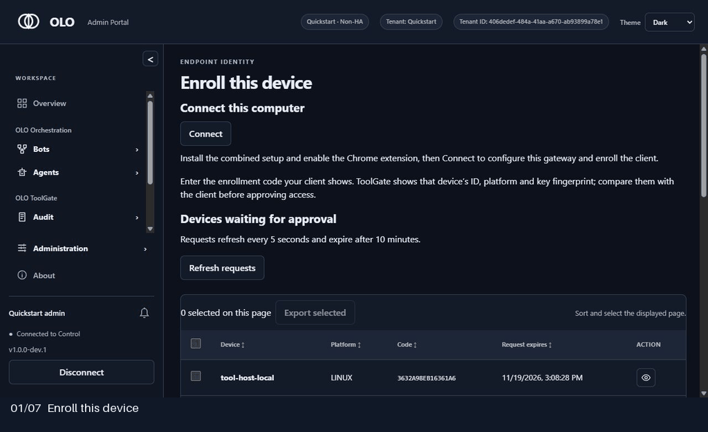 |

| Tools and runtime access | Workspace administration |
|---|---|
| 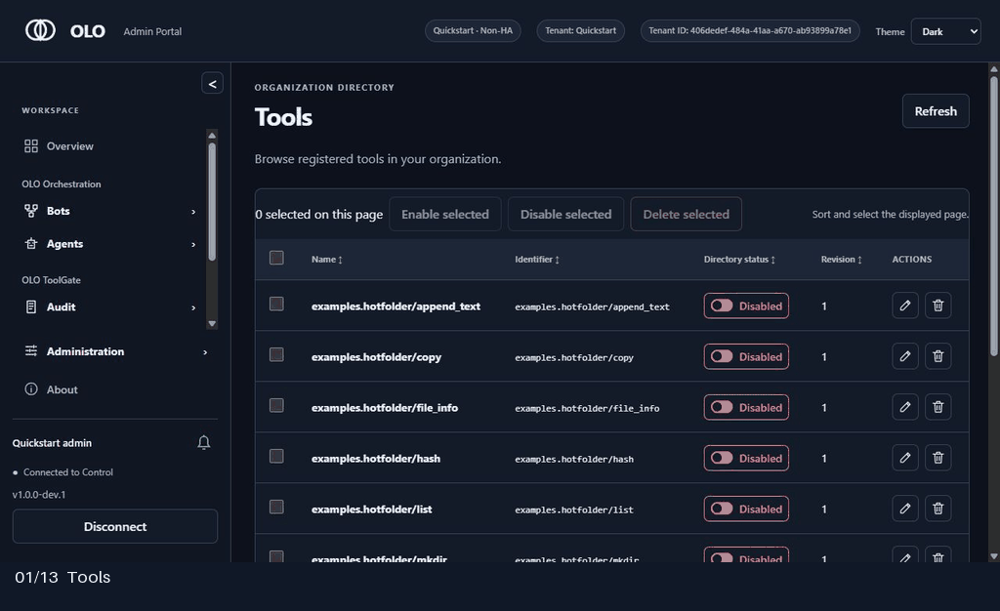 | 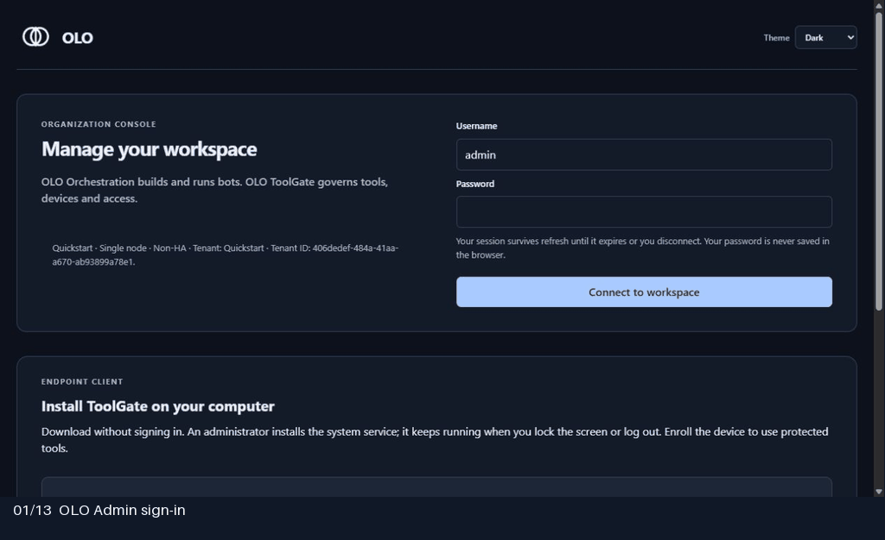 |

[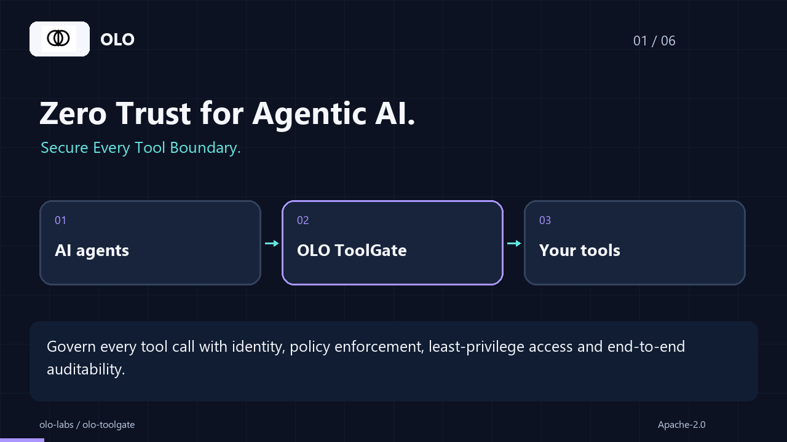](docs/media/toolgate-overview.mp4)

[Watch the captioned overview](docs/media/toolgate-overview.mp4) ·
[Animated preview](docs/media/toolgate-overview.gif) ·
[Captions and rebuild instructions](docs/media/README.md).
The overview is a diagram-based explainer. Earlier native desktop, independent
approval, Operator Insights, Grafana and New Relic captures are
[historical](docs/media/HISTORICAL.md).

<details>
<summary><strong>Earlier infrastructure monitoring examples</strong></summary>

These retained Grafana, Prometheus and New Relic captures come from earlier
installations. They show separate integrations, not the two-agent run above.

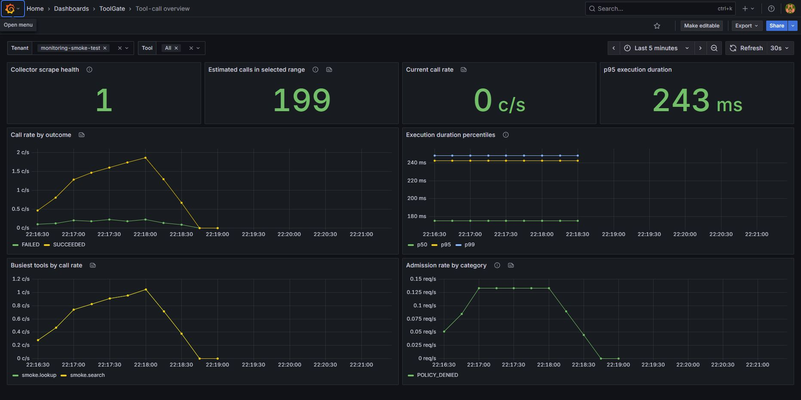

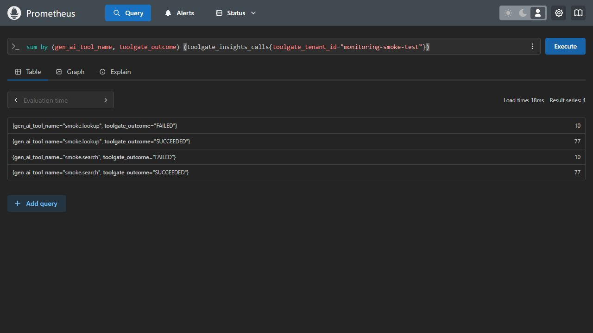

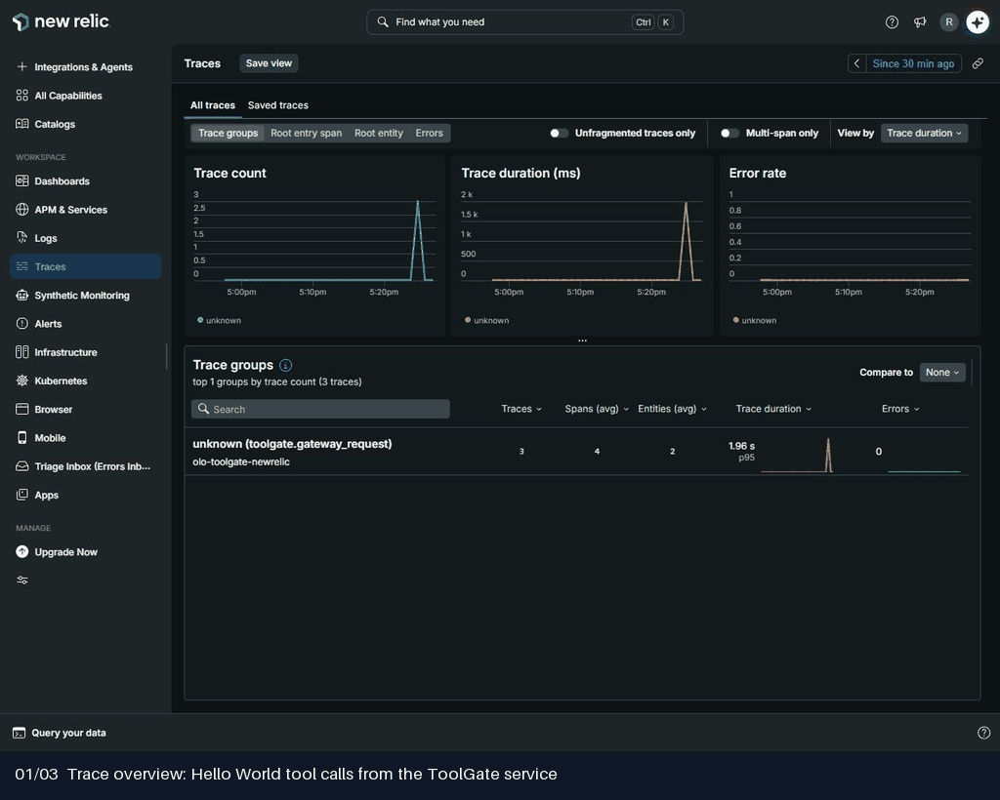

New Relic originals: [overview](docs/media/screenshots/newrelic-traces-overview-full.jpg),
[waterfall](docs/media/screenshots/newrelic-call-waterfall-full.jpg),
[attributes](docs/media/screenshots/newrelic-execution-attributes-full.jpg).

</details>

## Production and security status

OLO is in Beta Release. The authorization path described above is
enforced today; the following are **not yet** in place:

- **Tool Host isolation:** [qualified Python OCI pools](docs/operations/rootless-tool-host.md)
  enforce rootless container and network isolation. Native pools remain uncontained;
  other runtimes and broker process separation remain work in [#230](https://github.com/olo-labs/olo-toolgate/issues/230).
- **Execution recovery:** Tool Hosts have renewable execution leases, an admission
  spool and a durable result outbox ([operator guide](docs/operations/execution-leases.md)).
  The OLO memory/RAG path has qualified request-bound write authorization and
  target claim/outcome fencing. Generalized per-effect authorization, exact consent
  and operation-wide recovery remain unfinished: [#230](https://github.com/olo-labs/olo-toolgate/issues/230)
  ([claim inventory](docs/security/zero-trust-execution-status.md)).
- **Offline protected effects:** unsupported; live Control authority remains
  required. Design review: [#239](https://github.com/olo-labs/olo-toolgate/issues/239).
- **Nested or dynamic groups:** unsupported. Enhancement: [#240](https://github.com/olo-labs/olo-toolgate/issues/240).
- **Bot orchestration:** bounded local examples work; complete lifecycle, recovery,
  HA and security matrices remain in the [workflow live status](docs/architecture/workflow-v1-status.md).
  Native file mutations remain UNFENCED and are never automatically retried.
- **Quickstart:** single-node evaluation software with no HA guarantee.
  Production HA qualification: [#241](https://github.com/olo-labs/olo-toolgate/issues/241).
- **Authoring:** Java and Python implementations are available; TypeScript and .NET
  authoring APIs remain specifications. Implementations: TypeScript [#242](https://github.com/olo-labs/olo-toolgate/issues/242)
  and .NET [#243](https://github.com/olo-labs/olo-toolgate/issues/243).

The [adopted attacker matrix and trust limits](docs/security/zero-trust-boundaries.md)
distinguish healthy enforcement from compromised hosts and trusted roots.

Recorded acceptance and performance results apply to the tested revision and
environment; they do not establish your deployment's readiness, capacity or
compliance. [Standards alignment](docs/enterprise-access-control/standards-alignment.md)
describes design relationships, not a certification.

Before production, read the [enterprise evaluation guide](docs/enterprise-access-control/README.md),
[threat model](docs/security/threat-model.md) and
[production deployment](docs/deployment/production.md). For multiple tenants, see
[multitenant deployment](docs/deployment/multitenant.md).

The OLO Marketplace is developed in a separate private repository and hosted at
[olo-labs.org](https://olo-labs.org). Control can import from it through the
[Marketplace integration](docs/control-plane/marketplace-integration.md).

## Developers and contributors

| You want to | Start here |
|---|---|
| Build and package a tool | [Tool SDK guide](TOOL-SDK-GUIDE.md) · [Java SDK](tool-sdk/java-sdk/README.md) · [examples](examples/README.md) |
| Govern an existing MCP server | [MCP proxy guide](docs/gateway/mcp-proxy.md) · [example](examples/mcp-proxy/README.md) |
| Run server-side tools | [Tool Host](apps/tool-host/README.md) |
| Build from source | [Development guide](docs/development/README.md) |
| Contribute | [CONTRIBUTING.md](CONTRIBUTING.md) · [architecture map](docs/architecture/component-map.md) |

Small fixes, tests, documentation and examples are welcome. Discuss larger work in
GitHub issues.

## Project resources

[Support](SUPPORT.md) · [Report a vulnerability](SECURITY.md) ·
[Governance](GOVERNANCE.md) · [Code of conduct](CODE_OF_CONDUCT.md) ·
[Changelog](CHANGELOG.md) · [Apache-2.0 license](LICENSE)
