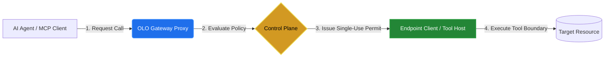
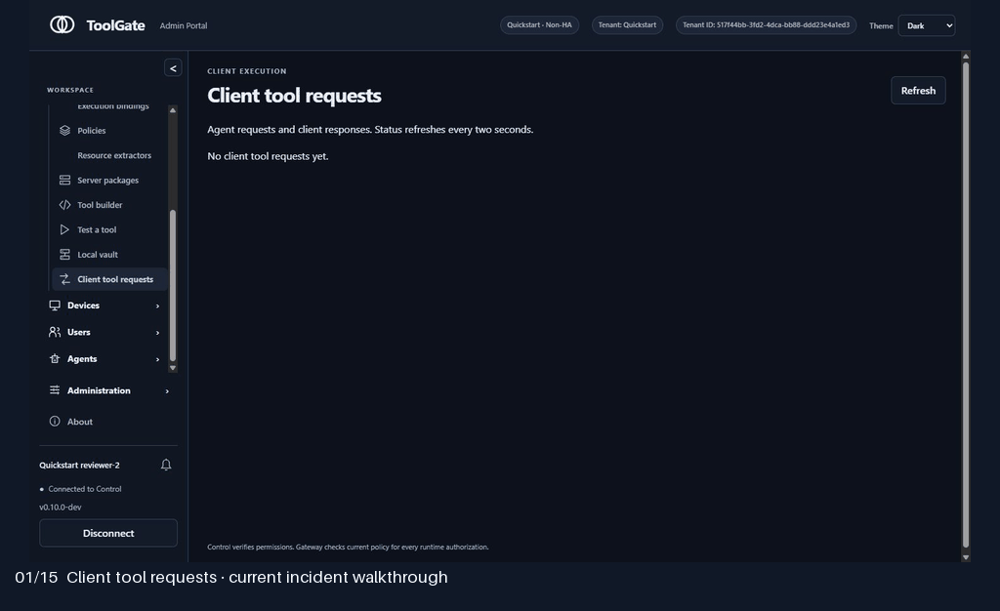
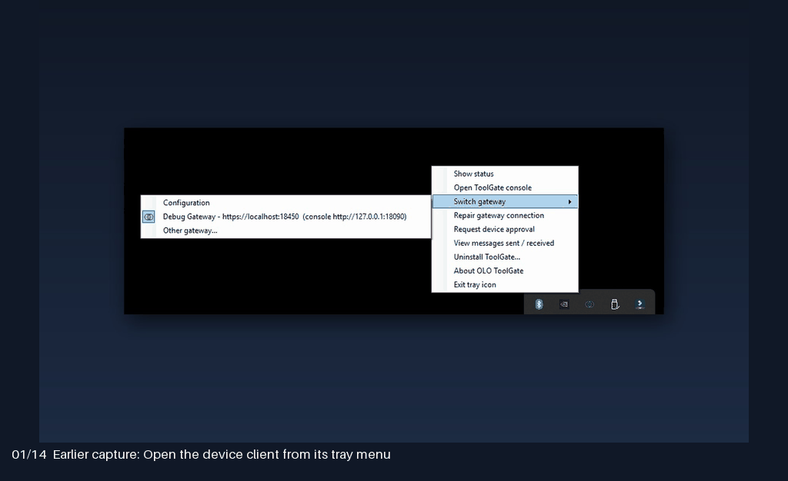
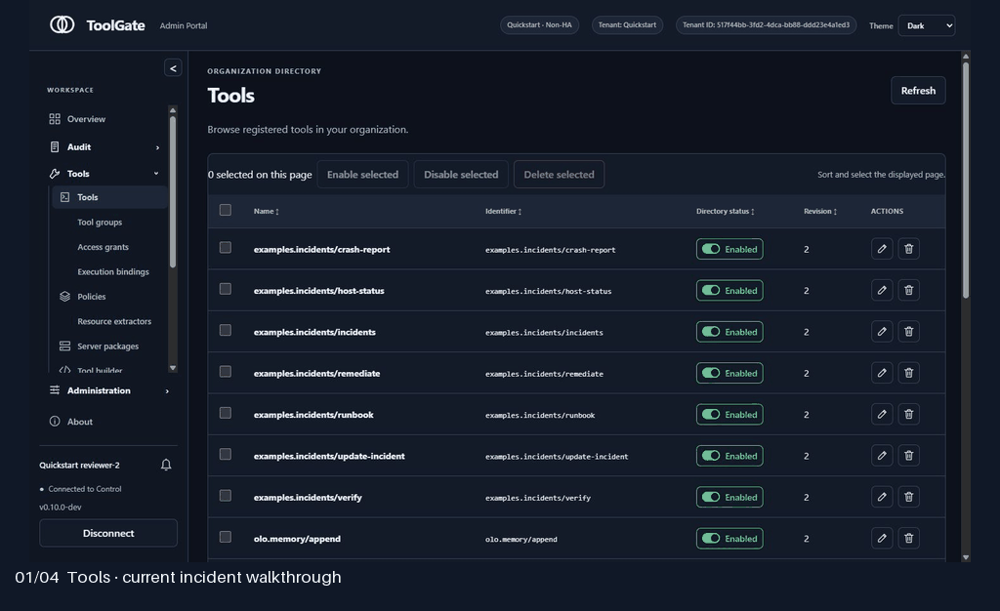
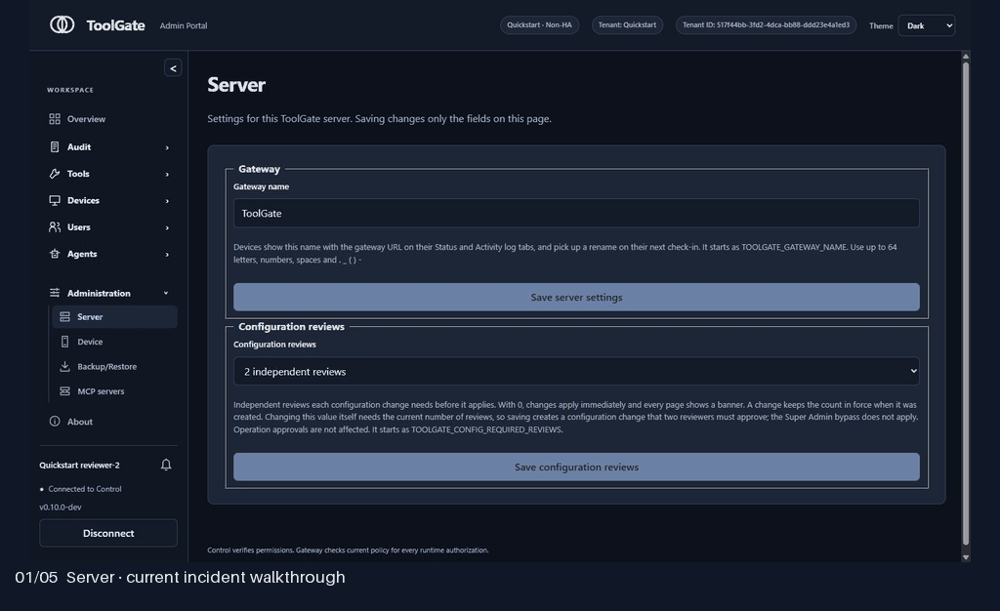

# OLO ToolGate

> **Zero Trust for Agentic AI.**
> **Secure Every Tool Boundary.**

Govern every tool call with identity, policy enforcement, least-privilege access,
and end-to-end auditability.

[Get started](docs/getting-started/one-minute-quickstart.md) ·
[Documentation](docs/README.md) · [Security model](docs/security/README.md) ·
[Enterprise evaluation](docs/enterprise-access-control/README.md) ·
[Build a tool](TOOL-SDK-GUIDE.md) · [Contribute](CONTRIBUTING.md)

## Why ToolGate

AI agents now act through tools: they write files, call APIs and change systems.
Each tool call crosses a trust boundary. ToolGate is the self-hosted control plane
that sits on that boundary and decides, at the moment of the call, whether it may
proceed.

- **Identity first.** Every call is tied to a verified person, agent and device.
  New users and agents start disabled; device approval alone never grants access.
- **Policy at every call.** ALLOW, ASK or BLOCK is evaluated against current
  authority before any protected effect. ASK routes to independent human approval.
- **Least privilege by default.** Fresh installations grant nothing. Access comes
  only from explicit group grants, delegated scopes and execution bindings, and is
  enforced by single-use permits on the executor.
- **Fails closed.** If Control is unavailable, nothing runs. Cached metadata never
  authorizes offline execution.
- **End-to-end auditability.** Requests, approvals, decisions and outcomes are
  recorded per tenant, with Analytics and Operator Insights on every tool call.

## Who it is for

| You are | Start here |
|---|---|
| Security and platform teams evaluating agent governance | [Enterprise evaluation](docs/enterprise-access-control/README.md) · [Security model](docs/security/README.md) |
| Administrators granting tools to people and agents | [Administration](docs/control-plane/README.md) |
| Operators deploying and running ToolGate | [Deployment](docs/deployment/README.md) · [Multitenant](docs/deployment/multitenant.md) · [Operations](docs/operations/README.md) |
| Tool authors | [Tool SDK guide](TOOL-SDK-GUIDE.md) · [Java SDK](tool-sdk/java-sdk/README.md) |
| Contributors | [Contributing](CONTRIBUTING.md) · [Architecture map](docs/architecture/component-map.md) |

## Try it in a minute

The [Quickstart walkthrough](docs/getting-started/one-minute-quickstart.md) runs a
local, single-node evaluation. The [Compose helpers](deploy/compose/QuickStart/README.md)
manage the deployment and retain its data volume. To build from source, follow the
[development guide](docs/development/README.md).

[Watch the captioned overview](https://github.com/olo-labs/olo-toolgate/raw/refs/heads/main/docs/media/toolgate-overview.mp4)
or read the [transcript and screenshot guide](docs/media/README.md).

## See it work

Full-resolution screens for each flow are in the [tour guide](docs/media/TOURS.md).

### Audit, approvals and tool calls

  

Follow a request through independent review, its recorded outcome, audit evidence,
tenant Analytics and Operator Insights. The example uses Qwen2.5 7B through Ollama
with one short RAG runbook; scripted acceptance traffic is labelled.

### Devices and device client

  

Enroll a device, compare its key fingerprint, approve it and inspect its activity.
Earlier enrollment/client captures are labelled in the tour guide.

### Tools and delegated access

  

Build and distribute tools, map agent capabilities, constrain delegated access and
inspect the final execution boundary.

### Workspace administration

  

Sign in and configure people, identities, MCP servers and server settings.

Screens were captured from a local `0.10.0-dev` installation on October 27, 2026.
Enabled tools and grants are fictional demo configuration, not installation defaults.

## Project status

This repository is a development release. Tool Host container/network isolation
and several SDK, integration and distribution features remain unfinished; each
[component guide](docs/README.md) states its current behavior and limitations.
[Standards alignment](docs/enterprise-access-control/standards-alignment.md)
describes design relationships; it is not a certification claim.

The OLO Marketplace is developed in a separate private repository and hosted at
[olo-labs.org](https://olo-labs.org). Control can import from it through the
[Marketplace integration](docs/control-plane/marketplace-integration.md).

## Contribute

Small fixes, tests, documentation and examples are welcome. Read
[CONTRIBUTING.md](CONTRIBUTING.md), pick a component from the
[architecture map](docs/architecture/component-map.md), and discuss larger work in
GitHub issues.

[Support](SUPPORT.md) · [Report a vulnerability](SECURITY.md) ·
[Governance](GOVERNANCE.md) · [Code of conduct](CODE_OF_CONDUCT.md) ·
[Changelog](CHANGELOG.md) · [Apache-2.0 license](LICENSE)
