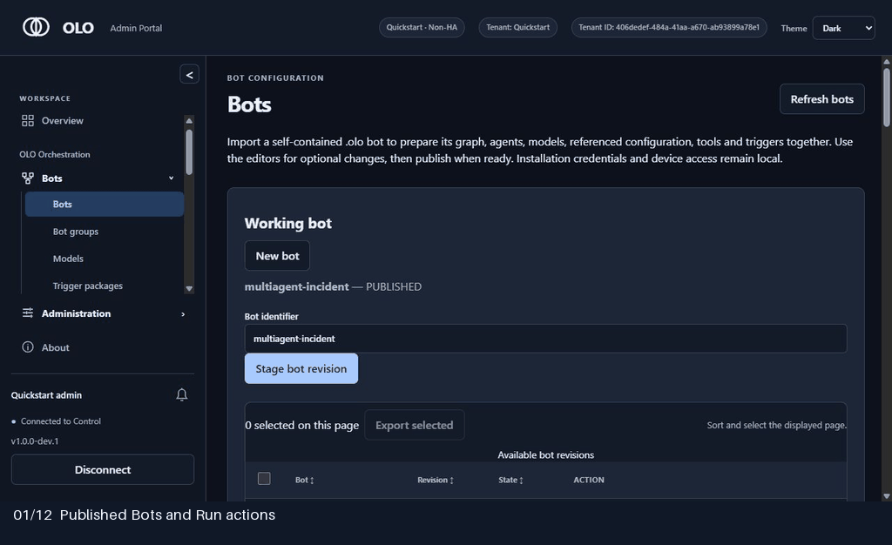

# OLO

Open-source, self-hosted orchestration and governed tool execution for AI agents.

**OLO Orchestration** runs bots with configured agents, models and triggers.
**OLO ToolGate** controls which identities may use which tools, on which devices
and resources. The console provides authoring, access review and execution history.

[Quickstart](#quickstart) · [Contribute](#contribute) ·
[Documentation](docs/README.md) · [Architecture](ARCHITECTURE.md) ·
[Tool SDK](TOOL-SDK-GUIDE.md) · [Security](SECURITY.md)

## Quickstart

Use the published-image launcher in
[deploy/docker/quickstart/dev](deploy/docker/quickstart/dev/README.md).
You need Git and Docker with its Linux engine and current Compose support.
Windows startup can install its own private Python runtime; Linux/macOS need
Python 3.11 or newer. Host Java, Node and Rust are not needed to run these images.

On Windows:

```powershell
git clone https://github.com/olo-labs/olo-toolgate.git
cd olo-toolgate\deploy\docker\quickstart\dev
.\start.bat
```

On Linux/macOS, from the cloned repository:

```sh
cd deploy/docker/quickstart/dev
sh start.sh
```

The launcher asks separately about a local Ollama model service and an
observability collector. Choose the services your installation needs. The
[deployment guide](deploy/docker/quickstart/dev/README.md) covers unattended
flags, CPU/GPU requirements, external model providers and private settings.

1. Open **http://127.0.0.1:18090/console/**.
2. Sign in as `admin`. Read the generated password from
   `credentials/admin/password.txt` inside the launcher directory.
3. Import a built or released `.olo` bundle in **Bots**. Configure its model
   credentials and review any device enrollment and required group assignments.
4. Resolve the readiness checks, prepare and publish the bot, then use **Run**
   or the trigger input described in its example README.

A fresh installation has no imported bot and no implicit runtime grants.
Restarts preserve credentials and data. Use matching image versions or digest
pins; startup refreshes mutable development tags and rejects missing required
image capabilities. Registry availability is not end-to-end qualification.

Continue with [running bots](docs/help/run-bots.md),
[device setup](docs/help/device.md), [models](docs/help/models.md),
[examples](bot/README.md) and [troubleshooting](docs/help/troubleshooting.md).
For source-built development, use [debug/profiled](debug/profiled/README.md).
Production requires [external identity, database, TLS and key custody](docs/deployment/production.md).

## How it works

```text
Bot / MCP client -> Gateway -> registered Tool Host or Device -> approved resource
                      |                    |
                      +---- Control <------+
                            current authorization, permits and durable evidence
```

Control owns authorization and tenant state. Gateway authenticates and routes
requests. Executors check Control-issued authority before protected effects;
they run outside the Control process. Device approval, administrator access and
package installation do not grant tool execution rights.

The local bot installation has three core services: Quickstart (Gateway,
Control, console and SQLite), LangGraph runtime, and Device. Optional model and
collector services are separate. Package executors may create additional containers.

Read the [component map](docs/architecture/component-map.md),
[workflow architecture](docs/architecture/workflows.md),
[trigger architecture](docs/architecture/triggers.md) and
[trust boundaries](docs/architecture/trust-boundaries.md) before changing an interface.

## What OLO supports

- Portable bot import/export, JSON graph authoring, configured agents and model routing.
- Manual bot runs and managed-file triggers, with progress and result inspection.
- Governed MCP tools, signed packages and enrolled execution devices.
- Group-based access, current runtime authorization, human review and audit evidence.
- Optional workflow tracing and ToolGate metrics through installation-owned collectors.

See [performance and capacity](docs/operations/performance.md) for tuning and
measurement limits, and [monitoring](docs/help/observability.md) for supported
collectors, metrics, traces and destination setup. Capability scope and security
limits still apply; this list does not claim every proposed integration is available.

## See it work

**Bot execution:** input, agent execution and the recorded result.



**Device operation:** registered devices, group assignment and package delivery.


These slideshows show a configured development installation, not fresh-install
defaults or production certification. Additional screenshots, console tours,
monitoring views and videos are in the [media guide](docs/media/README.md).

## Contribute

Contribute a bug fix, tool package, bot example, documentation improvement or
integration. Start with one component; you do not need to learn the entire
repository first.

| Work on | Start here |
|---|---|
| Console | [React/TypeScript UI](apps/admin-ui/README.md) |
| Authorization, persistence or API | [Java Control Plane](apps/control-plane/README.md) |
| MCP ingress and routing | [Rust Gateway](apps/gateway/README.md) |
| Devices and execution | [Endpoint Client](apps/endpoint-client/README.md), [Tool Host](apps/tool-host/README.md) |
| Workflow execution | [Python/LangGraph runtime](apps/langgraph-runtime/README.md) |
| A tool or bot | [Tool author guide](TOOL-SDK-GUIDE.md), [bot authoring](docs/help/author-bots.md) |
| Deployment and verification | [Deployment](docs/deployment/README.md), [testing](docs/testing/README.md) |

Source development needs Java 21, Node 22, Python 3.12+, Docker and the Rust
toolchain pinned in `rust-toolchain.toml`. Use the Gradle wrapper.
The [development guide](docs/development/README.md) lists setup and check-specific dependencies.

```sh
npm ci
python -m pip install -r tools/requirements.txt
python tools/check.py
```

Run component checks as you work; the full repository gate needs the additional
tools and services in the [testing guide](docs/testing/README.md).
Include current operating instructions and actual validation results in your PR.
Contract changes start in `packages/contracts/`; regenerate bindings instead
of editing generated models.

Read [CONTRIBUTING.md](CONTRIBUTING.md), find an
[open contributor issue](https://github.com/olo-labs/olo-toolgate/issues), or
discuss a larger design before implementation. Unfinished work belongs in
[docs/plans](docs/plans/README.md); current behavior belongs in its owning guide.

## Production and security status

OLO is beta software. Use this branch's [version configuration](version.json)
and matching [release artifacts](https://github.com/olo-labs/olo-toolgate/releases).
Local examples, imported bundles and image builds do not certify production
availability, containment or exactly-once effects.

Authorization requires current Control authority. Uncertain effects must not be
automatically replayed. Native execution and qualified OCI execution have
different trust boundaries. Consult [security limits](docs/security/zero-trust-boundaries.md),
[containment scope](docs/security/qualified-containment-matrix.md) and the
[production checklist](docs/deployment/production.md) for your deployment.

## Community and license

[Support](SUPPORT.md) · [Report a vulnerability](SECURITY.md) ·
[Code of conduct](CODE_OF_CONDUCT.md) · [Governance](GOVERNANCE.md)

OLO is licensed under [Apache-2.0](LICENSE). See [notices](NOTICE.md) for third-party licensing.
