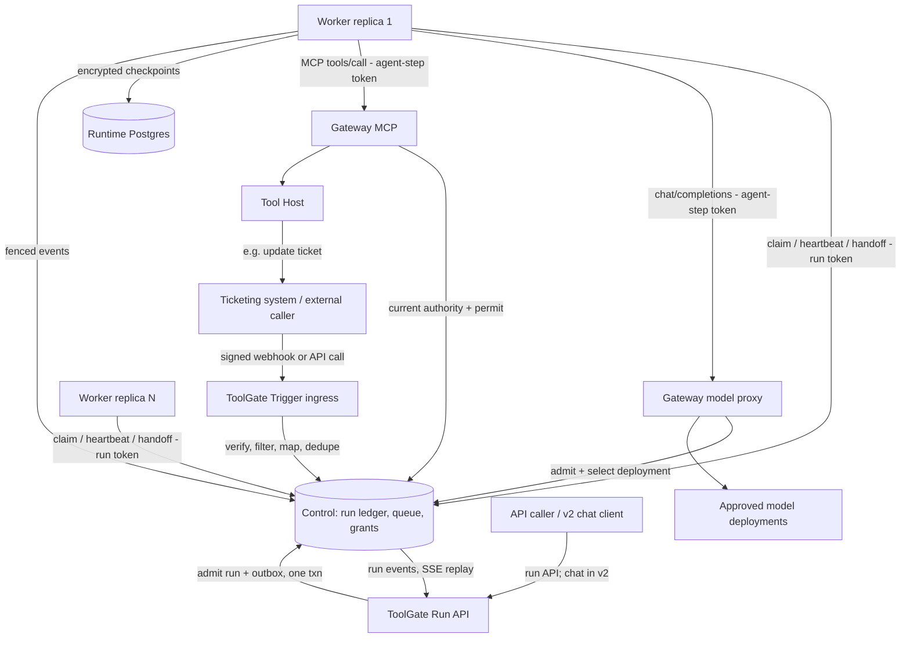

# OLO ToolGate — Horizontally Scalable LangGraph Runtime under ToolGate Control

**Status:** Architecture proposal for review · **Version:** 0.9 · **Date:** 2026-11-10
**Supersedes:** `toolgate-enterprise-multitenant-langgraph-plan-v0.4.md` (see [Changelog](#17-changelog-from-v04))
**Target repository:** https://github.com/olo-labs/olo-toolgate

Section 15 is the current release and branch-delivery baseline. It supersedes older v0.7/v0.8 release allocations elsewhere in this document; later capability descriptions remain target architecture, not v1 requirements.

This is the single normative plan. Earlier versions had three API tables, four
roadmaps and three definitions of done; this one has one of each.

---

## 1. Goal

Run **one generic Python LangChain/LangGraph worker image** as N interchangeable
replicas. Every tenant's workflows, agents, prompts, model choices and tool access
come from ToolGate at run time. ToolGate is the only authority for identity,
workflow access, agent delegation, model admission and tool authorization. Workers
are **untrusted, stateless executors**: they own no configuration, hold no
provider keys or Control database credentials, and reach models and tools only
through ToolGate.

**Configuration-driven triggering.** A tenant admin publishes one JSON bundle
containing the workflow, its agents, model groups, grants and a **Trigger**. From
then on, the workflow starts through ToolGate whenever that trigger fires: a
direct API call, or an inbound event such as "ticket created" from a ticketing
system. No code, image change or deployment is needed to add, change or disable a
trigger.

**Done means:** with no rebuild or restart of the worker image, a tenant admin
publishes a workflow/agent/model/trigger JSON bundle. When a ticket is created in
the connected ticketing system, ToolGate verifies the event, maps the ticket into
workflow parameters, admits a run under the trigger's service identity, and a
worker executes it. The workflow's agents investigate using governed tools and
models, and write the result back to the ticket through a governed tool call. The
same workflow can also be started by API. Any replica can run or resume the run. Revoking a grant or disabling the trigger blocks new runs and the
next protected step of running ones. A second tenant cannot discover, trigger,
read, infer through or affect any of it.

### 1.1 Release scope (historical v0.7 allocation; superseded by section 15)

| Release | Delivers |
|---|---|
| **v1 (this plan's core)** | Everything ToolGate needs to govern LangGraph execution end to end: configuration registry (workflows, agents, models, triggers, grants), run admission, queue/lease/fencing, identity tokens, governed model proxy, governed tools, checkpoints, events with SSE replay, ASK pause/resume, cancellation, audit. Runs start by **trigger** (webhook, e.g. ticket created) or **run API**. |
| **v2** | **Chat flow**: OIDC user login/BFF, chat sessions and messages, chat catalog. Built as a thin facade over v1 primitives; no change to the worker, run model, identity tokens or authorization path. |

v1 is built chat-ready (§1.2) so v2 adds endpoints, not architecture.

### 1.2 What v1 builds so chat drops in later

| Chat needs (v2) | Already in v1 |
|---|---|
| Multi-turn conversation state | `Run.threadId` and LangGraph `thread_id = {tenant}:{thread}`; checkpointer keyed by thread. Triggered runs use one thread per run; API callers may pass a thread to continue |
| One message at a time per conversation | Per-thread serialization in claim (§7.2) |
| Start a run as a human user | `RunDelegation.subjectKind=USER` path via `POST /workflows/{id}/runs` with a user token |
| Streaming replies | `message.delta` events, generic `GET /runs/{id}/events` SSE with `Last-Event-ID` replay |
| Human-in-the-loop approvals | ASK interrupt, `PAUSED` state, resume on any replica |
| Cancel from the client | `POST /runs/{id}/cancel` propagates to worker and model stream |
| Catalog of workflows a user may start | `discover` grants and filtered `GET /workflows/eligible` |

v2 then adds only: OIDC login and session token, `chat/sessions` as a named
wrapper around a thread bound to one workflow, `chat/sessions/{id}/messages` that
calls the same admission, and `chat/sessions/{id}/events` that merges the
thread's run event streams.

## 2. Principles

1. **ToolGate decides, workers execute.** No authority lives in the worker.
2. **Membership grants nothing.** Workflow, Agent Group and Model Group membership
   are eligibility sets. Every handoff, inference and tool call is independently
   authorized against current grants.
3. **Intersections, never unions.** Complete grant tuples are preserved; unrelated
   grants never combine into new authority.
4. **Fail closed.** If Control cannot authorize, start/handoff/inference/tool effect
   is denied or paused. Last-known-good policy never grants execution.
5. **Stock LangChain where possible.** OpenAI-compatible model proxy, standard MCP
   adapters, standard Postgres checkpointer. Custom code is limited to the claim
   loop, graph compiler and checkpoint serializer.
6. **Reuse, don't reinvent.** Build on ADR-029 tenancy, the directory/GroupGraph,
   EnterpriseEvaluator, invocation events, authorization epoch/outbox, permits,
   vault, insights spans and the kill switch (§14).

### 2.1 Everything is controlled by ToolGate

The worker contains no workflow, agent, model, tool or trigger definitions. It
asks ToolGate for each one at run time and every effect goes back through ToolGate.

| Concern | Defined in ToolGate | Enforced by ToolGate at run time | Worker's role |
|---|---|---|---|
| **Workflows** | Workflow, WorkflowVersion, WorkflowGroup, graph and limits | Admission, version pin, `maxSteps`/`maxHandoffs`/duration counters, cancel | Compile the returned graph; obey limits |
| **Agents** | AgentDefinitionVersion (prompt, output schema), Agent Group mapping | Handoff authorization, agent-step tokens, delegation chain | Run the returned prompt for the authorized agent only |
| **Models** | Model, ModelGroup, members (priority/weight), grants, budgets | Per-call admission, deployment selection, fallback, budget, credentials | Call the proxy with an alias; never sees a provider key or endpoint |
| **Tools** | Tool/Device Groups, grants, ASK/BLOCK policy (existing) | Per-call evaluation and single-use permits | Call the Gateway MCP endpoint with the step token |
| **Triggers** | Trigger (auth, filter, mapping, dedupe, `runAs`) | Signature check, mapping, dedupe, service-mode admission | None; triggers never reach the worker |
| **Identity** | Teams, Agent Groups, roles, service principals | Run lease and step tokens, RunDelegation re-checks | Present tokens it was given |
| **Secrets** | Tenant vault references | Resolved only inside Gateway/Tool Host at use time | Never receives secrets |
| **State and audit** | Run ledger, events, TriggerEvents, audit | Fenced writes, tenant scope | Writes events/checkpoints under its lease |
| **Emergency stop** | Kill switch (ADR-017) | Denies new runs, steps, inference and tools | Stops at the next call |

Changing any row is a ToolGate publish or grant change. It takes effect without
rebuilding, redeploying or restarting workers.

## 3. Non-goals (initial release)

- Chat facade and OIDC user login (**v2**; v1 primitives are chat-ready, §1.2).
- Visual workflow builder or any admin UI (headless, JSON-first).
- Running Python/LangGraph inside Control.
- Arbitrary code, imports or expressions in workflow configuration.
- Nested or dynamic groups (README limitation, issue #240).
- Cross-tenant workflows or sharing.
- Scheduled (cron) triggers and polling connectors (later; same Trigger model, §7.0).
- Vendor-specific ticketing plugins in Control. Ticket systems integrate through
  the generic signed-webhook trigger in, and governed MCP tools out.
- Bring-your-own provider credentials.
- Deterministic `GRAPH` routing mode (supervisor first; GRAPH after a safe-DSL ADR).
- External inference gateways (revisit after Phase 5).

## 4. Architecture



| Component | Owns | Must not |
|---|---|---|
| **Trigger ingress (Gateway route → Control)** | Authenticate trigger callers, verify webhook signatures, rate-limit, forward raw events to Control for filter/map/dedupe/admission | Derive identity, tenant or model from payload content |
| **Control (Java)** | Directory (workflow/agent/model/trigger kinds), grants, publish/versions, run ledger and queue, fair claim, leases/fencing, delegation records, step tokens, model admission and routing decision, budgets, permits, events, audit | Run LangGraph; make provider calls or stream under a transaction |
| **Gateway (Rust)** | Authentication, MCP routing (existing), OpenAI-compatible model proxy and streaming, correlation propagation | Cache authority or decide policy locally |
| **Worker (Python)** | Claim loop, safe graph compilation, LangGraph execution, checkpoints, limit enforcement, event production | Hold provider keys, Control DB credentials, tenant config in env/image; reach providers or MCP servers directly |
| **Runtime Postgres** | Encrypted LangGraph checkpoints only | Hold plaintext tenant content |
| **Tool Host (Rust)** | Tool execution under single-use permits (existing) | — |

## 5. Vocabulary and data model

New directory kinds extend `Ids.Kind` and `GroupGraph`. Every record is keyed
`(tenant_id, id)` under ADR-029 RLS.

| Entity | Semantics |
|---|---|
| **WorkflowGroup** | Tenant catalog/permission scope for workflows. Not a security principal. |
| **Workflow** / **WorkflowVersion** | Belongs to exactly one WorkflowGroup in v1. Versions are immutable once published. |
| **WorkflowAgentGroup** | Workflow version → existing AgentGroup mapping with narrowing filters (`allowedAgentIds`, `deniedAgentIds`, `entryEligible`, `delegationAllowed`, `maxHandoffs`). Filters only narrow. |
| **AgentDefinitionVersion** | Versioned prompt, model-group reference, output schema for an existing Agent identity. |
| **Model** | Registered provider deployment: provider type, endpoint ref, credential **vault ref**, capabilities, limits, regions. |
| **ModelGroup** / **ModelGroupMember** | Pool of models with per-member `priority` (1 = highest tier) and `weight` (share within a tier), plus capacity caps. |
| **WorkflowGroupGrant**, **ModelGroupGrant** | Team/Human Role or Agent Group/Actor Role scoped grants. No direct User or Agent ACLs. |
| **Trigger** | Published, versioned start rule for one workflow: kind (`API`, `WEBHOOK`; `SCHEDULE` later), service identity it runs as, caller authentication, event filter, parameter mapping, dedupe key, rate limits. Not a security principal and grants nothing by itself. |
| **TriggerEvent** | Received event record: tenant, trigger, dedupe key, payload digest, outcome (`ADMITTED`, `DUPLICATE`, `FILTERED`, `REJECTED`, `RATE_LIMITED`), runId?. Payload stored only per retention policy. |
| **Run** | Admitted execution: tenant, session or trigger event, pinned config digest, delegation record ref, state, lease, fencing epoch. |
| **RunDelegation** | Who started the run, on whose behalf, workflow, scope, max lifetime. Re-evaluated at every protected step. |

```text
WorkflowVersion {
  tenantId, workflowId, versionId, state: DRAFT|REVIEWED|PUBLISHED|DEPRECATED|RETIRED,
  parameterJsonSchema, resultJsonSchema, routingMode: SUPERVISOR,
  limits {maxSteps, maxHandoffs, maxDurationSeconds, maxConcurrency, maxTokens, maxCost},
  modelGroupId, agentGroups: [WorkflowAgentGroup], checksum,
  createdBy, reviewedBy?, publishedBy, publishedAt
}
AgentDefinitionVersion {
  tenantId, agentId, versionId, systemPrompt (size-limited, classified),
  modelGroupMode: EXPLICIT, modelGroupId, requiredCapabilities,
  outputSchema, checksum, publishedAt
}
ModelGroupMember {
  tenantId, modelGroupId, modelId, enabled, priority, weight,
  maxConcurrent?, maxRpm?, maxTpm?, timeoutMs?, fallbackEligible, revision
}
Trigger {
  tenantId, triggerId, workflowId, versionId, state (same lifecycle), enabled,
  kind: API | WEBHOOK,                       // SCHEDULE later
  runAs: { serviceAgentId, agentGroupId },   // explicit service principal; never a human
  auth: {                                    // how the caller proves itself
    mode: HMAC_SHA256 | MTLS | OIDC_CLIENT,
    secretRef?,                              // vault ref for HMAC signing secret
    signatureHeader?, timestampHeader?, maxSkewSeconds,
    allowedClientIds?, allowedCertSubjects?
  },
  filter: [ { pointer: "/event/type", equals: "incident.created" },
            { pointer: "/ticket/priority", in: ["P1","P2"] } ],   // equality/in only
  parameterMapping: { "incidentId": "/ticket/id",
                      "service":    "/ticket/cmdb_ci",
                      "summary":    "/ticket/short_description",
                      "environment": { "const": "production" } }, // pointers + constants only
  dedupeKey: ["/ticket/id", "/event/type"],
  dedupeWindowSeconds, maxPayloadBytes,
  limits: { maxRunsPerMinute, maxConcurrentRuns },
  resultDelivery?: { toolId, action, argumentMapping }  // optional governed write-back
}
Run {
  tenantId, runId, threadId, sessionId? (v2), triggerEventId?, workflowId, workflowVersionId, configDigest,
  delegationId, state: QUEUED|RUNNING|PAUSED|SUCCEEDED|FAILED|CANCELLED|EXPIRED,
  leaseHolder?, leaseExpiresAt?, fencingEpoch, authorizationEpoch, createdAt
}
RunDelegation {
  tenantId, delegationId, runId, subjectKind: USER|SERVICE, subjectId,
  workflowId, grantedActions, notAfter, revokedAt?
}
```

**Lifecycle (one, everywhere):** `DRAFT → REVIEWED → PUBLISHED → DEPRECATED → RETIRED`.
Rollback is a new publication. Author/reviewer separation is required where the
tenant marks the group sensitive.

**Permissions (one list):**
- WorkflowGroup: `discover`, `read_definition`, `execute`, `view_runs`, `cancel_runs`, `manage`, `publish`, `manage_triggers`.
- A trigger's `runAs` service principal must itself hold `execute` on the workflow's
  group (via an Actor Role service grant) and `infer` on the model groups. Managing
  a trigger does not confer either.
- ModelGroup: `discover`, `infer`, `view_usage`, `manage`.- Tool approvals stay with existing ASK; there is no workflow-level `approve`.
- Management permissions register in `ManagementPermissionCatalog`.

**Default groups:** WorkflowGroup and ModelGroup have **no** default group and no
auto-membership (unlike Team/AgentGroup/ToolGroup/DeviceGroup in `GroupGraph`).
## 6. Identity and authority

Three token types. Tokens bind identity and context; **they are never authority on
their own.** Control re-evaluates current grants on every protected call.

| Token | Issued by / when | Bound to | Used for | TTL |
|---|---|---|---|---|
| **User API token** (v1) | Existing ToolGate user credentials | tenant, user | Run API, run status/events | existing policy |
| **Chat session** (v2) | Auth layer after OIDC login (BFF cookie for browsers) | tenant, user, `aud=toolgate-chat` | Chat API only | short, revocable |
| **Run lease token** | Control on `claim`; renewed by heartbeat | tenant, run, workload identity, fencing epoch, `aud=toolgate-internal` | resolve, heartbeat, handoff, events | ≤ 60 s, renewable |
| **Agent-step token** | Control on `handoff/authorize` | tenant, run, agent, delegation chain, authorization epoch | Model proxy and MCP calls for that agent step | ≤ 5 min, step-scoped |

**Agent identity in a pooled worker.** Today an Agent is a separately authenticated
actor. The agent-step token keeps that model: Control mints it only for an agent
that is eligible in the pinned workflow version and passes current delegation. The
Gateway verifies it and forwards `{run, agent, chain}` to the existing evaluator. A
worker writing an agent name into a request does nothing without a valid step token.

**Async user authority.** At admission, Control writes a `RunDelegation`. Every
protected step re-checks it against current Team/Role grants. The run ends at
`notAfter` (default: max workflow duration plus approval wait cap). A user's
browser token expiring mid-run does not matter; the user being disabled or
revoked does.

**Triggered (service-mode) runs.** A triggered run's `RunDelegation` has
`subjectKind=SERVICE` and names the trigger's `runAs` service Agent. Effective
authority is that Agent's Actor Role service grants, intersected with workflow
and model ceilings, exactly as for any unattended service Agent today. No human
identity is invented, and nothing in the event payload (assignee, reporter, email)
becomes a principal. If a workflow needs a human's authority, use ASK approval.

**Trigger callers.** The external system authenticates to the trigger with HMAC
signature (secret in tenant vault, timestamped, replay window), mTLS, or OIDC
client credentials. Caller authentication proves *who sent the event*; it is not
execution authority.

**Workload identity.** Workers authenticate with mTLS or OIDC client credentials.
Run-level access is checked by server-side lookup of the active lease; a worker
cannot request another run's or tenant's configuration.

**OIDC.** Control/Gateway have no OIDC support today. v1 uses existing ToolGate
user credentials for the run API and trigger auth for webhooks. OIDC user login is
a v2 item with its own ADR.

## 7. Protocols

### 7.0 Start paths and triggers

All start paths end in the **same admission** (§7.1). They differ only in who the
subject is and where parameters come from.

| Path | Subject (`RunDelegation`) | Parameters from |
|---|---|---|
| Chat message (**v2**) | Authenticated user (`USER`) | Message + session |
| `POST /api/v1/workflows/{id}/runs` with user token | Authenticated user (`USER`) | Request body || `API` trigger | Trigger's `runAs` service Agent (`SERVICE`) | Request body, through the trigger's mapping |
| `WEBHOOK` trigger (e.g. ticket created) | Trigger's `runAs` service Agent (`SERVICE`) | Event payload, through the trigger's mapping |

**Webhook trigger flow (ticket → workflow):**
1. Ticketing system sends `POST /api/v1/triggers/{triggerId}/events` to the tenant's
   ToolGate host. Tenant comes from the host (ADR-029), never the payload.
2. Gateway enforces `maxPayloadBytes` and rate limits, then forwards to Control.
3. Control loads the published, enabled Trigger and verifies caller auth (HMAC
   signature + timestamp within `maxSkewSeconds`, or mTLS/OIDC client). Failure →
   `401`, recorded as `REJECTED`; the response does not reveal whether the trigger exists.
4. Apply `filter`. No match → `202 FILTERED`, no run.
5. Compute `dedupeKey`. Seen within the window → `200 DUPLICATE` with the existing
   `runId`. Ticket systems that retry webhooks never create duplicate runs.
6. Apply `parameterMapping` (JSON pointers and constants only, no expressions) and
   validate against the workflow's `parameterJsonSchema`. Invalid → `422 REJECTED`.
7. Admit (§7.1) with `subjectKind=SERVICE`, `subject=runAs`. Record `TriggerEvent`
   with `ADMITTED` and the `runId`, all in the admission transaction.
8. Respond `202 {runId, statusUrl}`. Execution proceeds as for any run.

**Result delivery.** Writing back to the ticket (comment, status, assignment) is a
normal **governed MCP tool call**, either made by an agent during the workflow or
by the optional `resultDelivery` step after `run.completed`. It goes through the
existing ALLOW/ASK/BLOCK and permit path under the run's service identity. There
is no unauthenticated callback URL and no outbound call from Control.

**Untrusted content.** Ticket text is attacker-controllable. Mapped fields are
passed to agents as data, marked untrusted, size-limited and never interpreted as
instructions, identities, tool names, model IDs or URLs.

**Trigger lifecycle.** Triggers are published and versioned like workflows. Each
trigger pins one workflow version, or follows the workflow's current published
version when `versionId` is `current`. Disabling a trigger stops new admissions
immediately; running runs continue under their own authority checks.

**Example: one bundle with all configuration**

```json
{
  "apiVersion": "toolgate.ololabs.io/v1alpha1",
  "kind": "TenantAIConfiguration",
  "spec": {
    "models": [
      {"id": "local-qwen", "provider": "openai-compatible", "endpointRef": "endpoints/local-qwen",
       "capabilities": ["chat", "tools", "json_schema"], "region": "local"},
      {"id": "hosted-b", "provider": "openai-compatible", "endpointRef": "endpoints/hosted-b",
       "credentialRef": "vault/model-b", "capabilities": ["chat", "tools", "json_schema"], "region": "eu"}
    ],
    "modelGroups": [
      {"id": "ops-models", "allowCrossPriorityFallback": true, "members": [
        {"modelId": "local-qwen", "priority": 1, "weight": 70, "maxConcurrent": 4},
        {"modelId": "hosted-b",   "priority": 1, "weight": 30, "maxConcurrent": 8}]}
    ],
    "agentGroups": [
      {"id": "incident-agents", "agents": ["triage-agent", "log-agent", "ticket-writer-agent"]},
      {"id": "incident-automation", "agents": ["incident-bot"]}
    ],
    "agentDefinitions": [
      {"agentId": "triage-agent", "modelGroupMode": "INHERIT_WORKFLOW",
       "systemPrompt": "Triage the incident using health checks."},
      {"agentId": "log-agent", "modelGroupMode": "INHERIT_WORKFLOW",
       "systemPrompt": "Find relevant error logs for the affected service."},
      {"agentId": "ticket-writer-agent", "modelGroupMode": "INHERIT_WORKFLOW",
       "systemPrompt": "Summarize findings and post them to the ticket."}
    ],
    "workflowGroups": [{"id": "operations"}],
    "workflows": [
      {"id": "incident-investigation", "workflowGroupId": "operations", "routingMode": "SUPERVISOR",
       "modelGroupId": "ops-models", "agentGroupIds": ["incident-agents"],
       "parameterJsonSchema": {"type": "object", "required": ["incidentId", "service"],
         "properties": {"incidentId": {"type": "string", "maxLength": 64},
                        "service": {"type": "string", "maxLength": 128},
                        "summary": {"type": "string", "maxLength": 2000},
                        "environment": {"enum": ["production", "staging"]}}},
       "limits": {"maxSteps": 20, "maxHandoffs": 6, "maxDurationSeconds": 600}}
    ],
    "grants": {
      "workflowGroups": [
        {"subject": {"kind": "TEAM", "id": "sre"}, "workflowGroupId": "operations",
         "actions": ["discover", "execute", "view_runs"]},
        {"subject": {"kind": "ACTOR_ROLE", "id": "incident-automation-service"},
         "workflowGroupId": "operations", "actions": ["execute"]}],
      "modelGroups": [
        {"subject": {"kind": "TEAM", "id": "sre"}, "modelGroupId": "ops-models", "actions": ["infer"]},
        {"subject": {"kind": "ACTOR_ROLE", "id": "incident-automation-service"},
         "modelGroupId": "ops-models", "actions": ["infer"]}]
    },
    "triggers": [
      {"id": "ticket-created-p1-p2", "workflowId": "incident-investigation", "versionId": "current",
       "kind": "WEBHOOK",
       "runAs": {"serviceAgentId": "incident-bot", "agentGroupId": "incident-automation"},
       "auth": {"mode": "HMAC_SHA256", "secretRef": "vault/ticketing-webhook",
                "signatureHeader": "X-Signature", "timestampHeader": "X-Timestamp", "maxSkewSeconds": 300},
       "filter": [{"pointer": "/event/type", "equals": "incident.created"},
                  {"pointer": "/ticket/priority", "in": ["P1", "P2"]}],
       "parameterMapping": {"incidentId": "/ticket/id", "service": "/ticket/cmdb_ci",
                            "summary": "/ticket/short_description",
                            "environment": {"const": "production"}},
       "dedupeKey": ["/ticket/id", "/event/type"], "dedupeWindowSeconds": 86400,
       "maxPayloadBytes": 65536,
       "limits": {"maxRunsPerMinute": 30, "maxConcurrentRuns": 10}}
    ]
  }
}
```

Tool access (health checks, log reads, `tickets/add_comment`) comes from the
existing Agent Group → Tool Group/Device Group grants and delegation policy, not
from this bundle's workflow entries. The importer resolves tenant from the
authenticated request, checks every reference, validates, and publishes atomically.
Secrets appear only as vault references.

### 7.1 Admission (all start paths → Control)
1. Authenticate; derive tenant from host + token (ADR-029). Ignore any body `tenantId`.
2. Check WorkflowGroup `execute` for the subject (user, or trigger `runAs` service
   Agent), published state, input schema, quotas, and trigger limits if triggered.
3. **Preflight model check:** the effective model set for the entry agent must be
   non-empty, else `MODEL_ACCESS_DENIED` (reject at start, not mid-run).
4. One transaction: `Run(QUEUED)`, `RunDelegation`, config pin (digest), quota
   reservation, outbox row, `TriggerEvent` if triggered. Unique
   `(tenant_id, thread_id, idempotency_key)` for API (and v2 chat) and
   `(tenant_id, trigger_id, dedupe_key)` for triggers.
5. Return `202 {runId, eventsUrl}`.

### 7.2 Claim and lease (worker → Control)
- `POST /internal/v1/runtime/claim` (long-poll). Control selects a queued run with
  `FOR UPDATE SKIP LOCKED`, **round-robin across tenants**, honoring per-tenant
  in-flight caps. Returns run lease token, fencing epoch, resolved pinned config,
  and the tenant checkpoint data key (wrapped for this lease).
- `heartbeat` renews the lease. On lease loss, the epoch increments; any write with
  an old epoch is rejected.
- Per-thread serialization: only one active run per `(tenant, thread)` at a time.

### 7.3 Agent step and handoff
- Before running agent A (entry or handoff), the worker calls `handoff/authorize`
  with `{fromAgent?, toAgent}`. Control checks: eligible in pinned version, mapping
  filters, current delegation, non-expanding chain, `maxHandoffs` counter
  (server-side), RunDelegation valid, kill switch. Returns agent-step token or a
  structured denial.

### 7.4 Model call
1. Worker calls `POST /v1/chat/completions` on the Gateway with the step token and
   `model=<alias>` (alias is a preference within the authorized set, never an override).
2. Gateway asks Control to admit: effective set = caller grants ∩ workflow model
   group ∩ agent model group (§8) ∩ health/capability/residency/budget.
3. Control picks a deployment, reserves estimated max tokens, returns a seconds-long
   admission lease and endpoint/credential reference.
4. Gateway resolves the credential from vault, strips untrusted headers, streams.
   Usage settles on completion, error, cancel or timeout; leases always release.
5. Saturation → `429` + `Retry-After`. No unbounded queue.

### 7.5 Tool call
Unchanged ToolGate path: MCP `tools/call` to the Gateway with the step token →
Control evaluates the complete tuple (agent group capability ∩ delegation ∩ user
grants ∩ tool/device/resource/action) → ALLOW / ASK / BLOCK → single-use permit →
Tool Host. `tools/list` returns only the agent's effective subset.

### 7.6 Approval pause (ASK)
The worker records a LangGraph interrupt, checkpoints, emits `approval.requested`,
and releases the lease (run → `PAUSED`). The approval binds to exact
agent/tool/action/arguments, tenant, run and policy revision. On approval, Control
re-queues the run; any replica resumes from the checkpoint. BLOCK always wins.

### 7.7 Events and streaming
Workers write ordered events with the fencing epoch: `run.started`, `agent.started`,
`message.delta`, `tool.called`, `approval.requested`, `run.completed`, `run.failed`.
Key `(tenant_id, run_id, sequence)`, following the `control_invocation_events`
pattern. The run API serves SSE at `GET /runs/{id}/events` with `Last-Event-ID`
replay and checks access on subscribe and reconnect. v2 chat reuses this stream.

### 7.8 Cancel, crash, finish
- **Cancel:** `POST /runs/{id}/cancel` → Control marks run; next heartbeat/step returns cancel;
  the model proxy aborts streams. Completed tool effects are not rolled back.
- **Crash:** the lease expires; another replica claims with a new epoch and resumes
  from the last checkpoint. Delivery is at-least-once; tools rely on ToolGate
  business keys (ADR-016) for effect safety.
- **Finish:** fenced `finish` seals the outcome, settles budgets, releases
  reservations. It cannot override Control decisions.

## 8. Model routing semantics

- **Effective set:** caller grants ∩ workflow ModelGroup ∩ agent ModelGroup (if
  `EXPLICIT`; `INHERIT_WORKFLOW` uses the workflow group only) ∩ enabled, healthy,
  capable, residency- and budget-eligible members. Empty → `NO_AUTHORIZED_MODEL`.
- **Caller** means the delegated user's grants intersected with the agent's Actor
  Role grants. In service mode, the service grant replaces the user grant.
- **Routing table:** the workflow group's priority/weight, restricted to the
  effective set. Groups' priorities and weights are never mixed.
- **Selection:** lowest-numbered tier with an available member, then weighted
  random within that tier. Next tier only on permitted triggers (unhealthy,
  saturated, out of budget) and only if `allowCrossPriorityFallback`.
- **Fallback** stays inside the effective set and never relaxes capability,
  residency or privacy requirements.
- **Sticky:** a single tool-calling turn stays on one deployment; no mid-stream swaps.
- **Weights are routing, not authorization or tenant fairness.** Tenant fairness is
  done at claim time (§7.2) and per-tenant inference caps.

## 9. Checkpoints and memory

- Stock `langgraph-checkpoint-postgres` in a separate runtime database, schema and
  credentials. `thread_id = "{tenant}:{session}"`.
- An encrypting serializer uses a **per-tenant data key** that Control releases
  only to the holder of an active lease (wrapped by the tenant vault key, ADR-029).
  A pooled worker cannot read other tenants' checkpoints at rest.
- Retention and deletion follow tenant policy; delete-by-tenant is supported.
- Prompts, tool outputs and memory are treated as untrusted input; no cross-tenant
  vector retrieval.
- High-assurance tenants can use dedicated worker pools and a dedicated runtime DB.

## 10. API surface (single table)

Final paths follow existing Control/Gateway conventions; semantics are normative.

| Method | Path | Caller | Purpose |
|---|---|---|---|
| `POST/GET/PATCH` | `/api/v1/admin/{workflow-groups,workflows,agent-definitions,models,model-groups,triggers}` | tenant admin | Revisioned CRUD, etags, schema validation |
| `POST` | `/api/v1/admin/triggers/{id}/test` | `manage_triggers` holder | Dry-run a sample payload: auth check, filter, mapping, schema, effective access; no run |
| `GET` | `/api/v1/admin/triggers/{id}/events` | `manage_triggers` / `view_runs` | Trigger event history and outcomes |
| `POST` | `/api/v1/admin/{resource}/{id}/publish` | `publish` holder | Immutable publication |
| `POST` | `/api/v1/admin/{workflow-groups,model-groups}/{id}/grants` | `manage` holder | Team/Role grants, audited |
| `POST` | `/api/v1/admin/import` · `GET /export` | tenant admin | Canonical JSON bundle, dry-run |
| `POST` | `/api/v1/admin/simulate` | tenant admin | Effective workflow/agent/model/tool access explanation |
| `POST` | `/api/v1/triggers/{triggerId}/events` | external system (HMAC / mTLS / OIDC client) | Webhook trigger ingress → `202 {runId}`, `200 DUPLICATE`, `202 FILTERED` |
| `POST` | `/api/v1/workflows/{id}/runs` | user with `execute`, or `API` trigger caller | Start a run with parameters + idempotency key → `202 {runId}` |
| `GET` | `/api/v1/workflows/eligible` | authenticated user | Filtered catalog (no prompts) |
| `GET` | `/api/v1/runs/{runId}` | run subject / `view_runs` | Status, result, usage |
| `GET` | `/api/v1/runs/{runId}/events` | run subject / `view_runs` | SSE events with `Last-Event-ID` replay |
| `POST` | `/api/v1/runs/{runId}/cancel` | run subject / `cancel_runs` | Audited cancellation |
| `POST` | `/api/v1/chat/sessions` (**v2**) | chat user | Session wrapping a thread bound to one workflow |
| `POST` | `/api/v1/chat/sessions/{id}/messages` (**v2**) | session owner | Message → same admission → `202 {runId}` |
| `GET` | `/api/v1/chat/sessions/{id}/events` (**v2**) | session owner | Merged SSE of the thread's runs |
| `POST` | `/internal/v1/runtime/claim` | worker | Lease a run (long-poll) |
| `POST` | `/internal/v1/runtime/runs/{runId}/heartbeat` | lease holder | Renew lease, report progress |
| `POST` | `/internal/v1/runtime/runs/{runId}/handoffs/authorize` | lease holder | Agent-step token |
| `POST` | `/internal/v1/runtime/runs/{runId}/events` | lease holder | Fenced ordered events |
| `POST` | `/internal/v1/runtime/runs/{runId}/finish` | lease holder | Seal outcome |
| `POST` | `/v1/chat/completions` (Gateway) | agent-step token | Governed inference, OpenAI-compatible |
| MCP | existing Gateway MCP endpoint | agent-step token | Governed tools |

In v2, a chat session wraps one thread bound to one workflow; messages do not carry
`workflowId`. Each message creates one run; runs in a thread are serialized. All responses use
`Cache-Control: no-store`. `discover` never returns prompts or tool schemas.

## 11. Worker design

```text
apps/langgraph-runtime/
  Dockerfile, pyproject.toml (locked)
  src/toolgate_runtime/
    worker.py          # claim loop, heartbeat, fencing, cancellation
    toolgate_client.py # claim, handoff, events, finish
    graph_compiler.py  # allowlisted nodes: agent, supervisor_route, human_approval, end
    agents.py          # ChatOpenAI(base_url=gateway) + MCP adapters per agent step
    checkpoint.py      # EncryptedPostgresSaver
    limits.py          # steps, tokens, cost, recursion, fan-out, output bytes, retries
    observability.py   # OTel, W3C trace context, redaction
  tests/
examples/chat-headless/  seed.json, demo-client.py, docker-compose.yml
```

```python
run = toolgate.claim()                                   # lease + pinned config + data key
graph = compile_supervisor(run.config)                   # allowlisted constructs only
def llm_for(agent):
    return ChatOpenAI(base_url=TG_MODEL_URL, model=agent.model_alias,
                      api_key=lambda: toolgate.step_token(run, agent))
def tools_for(agent):
    return MultiServerMCPClient({"tg": {"url": TG_MCP_URL,
                      "headers": toolgate.step_headers(run, agent)}}).get_tools()
graph.invoke(run.input,
             config={"configurable": {"thread_id": run.thread_id}},
             checkpointer=EncryptedPostgresSaver(run.tenant_data_key))
```

- Configuration is infrastructure-only: `TOOLGATE_URL`, workload auth, runtime DB,
  concurrency, telemetry. No tenant definitions in env vars or images.
- Image: `ololab/toolgate-langgraph-runtime:<version>`, built and published through
  the existing CI gate and image publication flow (ADR-024/025/026).
- Network policy: default-deny egress except Control, Gateway, runtime DB, telemetry.

## 12. Tenancy and isolation

Conform to ADR-029; do not redesign it. Deltas only:
- New tables use `(tenant_id, …)` keys, forced RLS and `PostgresStore.transaction(...)`.
- SQLite quickstart supports one tenant; shared hosting requires PostgreSQL.
- Queue, lease, idempotency, event and checkpoint keys are tenant-namespaced.
- Model deployments may be platform-shared, with per-tenant grants, quotas,
  credentials and billing attribution.
- Isolation levels: pooled workers (baseline), dedicated worker pools (optional),
  dedicated region/data stores (deployment feature).

## 13. Scaling and operations

- **Workers:** stateless; scale with KEDA on Control's queue-age/depth metric and
  in-flight utilization, capped by model capacity and budget.
- **Control load per step:** claim, heartbeat, handoff, model admission, tool
  authorization, events. Model token streams bypass Control.
- **Queue:** Postgres-backed in Control for MVP; can move to a broker behind the
  same claim API.
- **Admission leases** (seconds) are the one bounded-TTL exception to "no authority
  cache"; revocation bumps the authorization epoch and invalidates them.
- **Initial targets (validate by load test):** p95 added Control/Gateway overhead
  < 250 ms per protected call at a published reference load; 99.9% admission
  availability with healthy dependencies; zero acknowledged messages lost under
  injected worker crashes. Queue wait reported separately from model latency.
- **Observability:** traces Gateway → Control → claim → worker → model/tool;
  queue age/depth, 429s, fallback, denials, approval delay, checkpoint recovery,
  per-tenant saturation, tokens and cost. Content redacted by default.

## 14. Reuse map

| Need | Reuse |
|---|---|
| Tenancy, RLS, vault keys | ADR-029, `PostgresStore.transaction`, `control_tenant_vault_keys` |
| Groups, roles, grants | `GroupGraph`, `DirectoryService`, `EnterpriseEvaluator`, `ManagementPermissionCatalog` |
| Tool authorization, ASK/BLOCK, permits | Existing invocation/approval/nonce/permit path |
| Revocation propagation | `control_authorization_outbox`, `authorization_epoch` |
| Run events | `control_invocation_event_streams` / `control_invocation_events` pattern |
| Correlation | ADR-031, `control_insights_spans` |
| Idempotency, effect safety | `control_idempotency`, ADR-016 business keys |
| Budgets | `control_execution_budgets` (extend for tokens/cost) |
| Secrets, egress | `control_secrets`, ADR-013 egress broker |
| Emergency stop | ADR-017 kill switch (also stops runs and inference) |

## 15. Delivery phases — minimal end-to-end v1

This v0.9 baseline replaces the v0.7 release allocation and section 19.6 phase
mapping. v1 is a controlled end-to-end release, not the fully hardened production
roadmap. No completion percentages or implementation completion are claimed.
The original security gates remain required wherever their behavior ships;
advanced capabilities and their associated gates move together to later versions.

### v1 acceptance contract

On a fresh supported installation with ToolGate infrastructure, approved model
access, packages and vault secrets available: upload and publish one use-case
profile; run the generic Python LangChain/LangGraph program **outside all
containers**; authenticate and register its listener for the profile's trigger
subscription; emit an authorized event; execute the configured default workflow,
supervisor, agents, model calls, context retrieval and tools through ToolGate;
observe its final result or governed write-back. A workflow ID plus text message
uses the same execution path. No use-case edits to the Python program are allowed.
Repeat with a second profile using the identical program and dependency lock.

The runner registers through an authenticated ToolGate subscription API/protocol,
not a new arbitrary callback endpoint. Registration cannot create a trigger,
change grants or select a run identity. Reuse #274's `toolgate.triggers.v1`
listener contract and delivery acknowledgement rules, including durable event
identity. Only acknowledge once admission is durably recorded; duplicate delivery
must resolve to that admission. The exact registration/claim adapter is settled
in V1.0 against the existing implementation, not invented in the demo.

| Phase | Minimal scope | Exit evidence |
|---|---|---|
| **V1.0 Contract decisions** | Inventory #274 and existing profile/run/model/tool contracts; define one canonical profile, workflow/group creation, authenticated listener registration, dispatch-to-admission mapping, explicit model assignments, run identity and minimal state machine. Current schemas/fresh initialization only. | Agreed ADRs and endpoint/schema gap list; executable acceptance scenario and denied cases specified. No duplicate trigger bus or scheduler. |
| **V1.1 Profile to effective configuration** | Import, validate, review/publish and readiness for workflow/group, agents/groups, explicit supervisor/agent model references, prompts/context, packages/tool bindings, grants and default-workflow subscription. Reuse existing installation and vault mechanisms. | One upload provisions the complete use case without manual catalog edits. Missing dependencies or unauthorized grants prevent READY; tenant/reference isolation and filtered per-user resolution pass. |
| **V1.2 Message to governed result** | Minimal run admission, pinned revision/digest, user/service delegation, single active runner ownership, agent handoff authorization, thin model proxy, per-agent governed tool/context discovery, bounded supervisor loop and final status/result. External generic Python program starts via API/message. | Real supervisor and two agents use configured models/prompts/context and distinct tools. Current-grant checks deny revoked/forged authority. No provider credentials in the program. PREPARE does not mutate; BLOCK/ASK cannot be bypassed (ASK may end in a visible awaiting-approval outcome in v1). |
| **V1.3 Trigger to the same run path** | Authenticated listener registration for existing configured subscriptions, default-workflow dispatch, event-to-message mapping, durable event admission/dedupe and governed result delivery. Reuse existing trigger authentication and effects. | External listener receives an event and completes the workflow with real model/tools; duplicate deliveries create one run; forged events, payload-selected identities, disabled subscriptions and invalid defaults deny. APPLY requires current authorization and existing effect safeguards. |
| **V1.4 End-to-end qualification** | Fresh-install scripts, one-upload example profiles, locked standalone runner dependencies, status/error documentation and repeatable positive/negative smoke suite. | Two unrelated profiles run with unchanged external code; text and trigger paths complete. Run failure is visible; reconnect/redelivery does not duplicate effects. Restart with uncertain effect outcome never blindly reruns it. All applicable component checks and v1 security gates pass with recorded revisions. **v1 complete only here.** |

V1.1–V1.3 are integration increments, not separately completed releases. No
custom fairness scheduler, token/cost accounting service, weighted model router,
new chat UI or container packaging is required to prove this path. A single
runner is sufficient. If a runner dies, v1 may fail the run visibly rather than
promise transparent checkpoint recovery; existing effect reconciliation and
single-use permits still apply. New durable transcript/checkpoint storage is
not required; any persisted sensitive data must use existing protected storage.

### Later releases

| Release | Planned scope and exit evidence |
|---|---|
| **v2 — capacity and operational controls** | Tenant/trigger/model quotas, token/cost budgets, fair admission, concurrency tuning, model priority/weight/fallback, usage reporting and load tests. Prove budget/routing/fairness gates before claiming those capabilities. Basic finite request sizes, execution step/time limits and existing security rate limits remain in v1. |
| **v3 — durable lifecycle and packaging** | Cross-replica claims/leases/fencing, encrypted checkpoints, crash recovery, durable ASK resume, cancellation propagation, continuation and replayable SSE. Package the already generic external runner as an independent container; qualify unchanged profile behavior and denied direct egress in the supported deployment. Prove recovery and stale-owner gates. |
| **v4 — broader entry points and production qualification** | Browser chat/OIDC/BFF, native schedules where not supplied by #274, dedicated pools, autoscaling, chaos/red-team/backup qualification and production SLOs. Production readiness requires the full applicable section 16 suite and operational evidence. |

Minimum authorization, tenant isolation, secret handling, authenticated events,
revocation, dedupe and protected-effect correctness are v1 requirements. Quotas
and advanced hardening are deferred; existing security controls are not removed.
For a host-run program, endpoint-side authorization is enforceable but ToolGate
cannot promise arbitrary host egress confinement. Document that deployment limit;
network-confinement certification belongs to the controlled container deployment.

### Branch integration and draft PR

`feature/workflow-enhancement` is the integration branch for #295. Keep one draft
PR from it to `main` throughout v1. Create each implementation branch from the
latest integration head and target its PR back to `feature/workflow-enhancement`.
Run the focused and applicable component checks, then merge each reviewed slice
into that branch; update the integration branch before starting dependent work.
Do not target intermediate work at `main` or merge the umbrella PR early. Keep
its description and phase evidence current; request final review only after
V1.4 passes. Later-release scope stays separate from v1 acceptance. This workflow
does not alter #230 or #274's own authoritative delivery/status requirements.

## 16. Verification gates (before production)

1. Tenant A cannot enumerate, resolve, run, infer or subscribe with Tenant B IDs, including shared model deployments.
2. WorkflowGroup access without a ModelGroup grant → start rejected with `MODEL_ACCESS_DENIED`.
3. ModelGroup grant without WorkflowGroup grant → workflow invisible and not startable.
4. Agent in two groups cannot combine grants into a new tuple; delegation chains never widen.
5. Forged agent name, missing/expired/foreign step token, stale lease epoch, spoofed `thread_id`, replayed idempotency key → rejected.
6. `resolve` snapshot or old step token after revocation → no inference or tool effect.
7. Mid-run revocation of workflow, model or tool grant → next protected step denied; run pauses or fails cleanly.
8. Worker kill during model stream and tool call → lease recovered, budgets and leases released, no duplicate tool effect.
9. Checkpoint rows unreadable without the lease-released tenant key.
10. Model `model` override cannot leave the effective set; user parameters cannot inject endpoints or headers.
11. Prompt injection and malicious tool output cannot trigger unauthorized effects; ASK independent, BLOCK wins.
12. Queue overload by one tenant does not starve others.
13. Contract conformance (Java/Rust/Python), redaction, migration rollback and fail-closed behavior in CI.
14. Webhook with missing, wrong or stale signature, or replayed outside the skew window → rejected, no run, no existence leak.
15. Same ticket event delivered N times → exactly one admitted run; the rest return `DUPLICATE`.
16. Payload fields cannot set tenant, subject, agent, model, tool, endpoint or workflow version; mapping is pointers and constants only.
17. Trigger whose `runAs` service Agent lacks `execute` or `infer` → event `REJECTED`, no run; managing a trigger grants neither.
18. Disabled or retired trigger, or revoked service grant → no new runs; running runs lose authority at the next protected step.
19. Prompt injection in ticket text cannot cause tool calls outside the service Agent's grants; write-back goes through ALLOW/ASK/BLOCK.
20. Webhook flood from one tenant is rate-limited per trigger and tenant, and does not starve other tenants' runs.
## 17. Changelog from v0.4

**v0.7**
- Terminology decision: **Workflow / WorkflowGroup** is the single name for the
  runnable, granted unit. A separate Intent / IntentGroup layer was considered and
  rejected: it duplicated Workflow/WorkflowGroup (two grants for one start), and
  "intent" already means route effect intents (`control_effect_intents`, ADR-053).

**v0.6**
- Added governed **Triggers** (`API`, `WEBHOOK`) so a published configuration bundle
  starts workflows through ToolGate, e.g. on "ticket created".
- Added a generic **run-start API** and run status/events endpoints outside chat.
- Triggered runs execute in **service mode** under the trigger's `runAs` service
  Agent; payloads never become identities.
- Ticket write-back is a **governed MCP tool call**, not a callback.
- Added `TriggerEvent` log, dedupe, filter/mapping (pointers and constants only),
  trigger dry-run, `manage_triggers` permission, and gates 14–20.
- Moved triggers into scope as Phase 4.
- Split releases: **v1** is the full governed core (trigger and API start paths);
  **v2** adds the chat flow as a thin facade. Added §1.2 listing the v1 primitives
  chat reuses (threads, USER runs, SSE replay, ASK resume, cancel, catalog).
- Added §2.1: workflows, agents, models, tools, triggers, identity, secrets and
  state are all defined and enforced by ToolGate; the worker holds none of them.
- Generalized session to `threadId` in the run model; chat sessions wrap threads in v2.

**v0.5**
- Merged three specs into one: one API table, one roadmap, one lifecycle, one permission list.
- Added **agent-step tokens** so pooled workers can act as specific Agents without breaking the authenticated-actor model.
- Added **RunDelegation** for user authority during async and paused execution.
- Moved the queue and **tenant fairness** into Control's claim API; workers get no Control DB access.
- Added **per-tenant checkpoint encryption** with lease-released keys.
- Chose an **OpenAI-compatible Gateway model proxy** and stock MCP adapters so the worker uses standard LangChain.
- Replaced the greenfield tenancy section with **conformance to ADR-029** and a reuse map.
- Defined "caller" for model grants, the routing table under intersecting groups, and preflight `MODEL_ACCESS_DENIED`.
- Removed workflow-level `approve`; ASK remains tool-scoped.
- Bound sessions to one workflow; one run per message, serialized per session.
- Called out new scope explicitly: OIDC, Flyway V2+ policy, default-group exemption.
- Moved UI, GRAPH mode, scheduler and external inference gateways to non-goals.

## 18. Open decisions

1. Thin model proxy inside the Rust Gateway, or a separate `model-proxy` service sharing its crates?
2. Default `RunDelegation.notAfter` and maximum approval wait.
3. Whether `REVIEWED` is mandatory for all tenants or only for groups marked sensitive.
4. Postgres claim queue throughput ceiling at which to switch to a broker.
5. Which OIDC providers to qualify first, and whether a BFF ships in this repo.
6. Which ticketing system to use for the reference trigger and write-back tool (e.g. Jira, ServiceNow, GitHub Issues).
7. Whether triggers may follow `current` workflow version, or must always pin one.
8. Payload retention for `TriggerEvent` (digest only, or full payload for N days).
## 19. Profile-driven use cases and generic external execution (v0.8)

This section updates the proposal for issue #295 as of 2026-11-10. It takes
precedence where v0.7 allowed model inheritance, omitted profile orchestration,
or deferred the text-message demonstration. It describes planned behavior,
not implemented support. The original phase exit criteria still apply.

### 19.1 One profile describes one complete use case

A use-case profile is the canonical import/export bundle for all ToolGate-owned
configuration needed by that use case. It has an immutable published revision,
content digest, tenant scope and readiness report. It declares:

- Workflow groups, workflows and their immutable versions, supervisor prompts,
  input/result schemas, routing constraints, budgets and execution limits.
- Agent identities and groups, versioned agent prompts, context sources,
  structured outputs and each agent's explicit model-group assignment.
- A separate explicit supervisor model-group assignment for each workflow.
  Agents never silently inherit the workflow model. Different assignments may
  deliberately reference the same approved deployment; each remains separately
  authorized, budgeted and attributable.
- Model groups, deployment references, routing/fallback constraints and vault
  references; tool groups, pinned packages, execution bindings and target
  selectors; teams, roles, service identities and reviewed grant tuples.
- Triggers and subscriptions, default workflow/version bindings, event/message
  mappings, deduplication, result delivery and prepare-versus-apply policy.
- Required resource declarations, secret references, context retention and
  redaction policy, and positive/negative readiness scenarios.

This extends the existing [deployment profile](../deployment/profiles.md)
concept through a shared schema/application design; do not introduce a competing
package installer or imply that today's DeploymentProfile supports these fields.
A follow-up ADR must settle the canonical schema and application transaction
boundaries before implementation. Current contracts and fresh initialization
are required; no migration, backfill or legacy format conversion is introduced.

An administrator uploads one profile, reviews its effective changes, supplies
any required vault secrets through the existing secure mechanism, and publishes
it. No per-use-case Python, worker image change or manual catalog edits are
required. A profile cannot manufacture credentials, deploy absent infrastructure
or grant its uploader authority they do not hold. Import validates the full
reference closure, tenant scope, supported schema and permissions before
publication. Packages use existing signature/digest verification. Provisioning
may progress asynchronously, but admission requires a published, ready revision;
partial provisioning cannot expose a runnable half-profile. Reapplication of an
identical digest is idempotent. Removal never implicitly deletes resources or
revokes shared grants. Conflicting ownership across profiles is rejected until
an explicit reviewed shared-resource reference is supplied.

### 19.2 Workflow and workflow group creation

1. Create or reference a tenant WorkflowGroup and define its management,
   discovery, execution and run-observation grants using existing role tuples.
   Membership alone grants nothing.
2. Create a workflow draft in exactly one group, with its supervisor prompt,
   explicit model group, input/result schemas, context declarations and limits.
3. Bind eligible agent groups and narrowing filters. Each referenced agent
   definition supplies its own prompt, context, output schema and explicit model
   group; validate references and model/tool eligibility before publication.
4. Configure API/message entry and optional monitoring-trigger bindings,
   including the explicit default workflow version and service run identity.
5. Dry-run the complete profile, review changes and effective-access evidence,
   then publish an immutable revision. READY means dependencies are provisioned
   and applicable readiness scenarios passed; it does not bypass runtime grants.

### 19.3 Message-to-result execution contract

The external application's use-case inputs are only `workflowId` and `message`.
Authentication, transport correlation, idempotency and optional thread continuation
are protocol metadata, not caller-selected security identities. ToolGate derives
the tenant and user from authenticated credentials; a supplied user ID cannot
impersonate another user. A minimal text demo uses the v1 run API with a message
parameter; browser chat/OIDC/BFF remain phase 8 scope.

1. ToolGate authorizes the user to execute the requested workflow, resolves the
   ready published profile revision and pins its config digest to the run.
2. Resolve only agents eligible for this workflow AND available under this user's
   current delegation and complete grant tuples. Do not enumerate all tenant
   agents and filter in the client. Discoverability is not execution authority.
3. Resolve each authorized agent's own tools and schemas, prompts, context-source
   declarations, output schema and model alias. Workflow-level context and the
   supervisor's model/prompt also come from ToolGate. Definition-read permissions
   remain distinct from lease-scoped worker resolution.
4. The generic runner compiles the returned safe supervisor configuration,
   invokes the supervisor model through ToolGate, and requests authorization for
   each selected agent handoff. It discovers tools under that agent step token,
   never one union of all agents' tools.
5. Every inference, context retrieval and tool effect uses current ToolGate
   authorization. Context retrieval uses governed tools/resources; no hardcoded
   local files, direct databases or provider SDK calls. Caller text and retrieved
   content are untrusted data and cannot override prompts or grant authority.
6. Publish fenced events, result and usage; pause for ASK, resume, cancel and
   recover under the existing run lifecycle. A resolved snapshot never preserves
   authority after revocation. Pin configuration for reproducibility while
   rechecking mutable authorization at every protected step.

### 19.4 Self-monitoring events and the default workflow

A profile's monitoring subscription binds a default workflow and explicit
published version, service identity, configured prompt/context references,
validated event-to-message mapping, dedupe policy and remediation mode. There
is no installation-wide implicit workflow fallback. A disabled, missing,
retired or unready binding fails closed with an auditable outcome.

Reuse #274's governed trigger/subscription and external-listener contracts.
ToolGate resolves and records the workflow binding at admission and makes its
reference available in the authorized dispatch envelope. The external listener
passes the admitted workflow reference and mapped event/message to the same
run path; it does not choose an identity, model, prompt or replacement workflow.
External webhook payloads cannot set these fields. Authoritative prompt content
is resolved by the leased runner, rather than copied into untrusted events.

A binding revision is pinned for each admitted event/run. Retry/redelivery uses
that binding and dedupe key, not a newly selected default; disabling the binding
or revoking its authority blocks subsequent protected steps. Reconcile this
adapter with #274 before adding any new event bus, scheduler or duplicate
Trigger object. Native scheduling remains later scope; existing monitoring
producers can exercise the event-driven path first.

`PREPARE` investigates and produces a proposed fix without a mutating effect.
`APPLY` may execute a fix only through an explicitly configured governed tool,
current grants, resource constraints and ALLOW/ASK/BLOCK evaluation. A prompt,
profile label or model recommendation is never permission to apply. Prevent
self-trigger loops with correlation/causation IDs, bounded depth/rate, dedupe and
explicit suppression rules; do not suppress unrelated external incidents.

### 19.5 Independent runner container

The runner is external to Control and has one generic code path for user
messages and trigger messages. It knows transport/authentication, safe graph
constructs, token handling, lifecycle and checkpoints. All use-case fields are
resolved from ToolGate. Bootstrap contains only infrastructure endpoints,
workload credentials, runtime storage, concurrency and telemetry settings.
It contains no use-case IDs, prompts, models, tool inventories or provider keys.

Qualify the same image digest against at least two unrelated profiles before
calling the runtime generic. A later independent container/repository release
must use the versioned runtime contract and conformance suite; it must not depend
on importing Control internals. Network policy blocks direct provider/tool
access and permits only the documented infrastructure destinations. Existing
checkpoint isolation, leases/fencing and governed effect guarantees remain
mandatory; stateless execution does not mean discarding durable run state.

### 19.6 Delivery additions and acceptance evidence (v0.8 mapping; superseded by section 15)

These requirements extend the existing phase scope; no phase is marked complete
by this document. Record the changed baseline before implementation estimates.

| Existing phase | Added scope and required demonstration |
|---|---|
| 0 — decisions | Canonical use-case profile schema, ownership/apply boundaries, #274 dispatch binding, explicit supervisor/agent models, safe context sources and fresh-schema design agreed; code/design gap inventory recorded. |
| 1 — catalog | Workflow/group creation and whole-profile dry-run/publish/export; closed references and readiness; missing model/prompt/context/package/secret reference or unauthorized grant blocks publication/readiness. No secret values exported. |
| 2 — run control | User-scoped workflow/agent/per-agent-tool resolution, pinned profile digest, service dispatch binding and current-grant checks; forged user/workflow/version and stale binding tests deny. |
| 3 — worker | Text message plus workflow ID runs end to end. Supervisor and at least two agents use their configured model assignments, prompts, context and distinct governed tools. Changing profile configuration requires no worker rebuild/restart. |
| 4 — triggers | A monitoring event dispatches its configured default workflow through the #274 adapter, prepares a fix, and applies only where separately authorized. Duplicate events, disabled bindings, malicious payload overrides and remediation loops are tested. |
| 5–7 — lifecycle/hardening | Revocation between discovery/handoff/inference/effect denies; cross-tenant profile/reference access denies; crash/resume preserves pinned config and dedupe; ASK and PREPARE prevent mutation; two unrelated profiles run using the same image digest, including replica failover. |

The demo must start from a fresh supported store with provisioned infrastructure
and required secrets, upload one use-case profile, reach READY, send a message,
and observe the governed result. Repeat with another profile and the identical
runner image. Capture profile/image digests, admission decisions, selected
workflow/agent model assignments, context/tool authorization, effects and run
events with sensitive content redacted. Include failed and denied scenarios,
not only successful model output. These are future verification gates; no
implementation, test execution or production guarantee is claimed here.