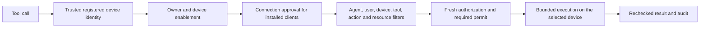

<!-- Copyright 2026 OLO Labs; SPDX-License-Identifier: Apache-2.0 -->
# Device registry and tool-call controls

This is the current reference for device registration, connection approval and
execution routing. It applies to installed client tools and Quickstart's fixed
server tools. A device record identifies the execution path; its presence,
installation, health indicator or deployment assignment never grants tool access.

## Registry flow

1. The installed protected service generates its own key and sends a signed CSR
   over direct HTTPS. Control creates a pending request, valid for ten minutes.
2. **Devices → Enroll device** lists pending requests automatically. An enabled,
   same-tenant human with `toolgate-enroller` reviews the public code and key
   fingerprint and chooses a connection duration before approving or denying.
3. Approval binds the key to that human's directory user. Control stores the
   directory device, owner, approval and audit atomically. Pending directory
   metadata, including a disabled record, cannot issue credentials.
4. The protected service retrieves its certificate using its private enrollment
   code, then reports ready tools and inventory. The browser never receives the
   device code, CSR private key, runtime bearer token or certificate credentials.
5. **Devices → Clients** combines registered devices and pending requests in one
   automatically refreshed table. Device name and registered user are visible
   columns alongside **System name** and **IP address**; each row has details available by hover, keyboard or the information
   button. Names can be edited through the directory editor.

Pending devices show **Awaiting registration** until an owner is established.
Admin mutations are committed immediately and refresh the Clients list on success.
The list checks the server every second for incoming requests and changes made in
other sessions, and also refreshes when the window regains focus.
The protected client sends a signed-key presence ping in every state, including
before enrollment, while disabled or deapproved, and after approval expires.
Control returns the current state and an action (`ENROLL`, `CHECK_IN`, or `WAIT`).
An unknown device follows `ENROLL` and automatically appears as a pending request.
Presence alone does not authorize a connection or a tool call.
Installed clients show connected/offline state from authenticated check-ins;
the console uses a two-minute freshness window and does not treat approval alone
as a connection. The current client polls at the configured check-in interval (2 s on Quickstart); older clients
retain their seconds-based interval.

System name is the protected client's reported OS hostname, separate from its
editable device name. Current clients send a bounded `X-ToolGate-System-Name`
header on authenticated HTTPS check-ins and WebSocket handshakes. Control records
the actual transport peer IP, ignoring forwarded-IP headers. These are display
metadata and never identity or authorization inputs. Missing metadata shows
**Not reported**; older clients need the current client build to report their name.
An observed IP may be a NAT/proxy address.

### Docker deployment and execution identities

The LangChain composition has two Docker containers and four enrolled execution
identities. Quickstart contains the direct-dispatch Tool Host and a pull-mode
Tool Host. `tool-host-remote` is the pull-mode example
inside Quickstart; its name does not imply another physical machine. The separate
`langchain-linux-device` container runs the managed endpoint client.

Clients shows their execution roles, shared container names/IDs, deployment IPs
and Docker network names/IDs. The full IDs are available in device details. Rows
can share the same container while retaining separate enrolled keys, permissions
and routing identities. Deployment IPs are shown alongside differing observed
transport addresses; loopback addresses remain accurate for intra-container calls.

The host helper collects these public facts from `docker inspect` during deployment
and before example execution. `python manage.py sync-deployment` refreshes them
without changing approval, enrollment or credentials. The optional
`?deployment=true` view preserves the default closed device response and only
attaches records for devices already visible to the authenticated administrator.
Missing, malformed or previous-container metadata is omitted. Docker metadata is
display information and never trusted network evidence for authorization.

## Approval and enablement

| Control | Meaning |
|---|---|
| Approve | Authorize the existing enrolled key until a chosen deadline or for unlimited time. Reapproval preserves the owner and directory enablement. |
| Deapprove | Temporarily remove connection approval while retaining the key, owner and reported state. |
| Enable / Disable | Independently control directory access. Enabling does not approve an enrolled key; approving does not reenable a disabled record. |
| API revocation | Block protected access and certificate recovery. Ordinary reapproval cannot reactivate the key; an explicit new request and fresh administrator review are required. |
| Request approval again | Reopen a revoked device for fresh enrollment. The admin action changes server state only; the disconnected client discovers it on its next hourly presence ping. The client can also explicitly request approval locally. |
| Delete | Remove the directory device and its approval. A live client keeps pinging and requests fresh approval using the same ID and key. Previous enrollment codes and device group membership are removed. |

Installed-device access requires an active key, an enabled matching registered
owner, an enabled directory device and current connection approval. Pending
requests never satisfy these gates. Tool filters and grants still apply after
the device passes them.

Connection approval defaults to 24 hours. **Until a date and time** uses the
administrator's local time and stores an absolute UTC deadline.
**Unlimited time** explicitly stores approval with no access deadline; it does
not create a permanent certificate or bypass filters. Certificates remain valid
for at most 24 hours and renew. Finite approvals cap certificates and tool leases
at the deadline, rounded down to X.509 second precision.

An expired approval remains in **Clients** as **Approval required**, with an
Approve action. Its presence pings continue while Control returns `WAIT`; admin
reapproval allows it to resume check-ins or recover an expired certificate.

Temporary disablement, deapproval or approval expiry returns HTTP **423** on
authenticated client access. The client retains its protected identity and retries
with bounded backoff. Unauthorized or permanently revoked identities continue to
receive authentication rejection for protected access. Their presence pings still
reach Control and receive its current state. Deleted devices receive HTTP **410**
on protected access and request fresh approval. Job sockets recheck authorization on messages
and periodically; disabling a device is not permission to finish a new effect.

Revoked clients ping once per hour, aligned to **X:00:00 in the client's local
time**. Each presence request includes the current OS UTC offset; Control returns
the delay to the next local hour. The client recalculates that boundary when
scheduling the next ping, including after a failed ping. An admin reopening review
does not push to the disconnected device or shorten its waiting period.

In the Windows tray, **Repair gateway connection** and **Switch gateway →
Configuration** make one immediate presence check. They apply any changed server
state and reschedule the background loop without a second ping. When the server
still says revoked, the client keeps its identity, remains disconnected and waits
for the next local hour. These checks do not request approval or grant access.

Use **Request approval again** on a revoked row in Clients, or run
`olo-toolgate-client request-approval` on the device (Windows tray: **Request
device approval**). A local explicit request contacts Control immediately. Both
routes retain the ID and key, invalidate previous enrollment codes and require a
new admin review even when automatic initial approval is enabled. Directory
enablement remains independent.

After an extended outage, the current client can use a verified CSR for the exact
already approved device/key to recover its public certificate. The server rechecks
owner, enablement and deadline and does not change the access grant. A different,
disabled, deapproved, expired-approval or permanently revoked key cannot recover.
Lost check-in responses retain sequence and effect replay protection; old replies
cannot reinstall an expired certificate or force a stale clock comparison.

### Own-device approval and code privacy

A management rule may set `"ownDevices": true` (`groupType: DEVICE_GROUP`, `approve-device`
only, exactly one group). A user holding `approve-device` only through such a rule may approve
or unapprove only devices whose owner is that user, and a pending enrollment it looks up by
code (`POST /endpoint/enrollments/lookup`). Approving by code makes the approver the owner
and replaces the device's memberships with the rule's group. Each user may own one device
in that group; a second approval returns `409 {"error":"ONE_DEVICE_PER_ACCOUNT"}`.

User codes and key fingerprints are returned only to callers who hold `approve-device`
through a group rule on the device's groups (`default-devices` for pending enrollments).
Other readers see pending rows without them; `ownDevices`-only callers see no pending
enrollments and only their own devices. Five failed lookups or approvals per user in ten
minutes return 429, so one visitor cannot find or take another's pending code.

## Uniform tool routing and filters

Control remains the registry authority. A caller cannot choose a device by adding
an untrusted request header or body field. Installed clients prove identity with
their actual TLS peer certificate; server adapters use composition-owned runtime
credentials bound to a fixed registered identity. Gateway normalizes arguments
and evaluates deterministic tool/action/resource and user/agent/device filters.
Unknown or unavailable identity, dependency, filter or permit fails closed.

Client calls use Gateway → Control's durable relay → the approved client. Discovery,
dispatch, authorization immediately before effects and result delivery all check
current registry and permission state. A device file operation must name a path
the authorized call was given; `move` and `copy` name both. These shared device gates
do not replace resource confinement, ASK permits, package signatures or runtime
sandboxing. Standalone policy-only authorization APIs remain compatible; a policy
decision by itself cannot enroll a device or execute a client tool.

## Administrative API and concurrency

| API | Request or result |
|---|---|
| `POST /api/control/v1/endpoint/ping` | Key-proved announcement and local UTC offset (`EndpointPresencePing`); returns current state, next action, report sequence and next ping interval. Direct HTTPS; no current client certificate required. |
| `POST /api/control/v1/endpoint/enrollments/request-approval` | Explicit signed-key request after revocation; returns a fresh pending challenge without granting access. |
| `POST /api/control/v1/endpoint/devices/{id}/request-approval` | Admin reopens a revoked device with `expectedRevision` and an idempotency key; a live client must submit a fresh request and receive approval. |
| `GET /api/control/v1/endpoint/enrollments` | At most 32 unexpired pending reviews; enroller role and enabled same-tenant user. |
| `POST /api/control/v1/endpoint/enrollments/decision` | Reviewed user code, fingerprint, APPROVE/DENY and optional connection duration. |
| `GET /api/control/v1/endpoint/devices` | Bounded combined snapshot of directory devices, endpoint approvals, pending reviews, registered users and server-device metadata; admin role. |
| `POST /api/control/v1/endpoint/devices/{id}/approval` | `expectedApprovalRevision`, `approved`, optional `connectionExpiresAtUnixMs` or `unlimitedConnection`. |
| `POST /api/control/v1/endpoint/devices/{id}/enabled` | `expectedRevision` of the directory record and `enabled`; revision zero only for an unregistered, still-pending request. |
| `POST /api/control/v1/endpoint/devices/{id}/revoke` | Blocks the key until an explicit new request and fresh approval; requires endpoint `expectedRevision`. |

Use `Idempotency-Key` for each administrative mutation. Exact retries replay the
transactional result; changed payloads or stale revisions fail with 409. Approval
revision is separate from heartbeat/report revision, so a check-in cannot make an
approval decision stale.

`unlimitedConnection: true` omits the access deadline. Sending it together with
`connectionExpiresAtUnixMs` on an approval is invalid. Omitting both gives the
24-hour default. Neither duration is inferred from the UI alone.

PostgreSQL migration V11 allows the new approve/deapprove, enable/disable and
identity-recovery audit events. Quickstart SQLite stores the same transactions
without a destructive state reset. Redeployment preserves existing identities,
owners, approvals, names and enablement and seeds only missing server records.

## Verification and troubleshooting

Boundary checks cover finite/unlimited decisions, stale revisions, idempotency,
same-tenant ownership, pending-device disablement, permanent revocation, deadline
expiry, certificate recovery and exact report replay on PostgreSQL and SQLite.
The composed smoke test proves installed-client disable/deapprove/reapprove
using real TLS, CSR and certificate authentication. UI checks cover pending and
approved rows, owner/name columns, accessible tooltips and unlimited forms.

For HTTP 423, inspect both device enablement and approval and its deadline. Keep the key and protected state; fix the registry or filter
that blocks access. Never relax TLS, owner binding, resource confinement or logging
redaction to work around a denied tool call.
