<!-- Copyright 2026 OLO Labs; SPDX-License-Identifier: Apache-2.0 -->
# Monitoring and observability

OLO exposes workflow progress and ToolGate execution observations. Monitoring is
installation configuration, outside portable bots. Exporter credentials stay in
private installation custody; never put them in `.olo`, bot JSON or issue logs.
For a beginner's baseline, prompt change and before/after comparison, follow
[Adapt a bot to your use case with monitoring](tune-bots.md).

## Supported paths

| Observe | Supported path | Setup |
|---|---|---|
| Workflow run/agent/model/tool structure | Optional collector with Langfuse, LangSmith or Phoenix destinations | Community launcher and private observability configuration |
| ToolGate admissions, calls and durations | Operator Insights BASIC/DETAILED modes and OTLP export | [Insights configuration](../control-plane/insights.md) |
| Local ToolGate metrics and trace views | Prometheus, Grafana and Tempo evaluation stack | [Local monitoring stack](../../deploy/prometheus/README.md) |
| New Relic or Datadog tool telemetry | Vendor collector configuration and the corresponding evaluation stack | [New Relic](../../deploy/newrelic/README.md), [Datadog](../../deploy/datadog/README.md) |
| Console progress and audit | Authenticated run/operation views | [Run events](../control-plane/run-events.md), [operation outcomes](../control-plane/operation-finalization.md) |

Workflow tracing and ToolGate Operator Insights are distinct pipelines. Choose
the signals required by your installation; configuring one does not configure
the other. Vendor delivery needs an actual destination and its own verification.

## Community Quickstart

From `deploy/docker/quickstart/dev` on Windows:

```powershell
.\start.bat -WithMonitoring
```

Use that installation's `credentials/observability.json` and configure only the
desired destinations using the shared
[credential template](../../debug/profiled/observability/credentials.example.json).
The [deployment guide](../../deploy/docker/quickstart/dev/README.md) documents
configuration, stop/restart and collector custody. The source-built debug
installation has its own settings and credentials; do not copy generated Admin
or runtime custody between installations.

Core Quickstart, LangGraph and Device services remain separate from the optional
collector and model services. Without cloud destinations, the helper can run a
local diagnostic collector. Destination keys stay collector-owned.

## Scope and validation

Workflow exports carry structural metadata. Private prompts, tool arguments,
results, credentials and user content are not an implied export feature. Check
the selected pipeline's actual content policy before enabling a destination.

Verify one allowed call, one denied call and the matching run/trace identifiers
at the chosen destination. Inspect collector errors, queue/drop counts and
readiness when a trace is missing. Collector acceptance or a rendered dashboard
alone does not establish end-to-end delivery, method/database instrumentation,
cost accounting or target-confirmed business success.

Use [performance guidance](../operations/performance.md) to measure overhead and
[the collector guide](../../deploy/insights/collector/README.md) for ToolGate fan-out,
network isolation and vendor credential configuration.
Demonstration images and videos are in [the media guide](../media/README.md).

## Screenshots

### One bot run across three workflow destinations

These saved cloud views show the same successful two-agent incident example from
the configured debug installation. The [capture record](../media/olo-2026-11/README.md)
identifies its run and trace. They illustrate structural spans, not exported
private prompts, measured inference costs or a production SLO.

Langfuse's tree shows the two agents and their model calls.

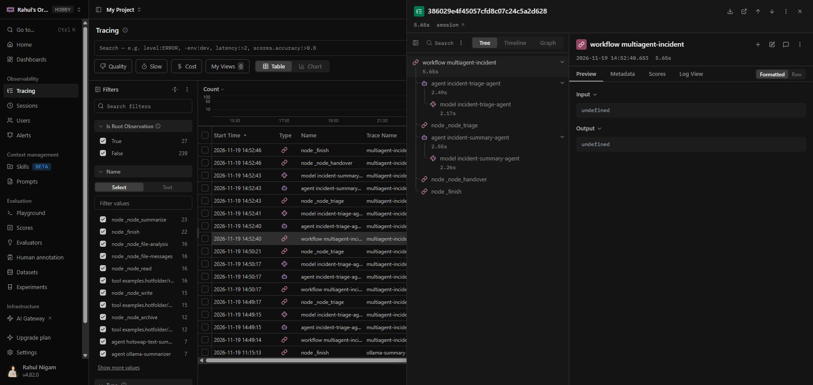

The timeline exposes the recorded sequence of agent/model work.

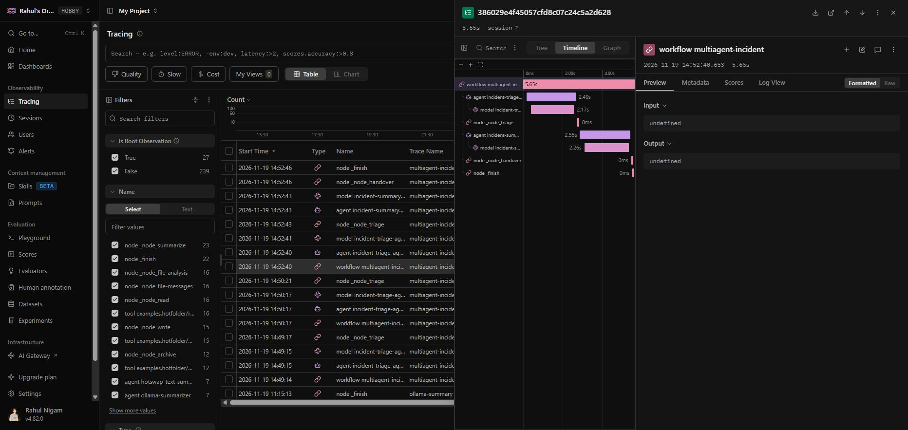

LangSmith displays the matching workflow trace and expanded execution structure.

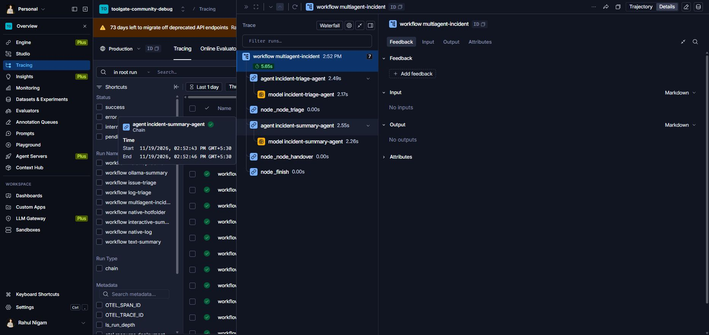

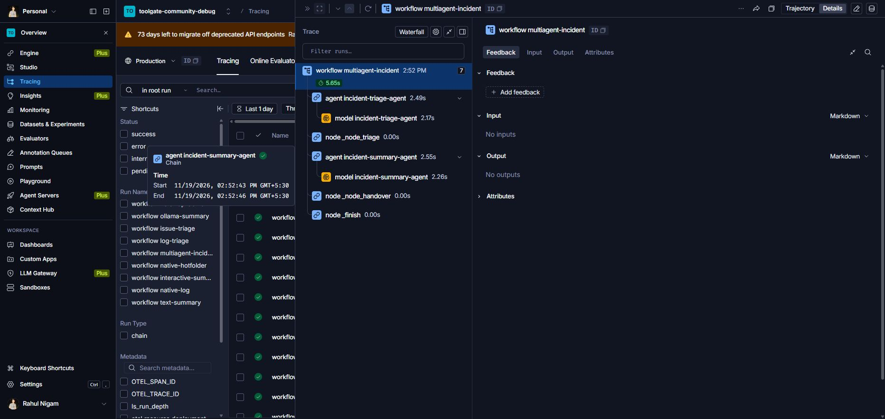

Phoenix displays the matching trace and the handover agent's structural details.

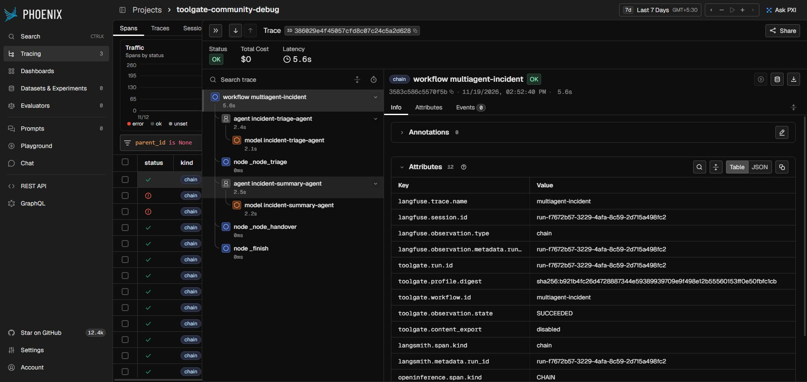

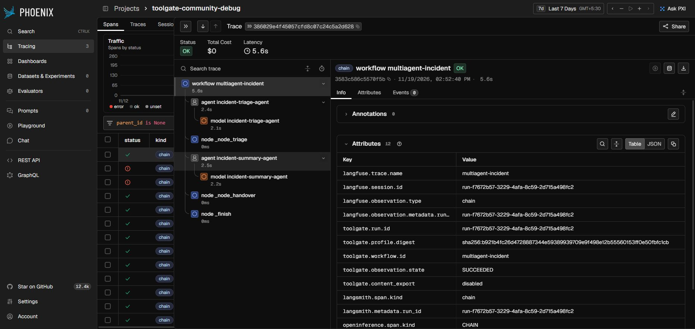

Absent content/token/cost fields are intentional in this capture. A displayed
`$0` is not a measurement of inference cost.

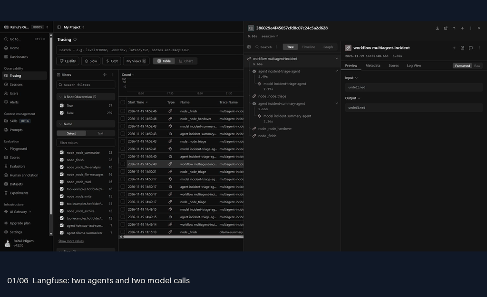

### Collector and vendor integration examples

The following captures belong to earlier, separate evaluation installations.
They are not the two-agent trace above and may show different branding/settings.
Use the linked deployment guides to configure and verify your own destination.

The Grafana and Prometheus captures use explicitly synthetic
`monitoring-smoke-test` / `smoke.*` samples. They illustrate dashboard rendering,
scraping and metric queries, not real-workload capacity or production latency.

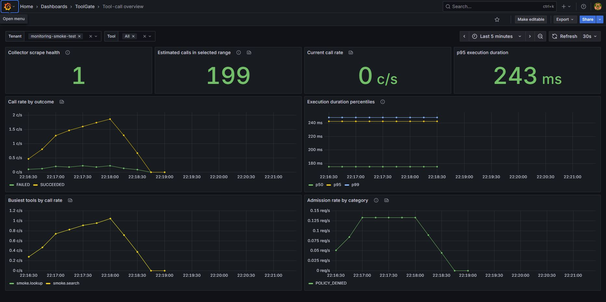

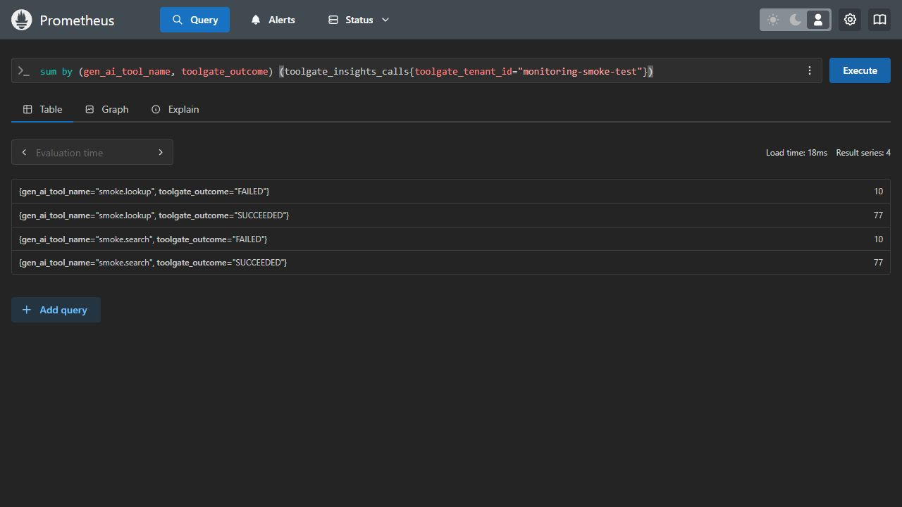

See [Prometheus/Grafana/Tempo setup](../../deploy/prometheus/README.md).

New Relic's separate ToolGate example shows trace search, a call waterfall and
recorded execution attributes. Trace presence alone does not prove a target's
business commit or universal instrumentation coverage.

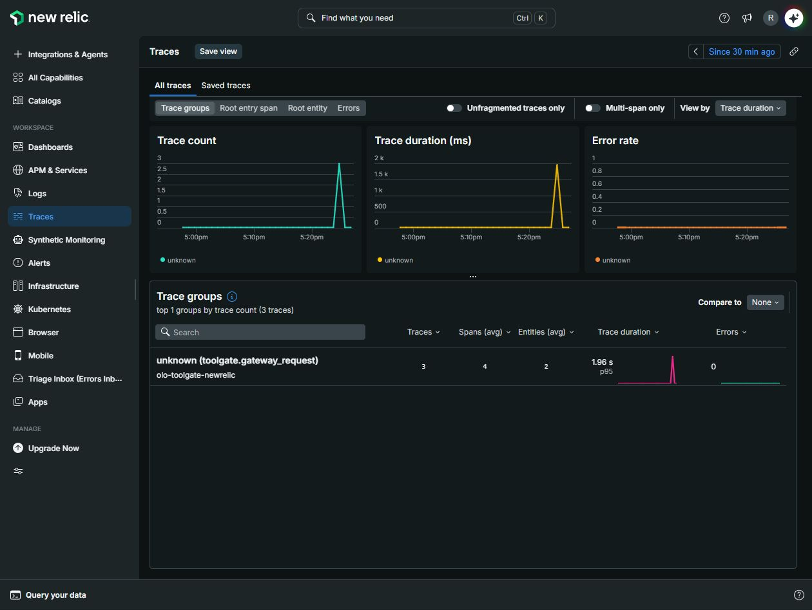

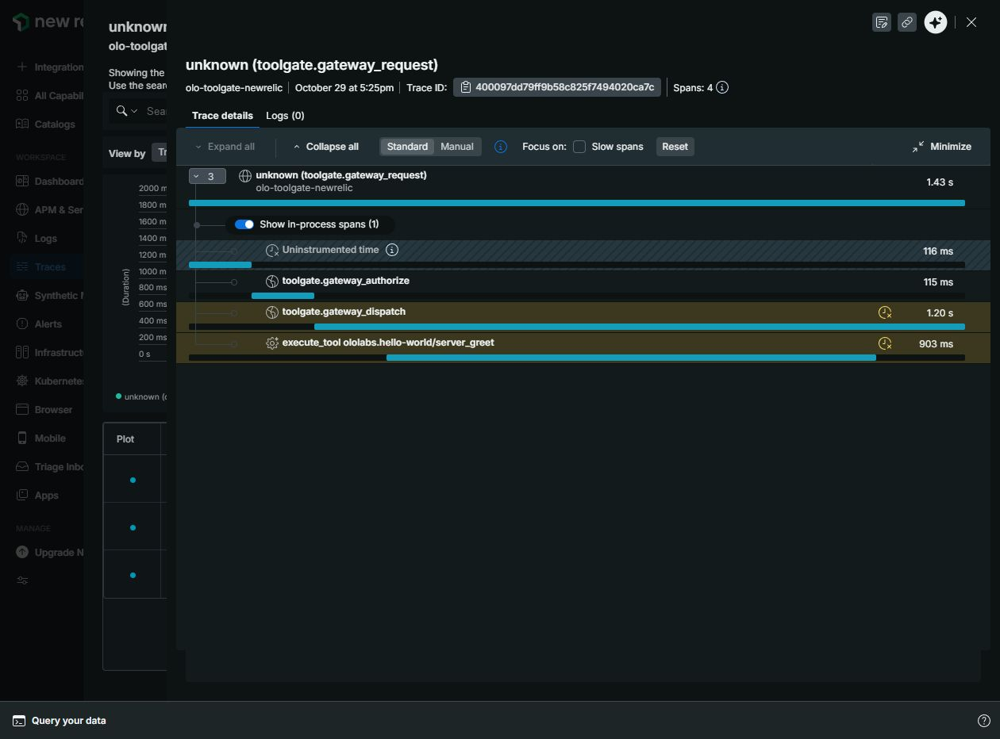

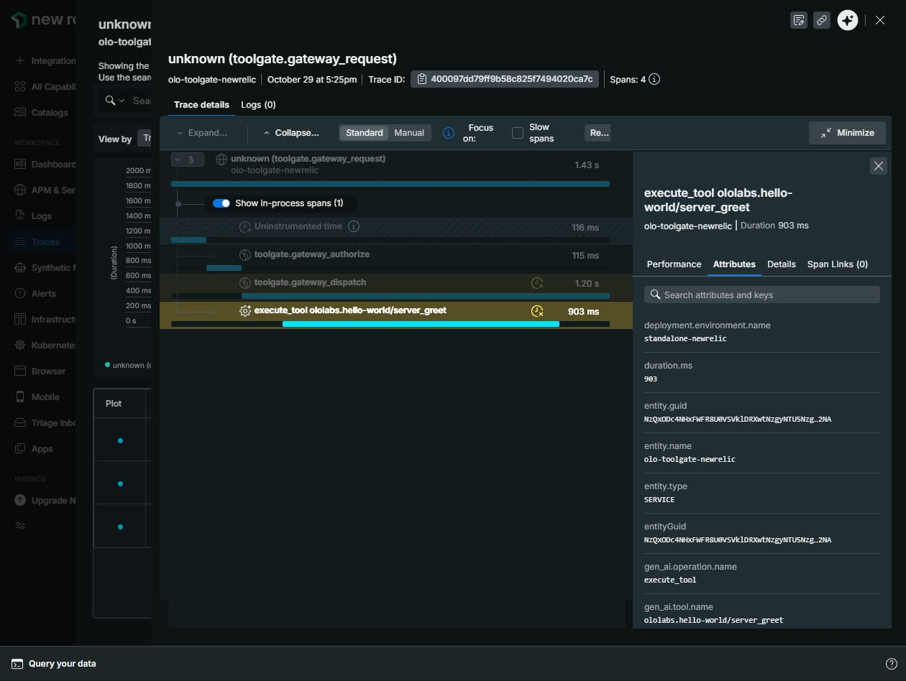

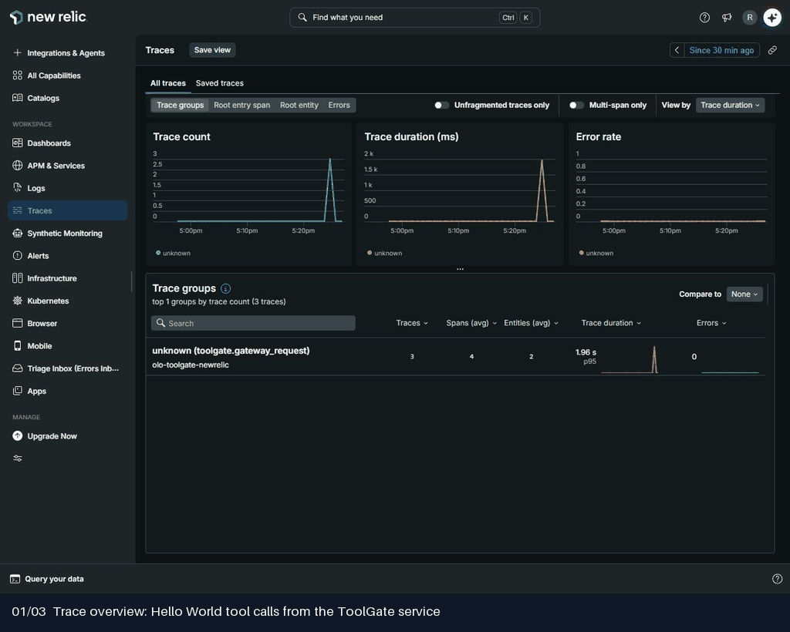

See [New Relic setup](../../deploy/newrelic/README.md) and
[Datadog setup](../../deploy/datadog/README.md). No Datadog screenshot is supplied
here; a collector configuration is not proof of vendor delivery.

[Performance and analytics screenshots](../operations/performance.md#screenshots) ·
[All illustrated capabilities](../media/README.md) · [Back to OLO](../../README.md#what-olo-supports)
