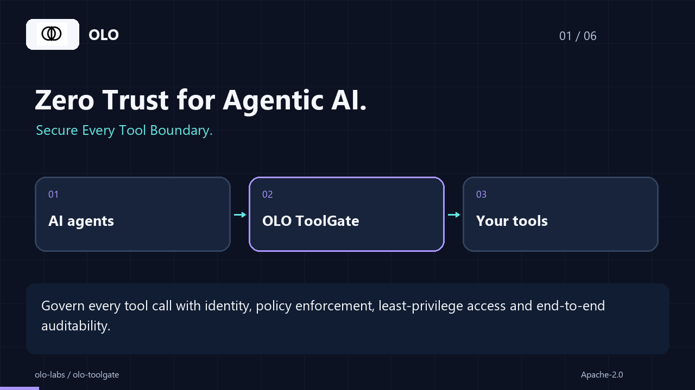
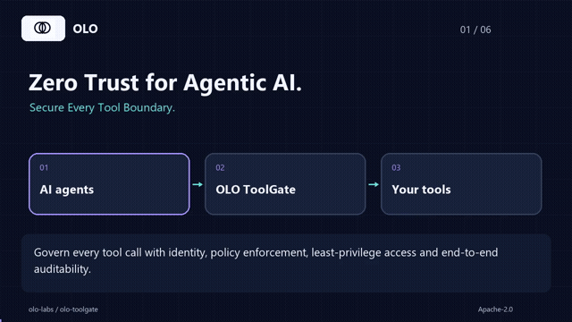

# OLO images, slideshows and videos

These demonstrations show a configured development installation. Imported bots,
sample grants and model settings are not fresh-install defaults. Captures and
collector traces are illustrations, not production or security certification.

The root README embeds only the [bot execution](orchestration-flow.gif) and
[device operation](device-flow.gif) slideshows. Additional media belongs here.

## Illustrated capability guides

Each guide pairs screenshots with an explanation and links to the maintained
setup/API instructions.

| Capability | Screenshot-rich guide |
|---|---|
| Bot bundles, manual runs, models and agents | [Bots, models and execution](bots-and-models.md) |
| Enrollment, groups, package delivery and trigger assignments | [Devices, packages and triggers](devices-and-packages.md) |
| Tools, MCP servers, workload identities, grants and policy | [Tools and runtime access](tools-and-access.md) |
| Requests, configuration review, outcomes and audit | [Review and audit evidence](audit-and-approvals.md) |
| Users, teams, roles, settings, backup and vault | [Workspace administration](administration.md) |
| Workflow/cloud traces and collector dashboards | [Monitoring screenshots](../help/observability.md#screenshots) |
| Tenant analytics and Operator Insights charts | [Performance screenshots](../operations/performance.md#screenshots) |

## Overview video

[Watch the overview](toolgate-overview.mp4) · [GIF preview](toolgate-overview.gif) ·
[Poster](toolgate-overview.png) · [Captions](toolgate-overview.vtt)

This silent captioned explainer uses diagrams; it is not a live installation recording.

[](toolgate-overview.mp4)



## Console and monitoring slideshows

- [Bot input, execution and result](orchestration-flow.gif)
- [Devices and package delivery](device-flow.gif)
- [Tools and access](console-tools-tour.gif)
- [Audit and approvals](audit-flow.gif)
- [Administration](console-administration.gif)
- [Langfuse, LangSmith and Phoenix views](monitoring-flow.gif)

Use [monitoring setup](../help/observability.md) for actual destination configuration
and [performance guidance](../operations/performance.md) for measurement scope.

## Capture sources and rebuild

[Tour steps](TOURS.md), [source inventory](screenshots.json),
[capture scope](capture-status.json) and [source captures](olo-2026-11/README.md)
describe the available frames. Monitoring views show structural observations;
absence of prompt/content or cost fields does not imply missing execution.

With Python, Pillow and imageio-ffmpeg installed:

```sh
python tools/docs/render_overview.py
python tools/docs/build_console_tours.py
```

The generators verify their input inventories and source checksums. Keep source
frames unmodified; captions/scaling belong in generated media. Runtime credentials
and local user state are never media inputs.

[Back to OLO capabilities](../../README.md#what-olo-supports)
