# Workspace administration

The console groups orchestration, execution governance and installation
administration in one workspace. These saved debug-installation screenshots
illustrate navigation and configuration; their sample users and memberships
are not fresh-install defaults.
[Capture scope](README.md#capture-sources-and-rebuild).

## Sign in and orient yourself

Use the installation's private administrator credentials. A successful login
does not grant runtime tools to every user or bot.

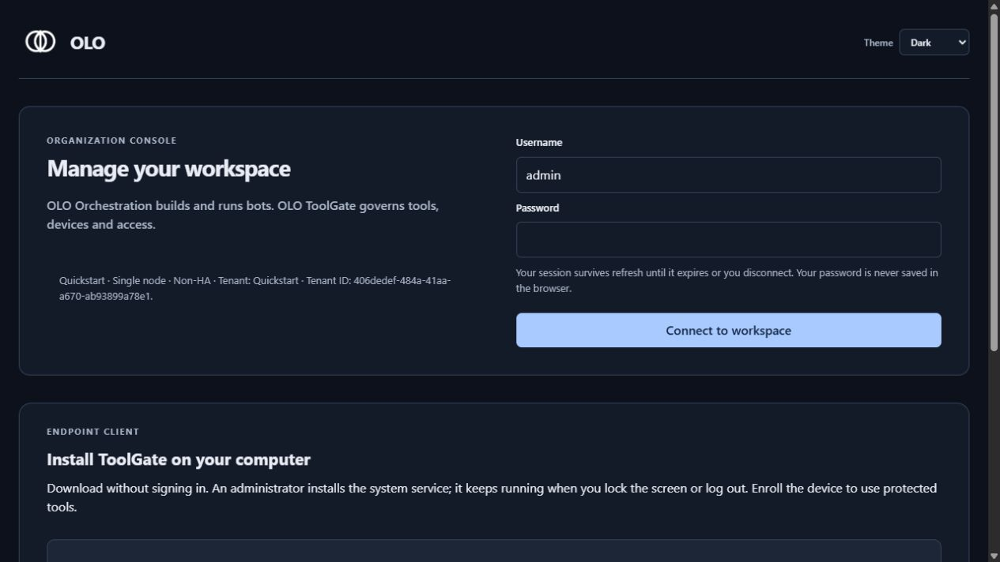

The overview links the workspace's main sections. Light and dark themes present
the same underlying installation and authority boundaries.

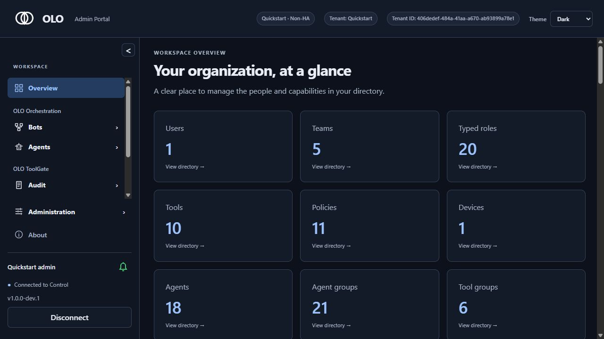

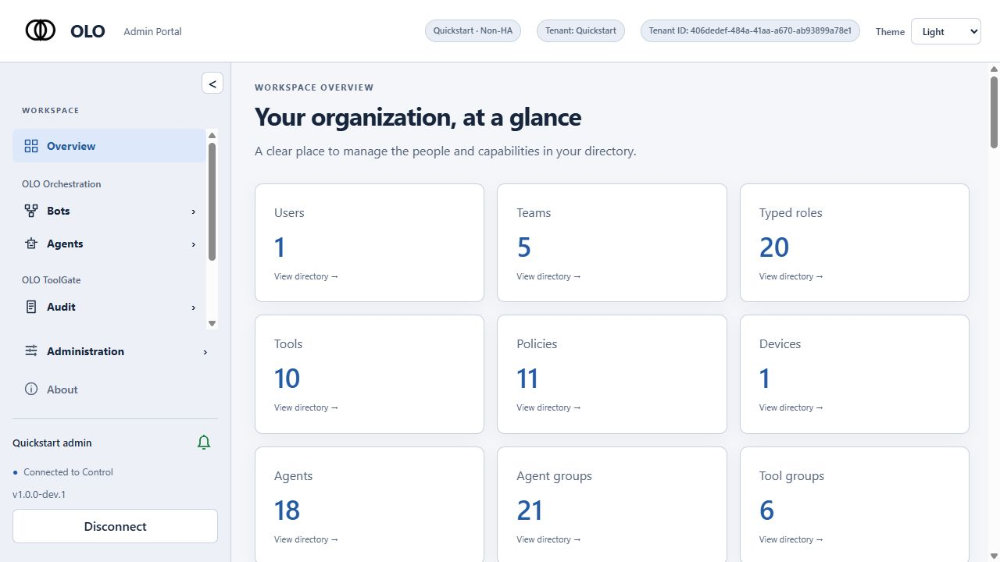

See [first login](../getting-started/first-login.md).

## Manage people and authority

Users join Teams; roles supply scoped administration and runtime responsibilities.
Enabling a user, assigning a management role and granting tool execution are
different actions.

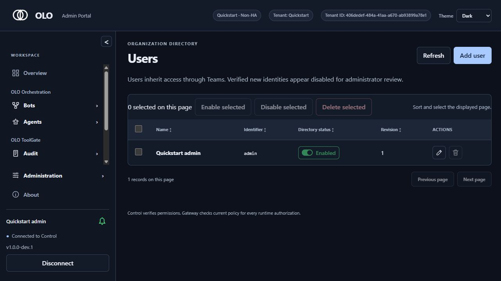

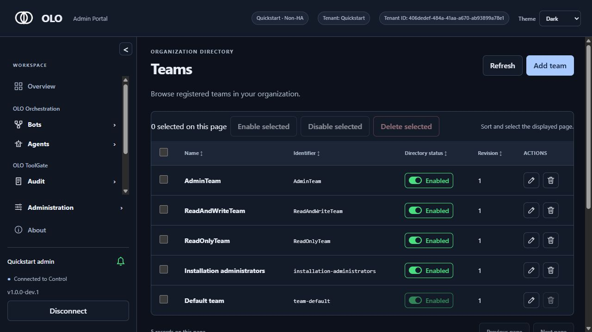

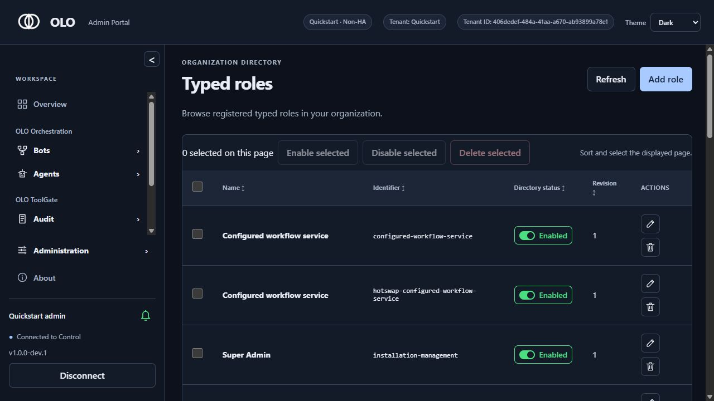

Identity bindings and delegations preserve the distinction between a human
subject and an agent acting on their behalf. Ownership alone is not delegation.

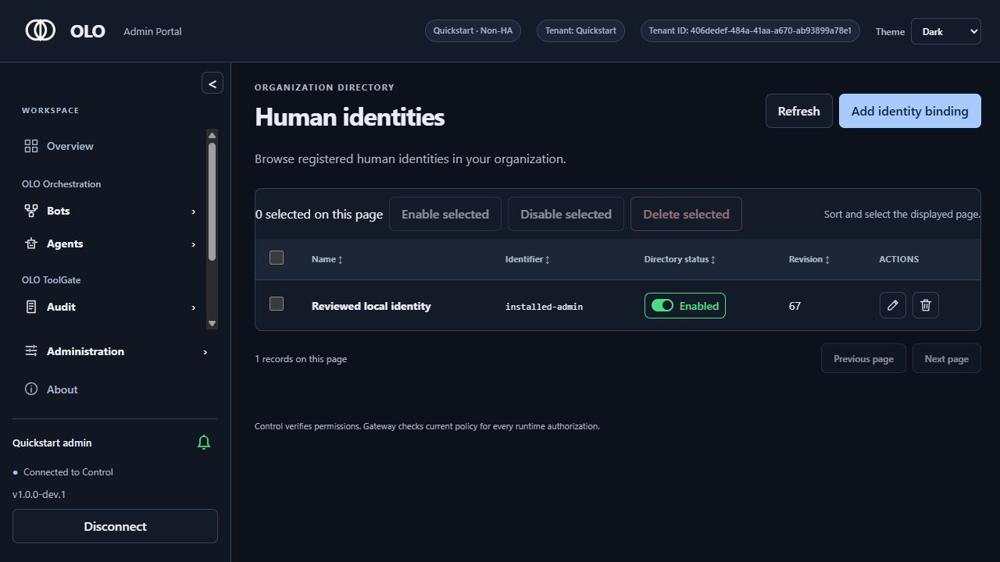

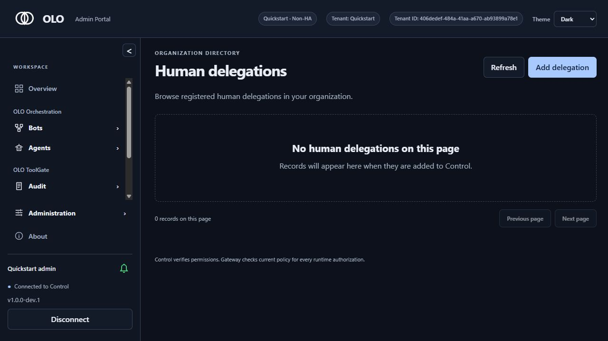

Read [user roles](../security/user-roles.md),
[console permissions](../security/console-permissions.md) and
[group access control](../security/enterprise-access-control.md).

## Configure the installation

Server and Device settings are installation-owned. Importing a bot does not
silently change its filesystem roots, host mounts or infrastructure.

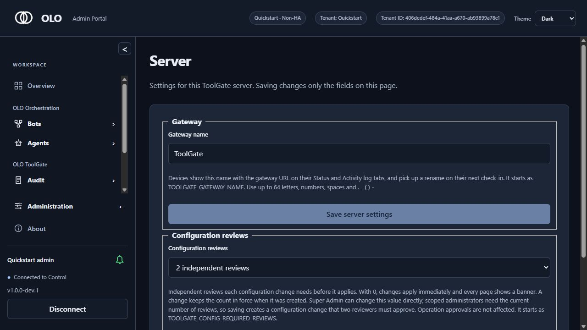

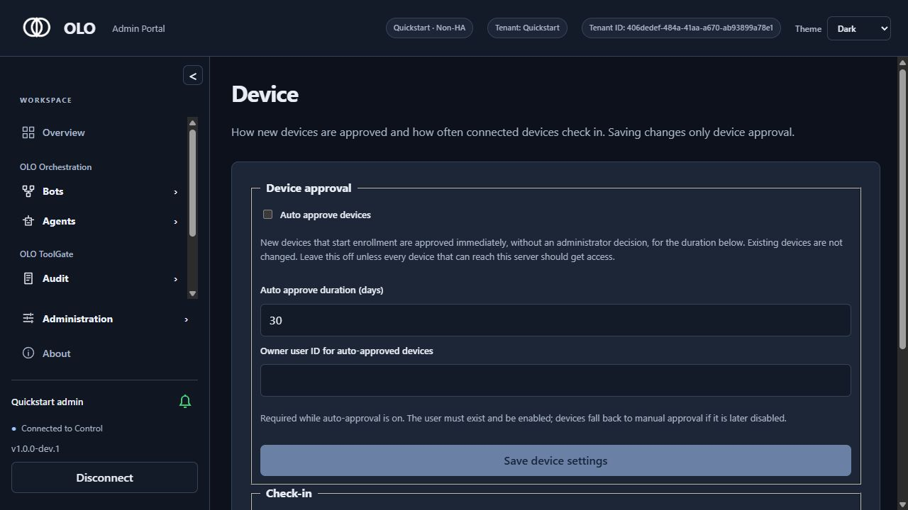

Backup/restore and vault custody require their own protected procedures; do not
treat a settings screen as permission to copy credentials between installations.

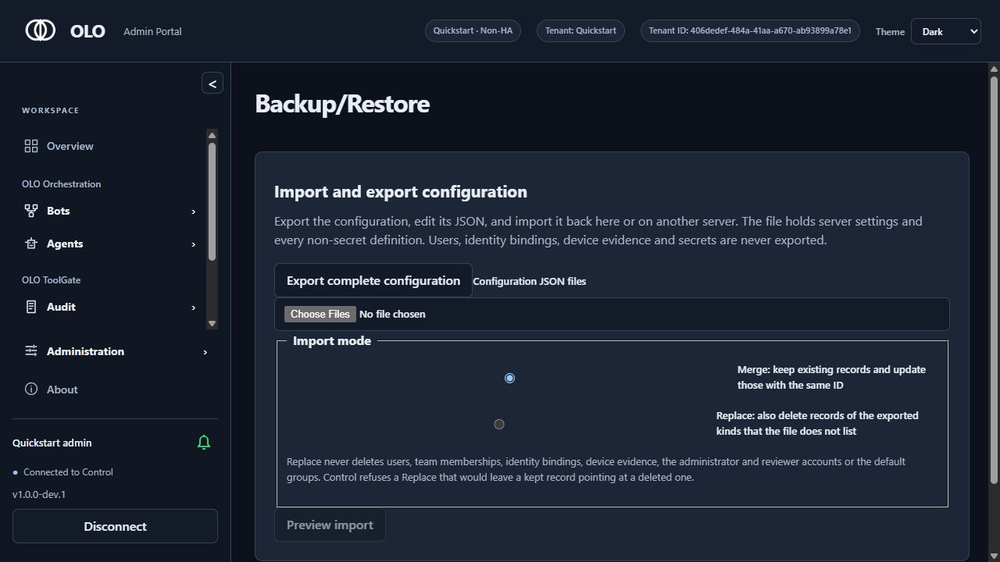

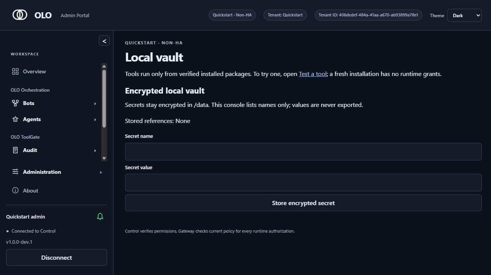

The About screen identifies the application version for support and investigation.

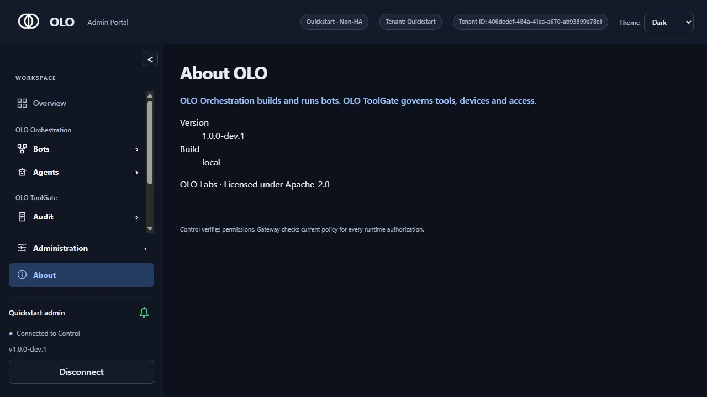

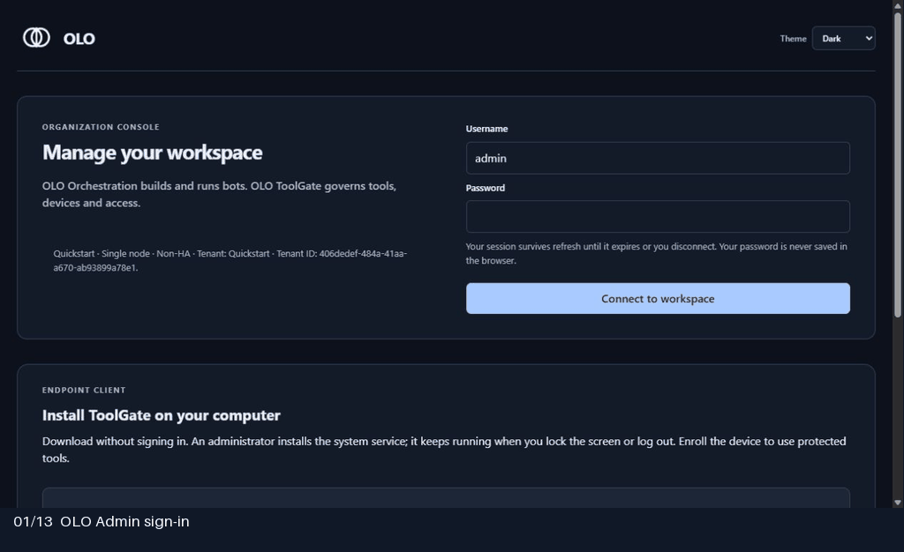

Use [configuration settings](../control-plane/configuration-menu.md),
[reviewed recovery](../enterprise-access-control/operations.md) and
[tenant vault custody](../control-plane/tenant-vault.md) for operational instructions.

[Overview video and more media](README.md) · [Back to OLO](../../README.md#what-olo-supports)
