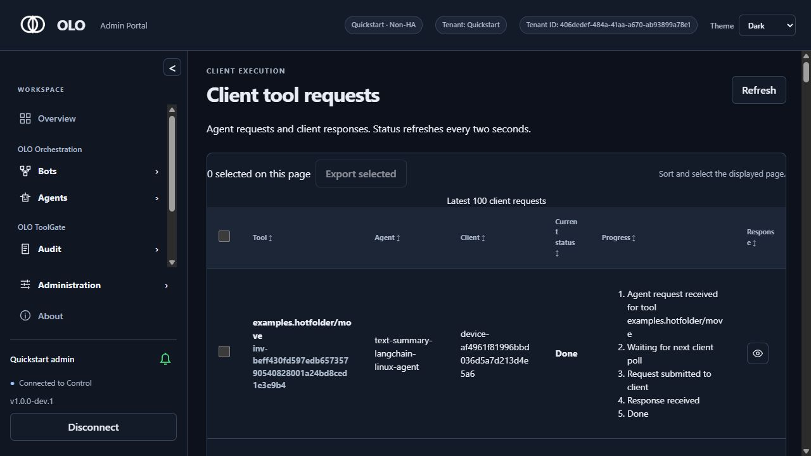
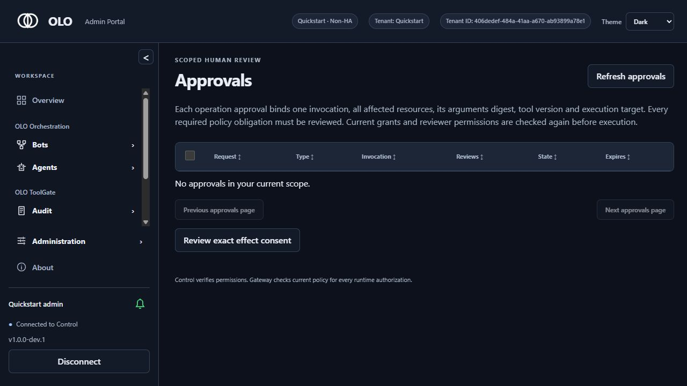
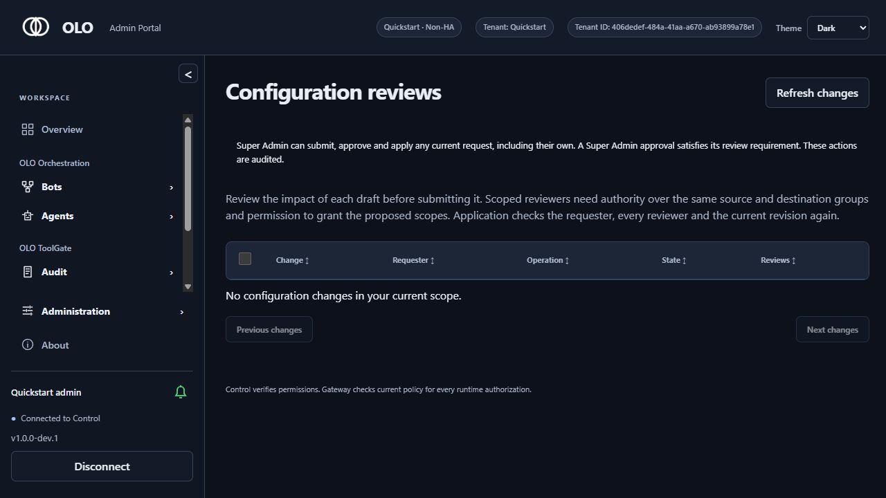
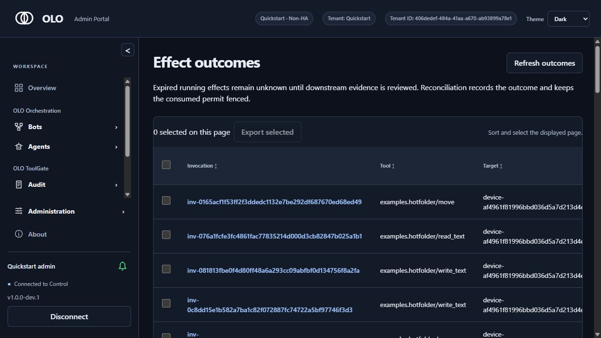
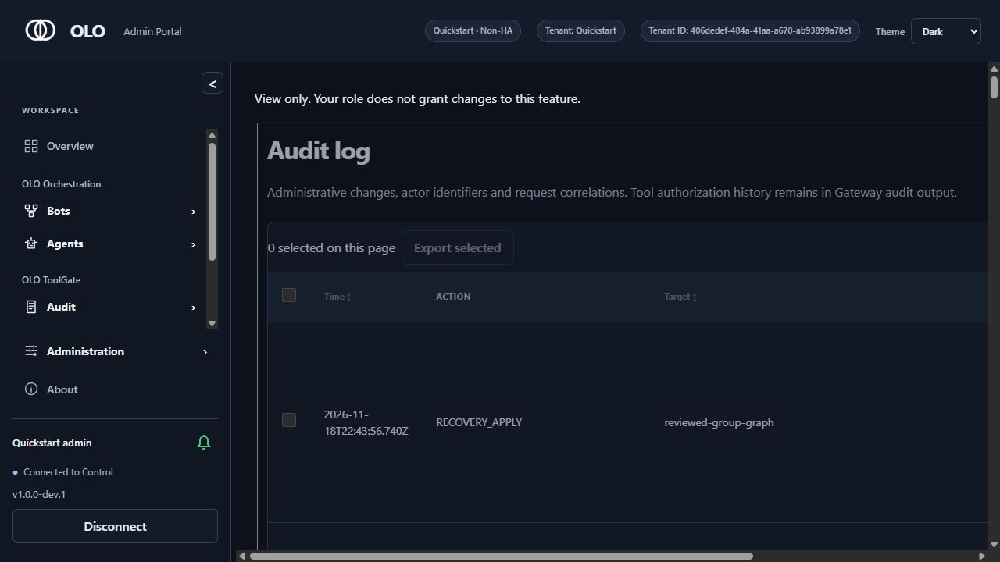
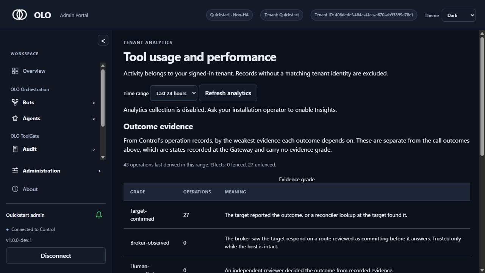
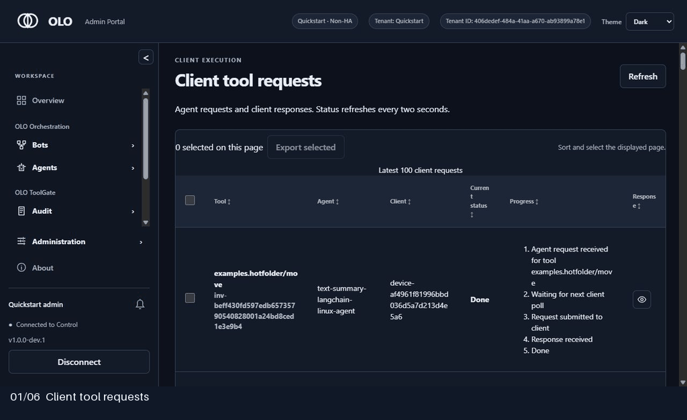

# Review, approvals and audit evidence

Use these views to inspect configuration changes, pending work and recorded
outcomes. The captures show a configured debug installation. Empty queues are
shown as captured; this walkthrough does not claim a newly performed independent
approval or proof of target completion.
[Capture scope](README.md#capture-sources-and-rebuild).

## Inspect requests and approvals

Client tool requests and approval queues expose different stages of governed
work. Approval cannot repair a missing runtime grant or change the admitted
actor, arguments or target.

For the actual review requirements, use [ASK and effect consent](../control-plane/approvals.md).

## Review configuration separately

Configuration review governs changes to the directory and policy. Publishing a
configuration is not the same action as approving a particular tool effect.

The [configuration guide](../control-plane/import-export.md) explains revisions,
review, apply and stale-change handling.

## Inspect outcomes and audit

Outcome evidence distinguishes what the executor observed from target
confirmation and fencing. A successful transport response does not establish
every business outcome, and uncertain effects must not be replayed automatically.

Audit records provide correlated administrative and execution evidence within
the authenticated user's scope. They are not permission to read another tenant.

Analytics presents evidence grades separately from call activity. This particular
capture has Insights collection disabled; it is not a populated performance test.

Read [operation finalization](../control-plane/operation-finalization.md),
[proof-bound recovery](../control-plane/operation-recovery.md) and
[security boundaries](../security/zero-trust-boundaries.md) before interpreting
an outcome or attempting recovery. For metrics, see
[performance screenshots](../operations/performance.md#screenshots) and
[monitoring screenshots](../help/observability.md#screenshots).

[All illustrated capabilities](README.md) · [Back to OLO](../../README.md#what-olo-supports)
