# Bots, models and execution

OLO separates a bot's portable configuration from installation credentials,
devices and model hosting. This walkthrough shows the console screens for that
workflow. These are saved captures of a configured debug installation, not
fresh-install defaults. See [capture scope](README.md#capture-sources-and-rebuild).

## Author and transfer a bot

The bot catalog exposes published bots and their Run actions. Import a `.olo`
bundle, inspect its dependencies and prepare/publish the intended revision.

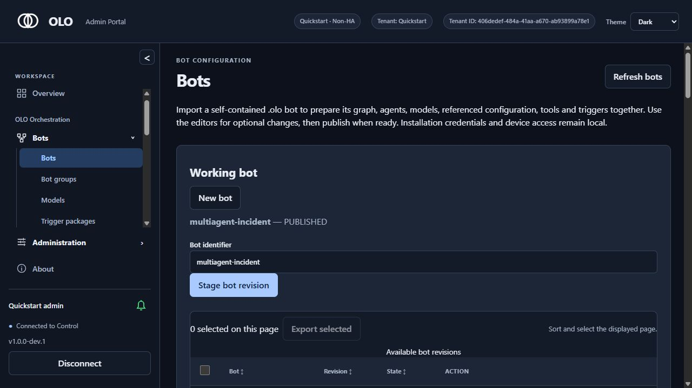

The bundle/profile view manages portable definitions. Human accounts, runtime
tokens, model weights and host permissions remain installation-owned.

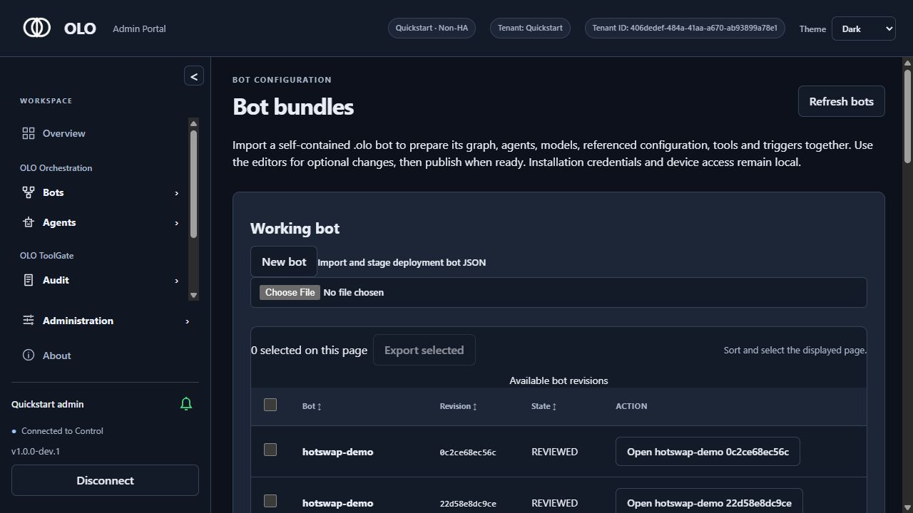

For the source and build path, use [bot authoring](../help/author-bots.md) and
[example bot sources](../../bot/README.md).

## Follow a run from input to result

Supply the input expected by the published bot. This example sends an incident
to a triage agent and then a handover agent.

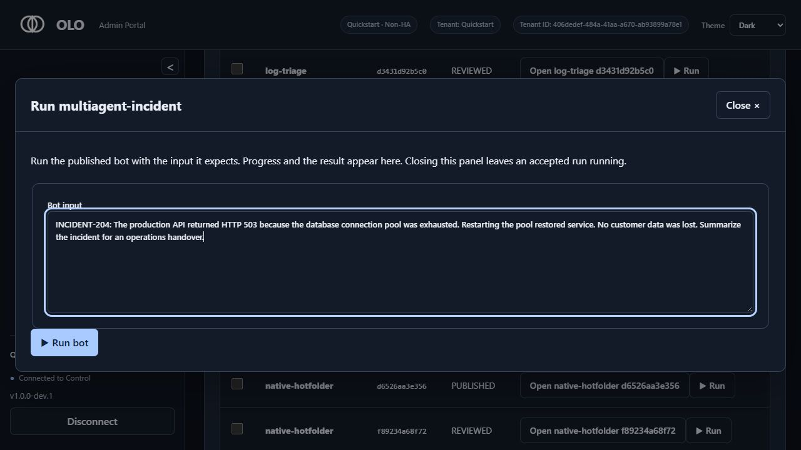

Admission creates a run identity and a queued state. A queued request is not a
completed model call or tool effect.

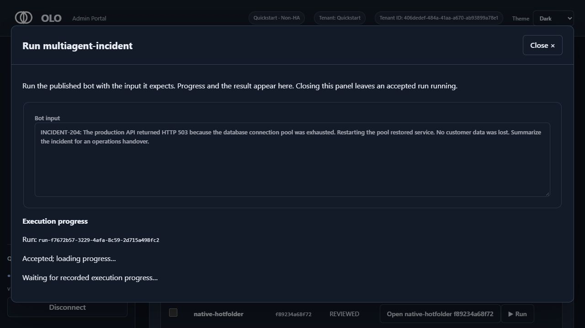

The progress view follows execution without changing the run's admitted revision.

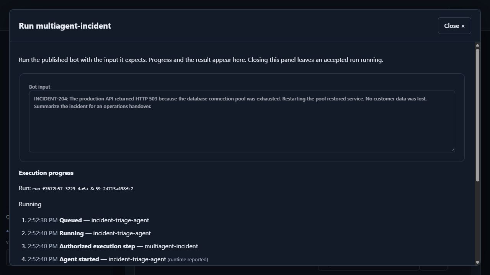

Inspect the terminal status and recorded result rather than inferring success
from a green container or an emitted span.

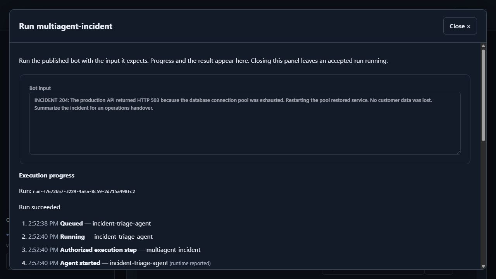

The recorded output combines triage with the second agent's handover. This text
example performs no remediation or external tool effects.

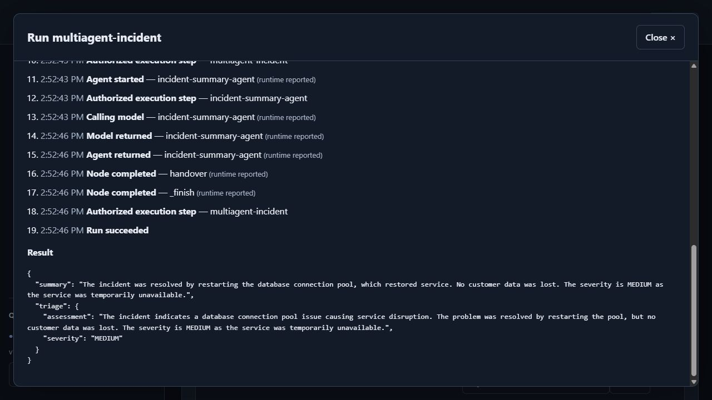

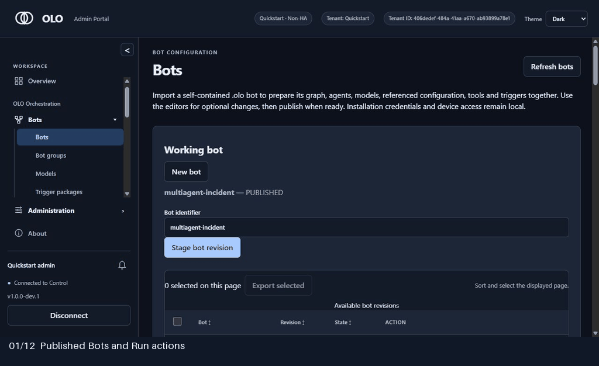

See [run and switch bots](../help/run-bots.md) for instructions and
[workflow architecture](../architecture/workflows.md) for execution boundaries.

## Configure models and agents

Model configuration selects deployment/group references. Provider credentials
and endpoint trust must be supplied by the destination installation.

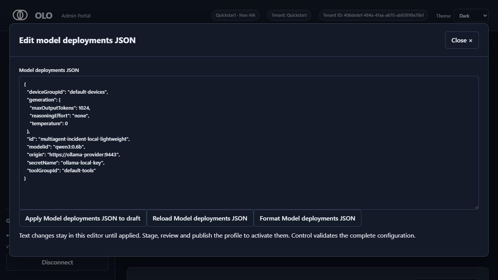

Agent definitions hold prompts, model selection and output requirements.
Configuring an agent does not supply runtime tool grants.

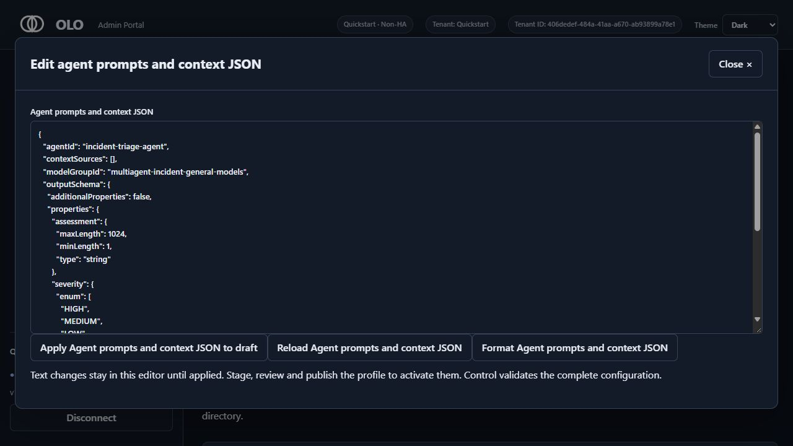

Mappings connect the intended agent and bot configuration. Existing runs keep
their pinned revision when a different revision is published.

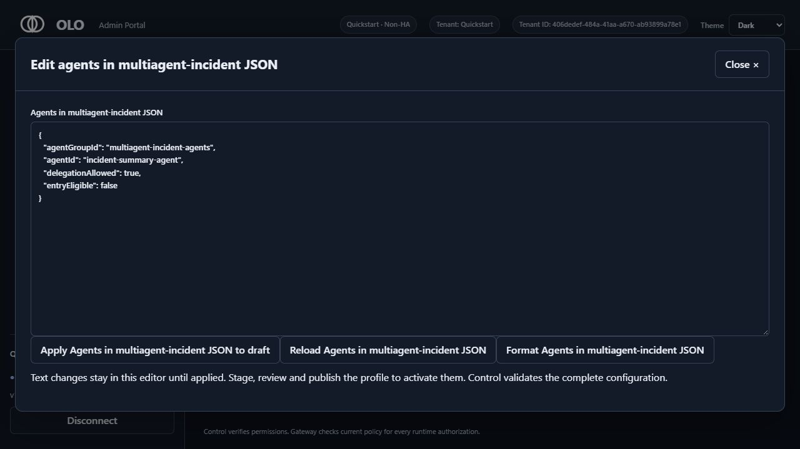

Use [model setup](../help/models.md) for Ollama, routing and provider custody;
[monitoring](../help/observability.md#screenshots) shows this example's trace views.

[All illustrated capabilities](README.md) · [Back to OLO](../../README.md#what-olo-supports)
