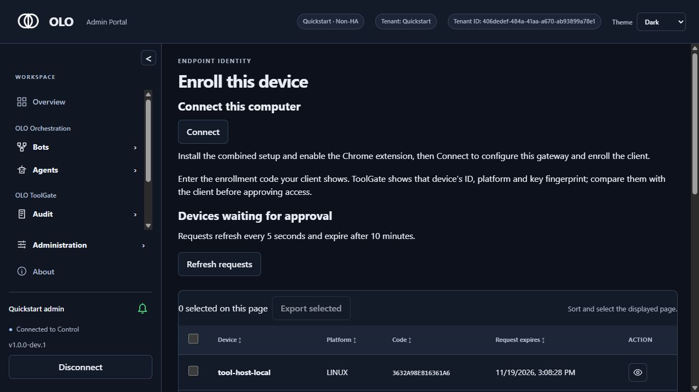
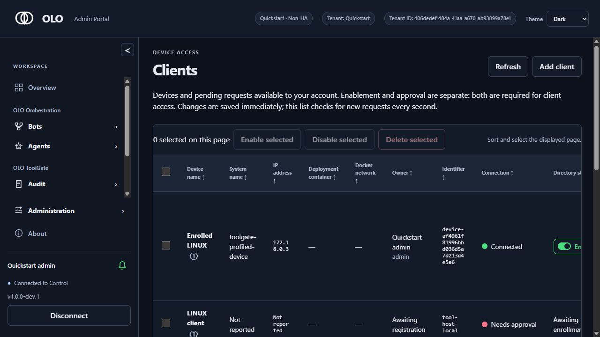
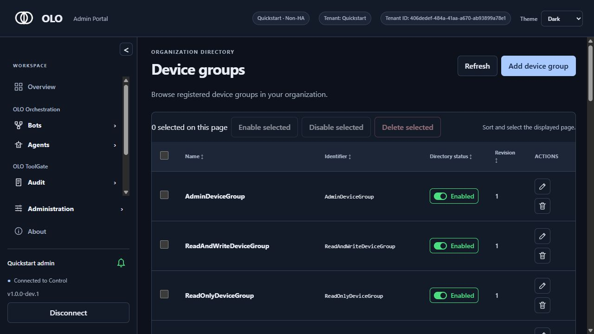
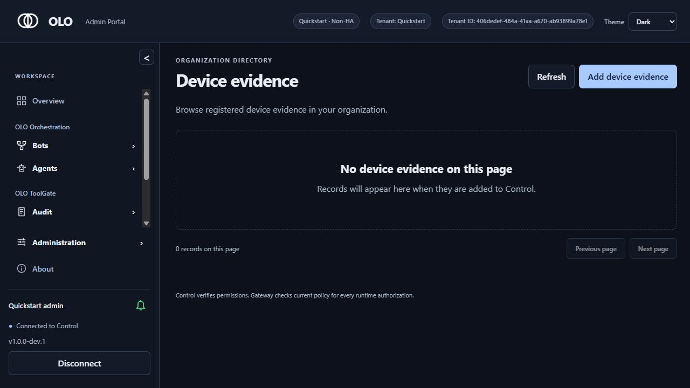
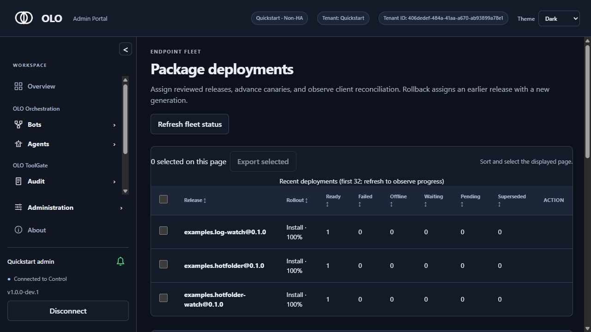
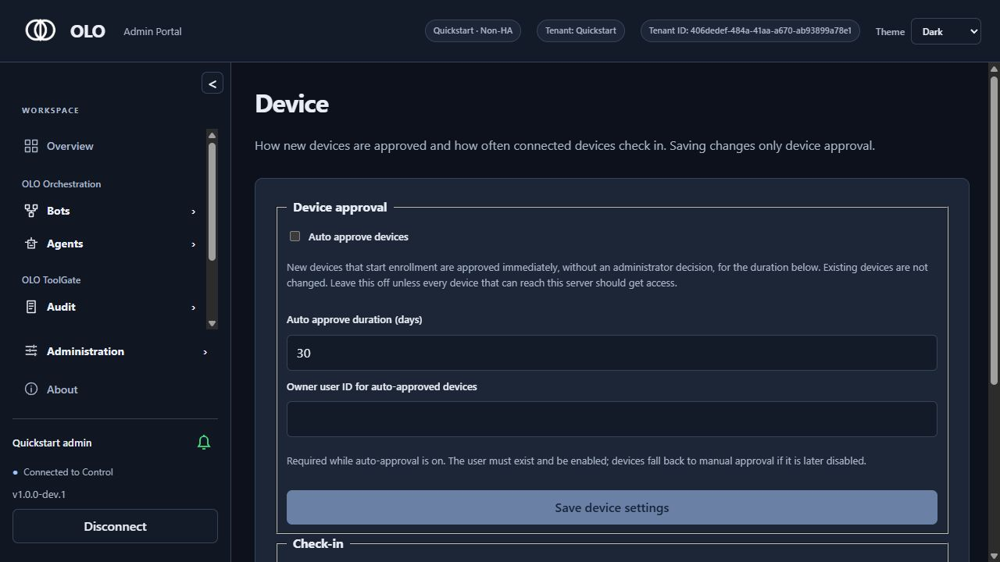
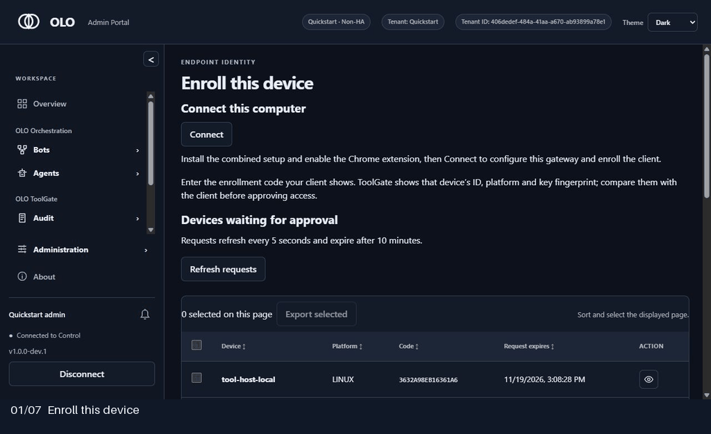
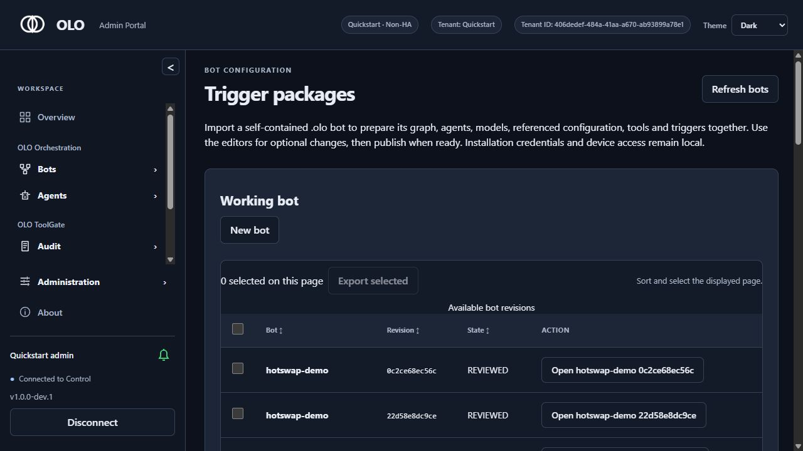
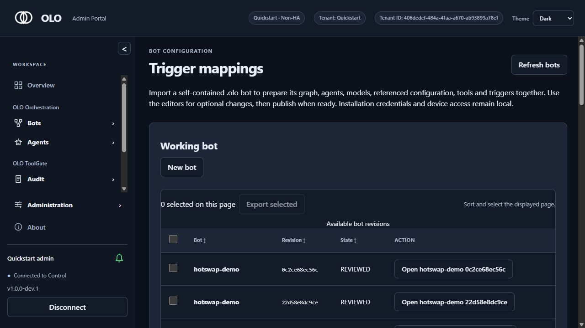
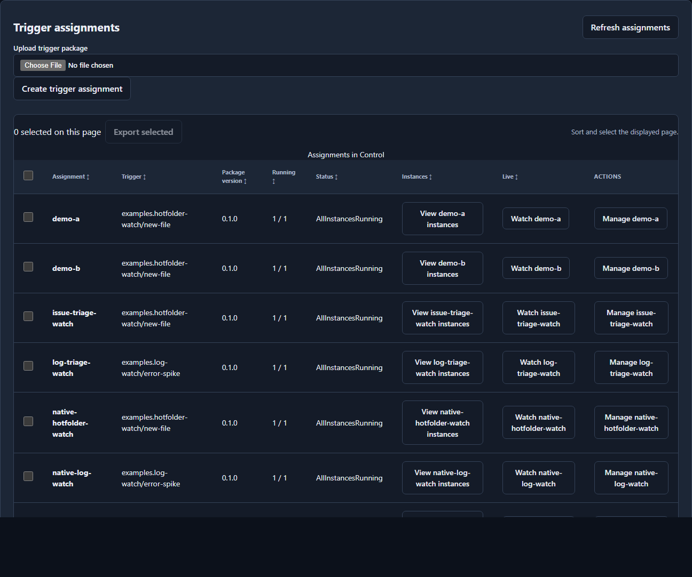

# Devices, packages and triggers

Devices execute approved package capabilities under current Control authority.
These saved debug-installation screens illustrate setup and inspection; sample
memberships and assignments are not new-install defaults.
[Capture scope](README.md#capture-sources-and-rebuild).

## Enroll and configure a device

Review the actual destination's enrollment identity and fingerprint before
approving it. Connection approval and account/device enablement are separate
from runtime grants.

The client list exposes the registered devices and their current reported state.
A connected device is not automatically authorized to run every installed tool.

Device Groups define execution scope. Assign the groups required by the bot and
bind its Tool Groups through reviewed configuration.

Reported evidence is inspected separately from approval and grants; a healthy
report does not replace current authorization or establish OS attestation.

Package deployment reconciles desired versions with the device. Installation
does not grant a caller access to the package's tools.

The Device settings page controls the installation's allowed capabilities and
configuration. Bot import does not create filesystem permissions or host mounts.

Follow [device setup](../help/device.md), [enrollment controls](../control-plane/device-registry.md)
and [signed package deployment](../client/package-deployment.md) for procedures.

## Connect a trigger to a bot

Trigger package references identify the source capability. The managed-file
examples do not grant arbitrary host logs, filesystems or provider access.

A dispatch mapping connects an authorized source to the intended workflow.
Event content cannot select a different actor or more privileged bot.

The assignment screen exposes package versions, desired/running state and instance
actions. This administration capture is not proof of subscriber authority or of
every proposed server/PUSH connector.

Use [trigger management](../control-plane/trigger-assignments.md),
[available examples](../architecture/trigger-package-catalog.md) and
[trigger architecture](../architecture/triggers.md) for current support and limits.

[All illustrated capabilities](README.md) · [Back to OLO](../../README.md#what-olo-supports)
