# Tools, MCP and runtime access

This walkthrough connects the tool catalog to the identities, group grants and
bindings needed to execute a call. Screens show a configured debug installation;
visible tools and grants are demonstration data.
[Capture scope](README.md#capture-sources-and-rebuild).

## Register and prepare tools

The catalog lists configured tools. Installing or enabling a tool does not grant
every caller permission to invoke it.

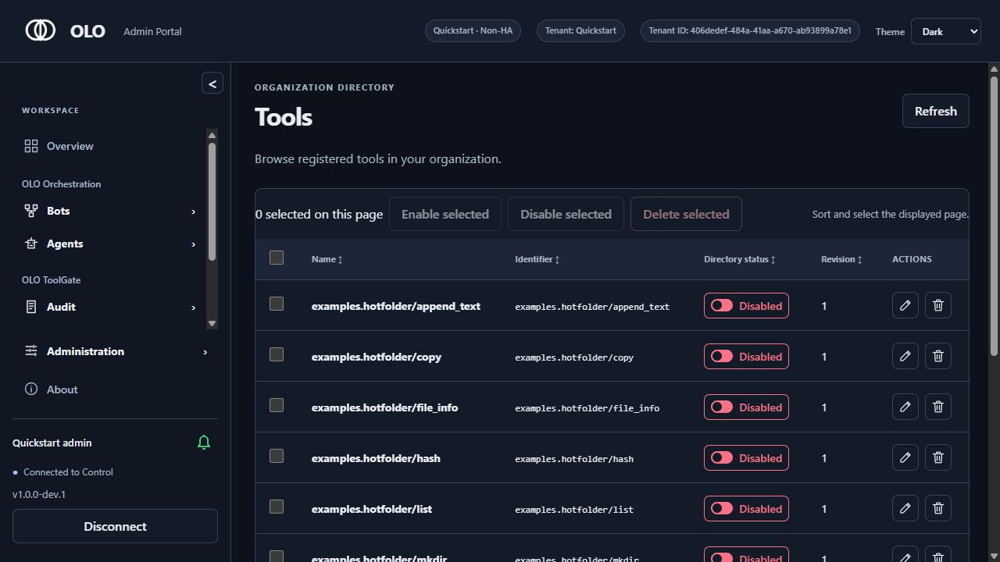

Tool Builder provides the authoring/build path for the supported JSON SDK.
Build and package checks remain distinct from runtime access review.

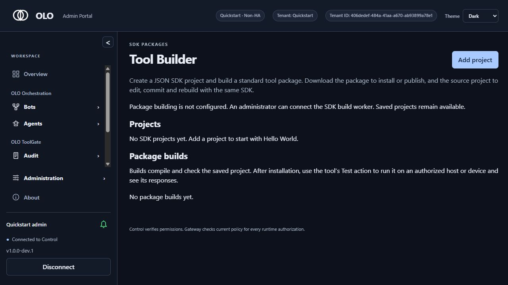

Server packages are reviewed and deployed to their intended execution pool.
Package trust and the executor's declared capabilities still apply.

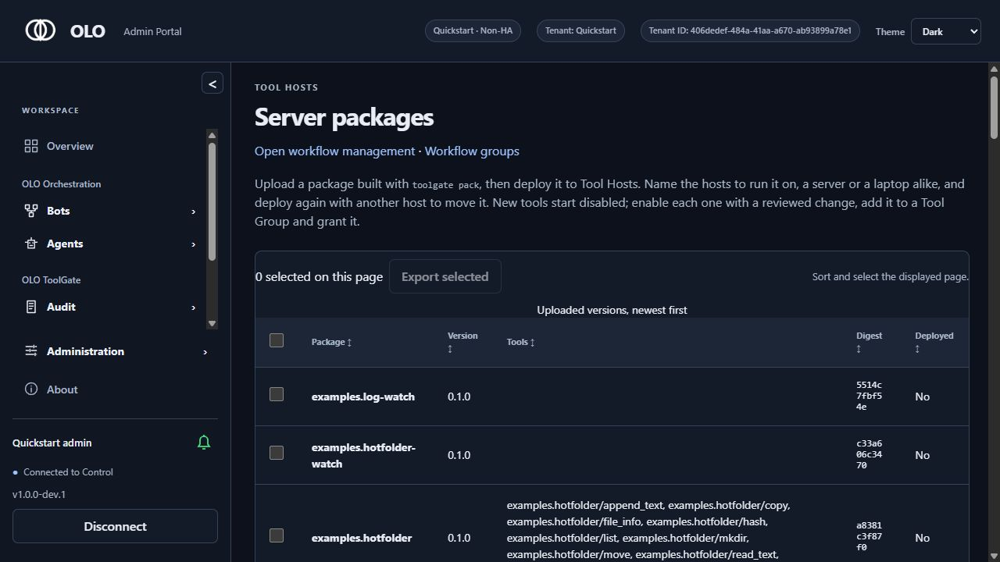

Existing MCP servers are registered, scanned and reviewed through the governed
proxy path. Control does not become the tool execution process.

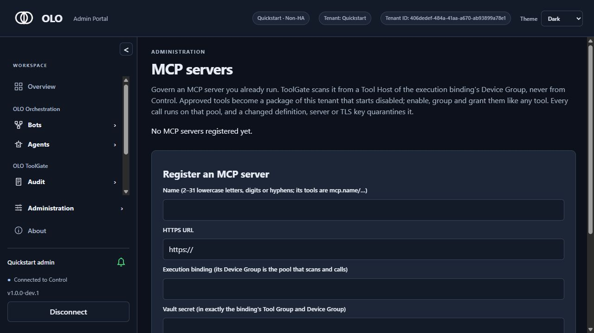

Read [build a tool](../../TOOL-SDK-GUIDE.md),
[Tool Builder](../client/tool-builder.md) and [MCP proxy setup](../gateway/mcp-proxy.md).

## Bind complete runtime access

Tool Groups and execution bindings specify where tools can run. Group membership
alone is not an execution grant.

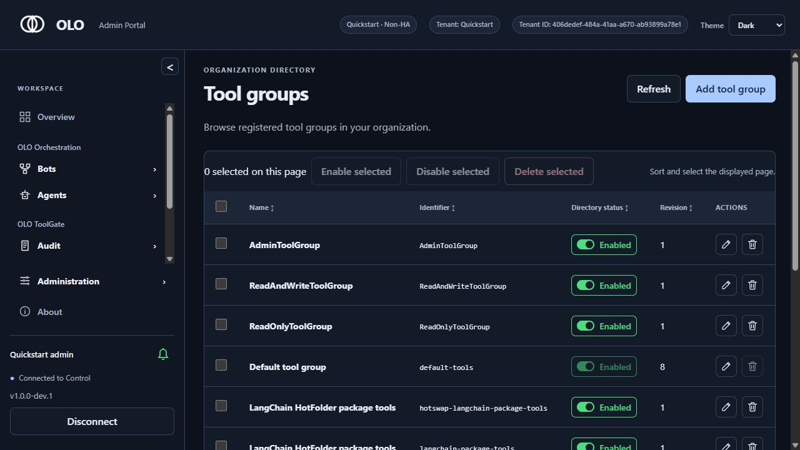

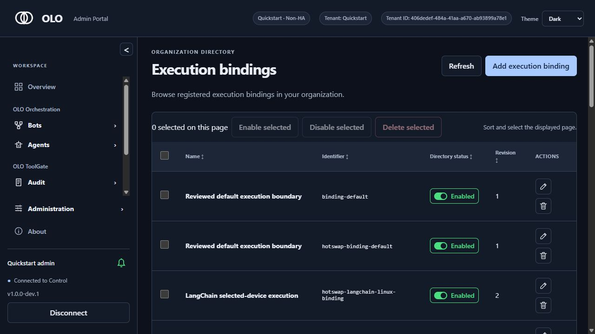

Agents have their own identities. Workload bindings and Agent Group capabilities
remain separate from a human's ability to configure an agent.

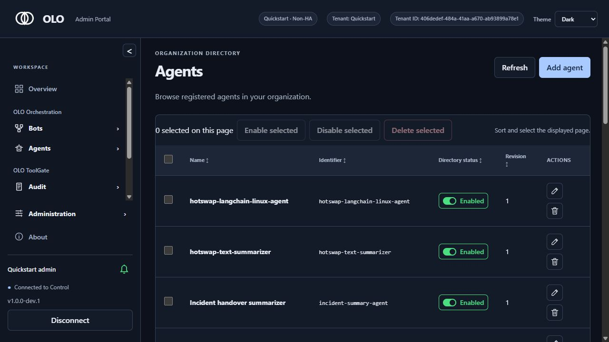

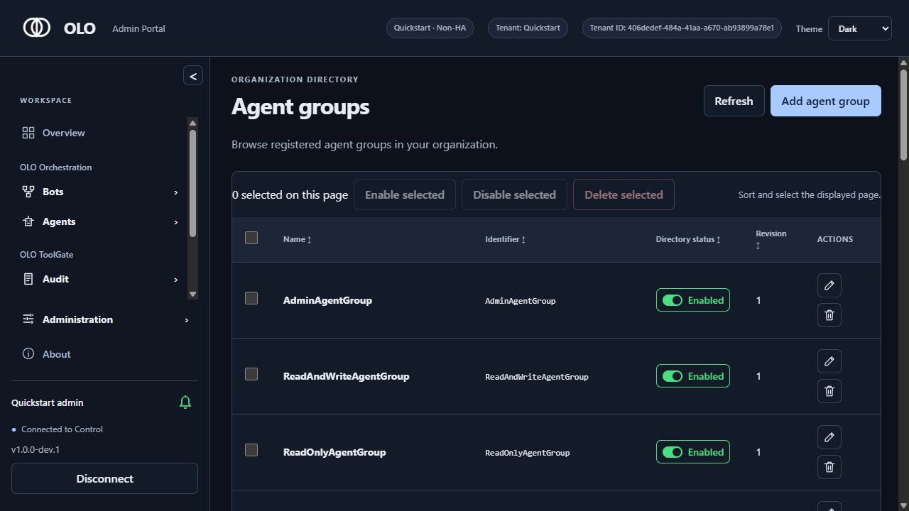

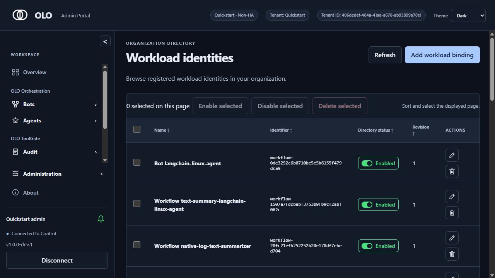

Complete grants retain their tool, device, action, resource and purpose scopes.
Policy can narrow a grant; ALLOW does not create missing access, ASK adds review,
and BLOCK wins.

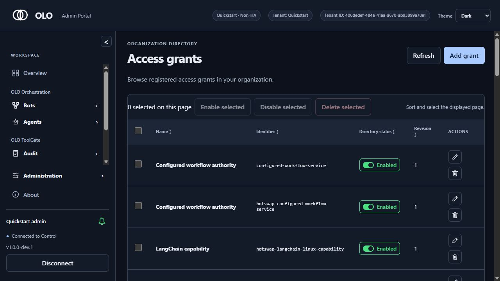

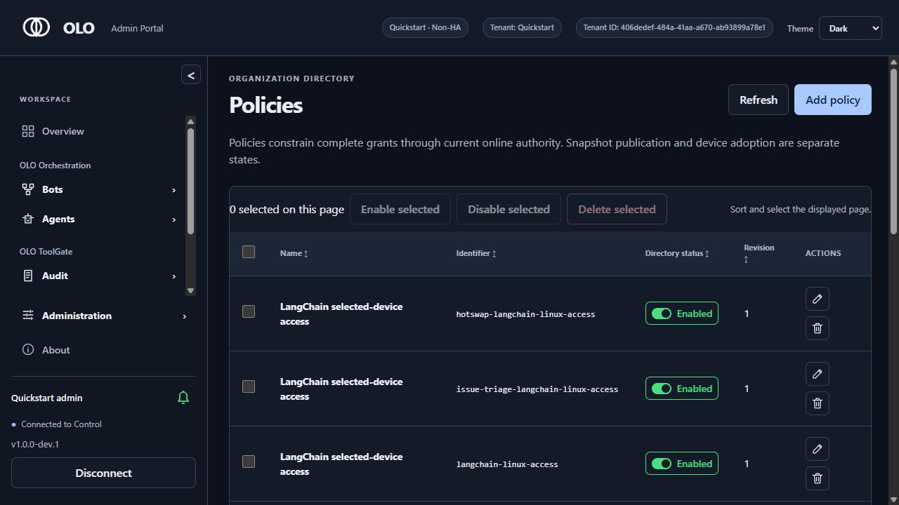

Resource extractors interpret the declared resource scope; access simulation
helps inspect configuration but cannot authorize an actual effect.

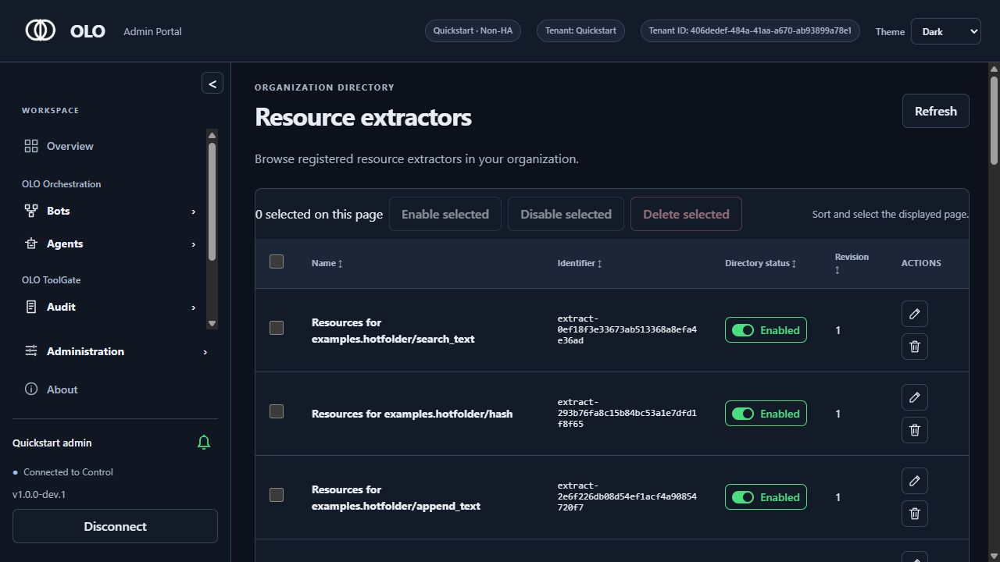

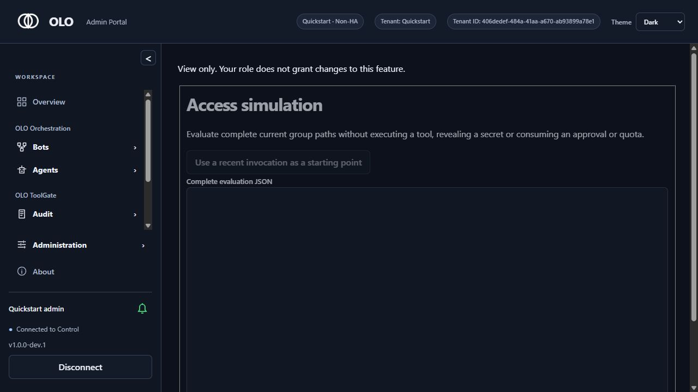

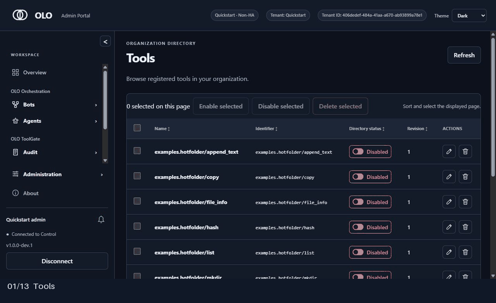

Use the [access-control guide](../security/enterprise-access-control.md) and
[first-tool checklist](../getting-started/first-tool.md). Inspect a real denied
call after changing a required grant; a screenshot or simulation is not that test.

[Review and audit screenshots](audit-and-approvals.md) ·
[All illustrated capabilities](README.md) · [Back to OLO](../../README.md#what-olo-supports)
