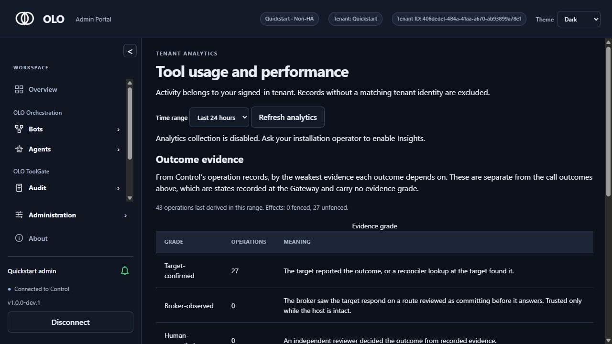
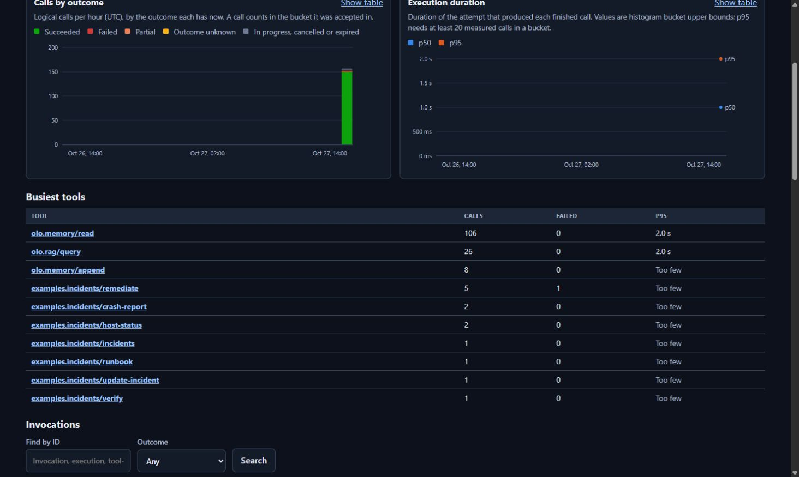
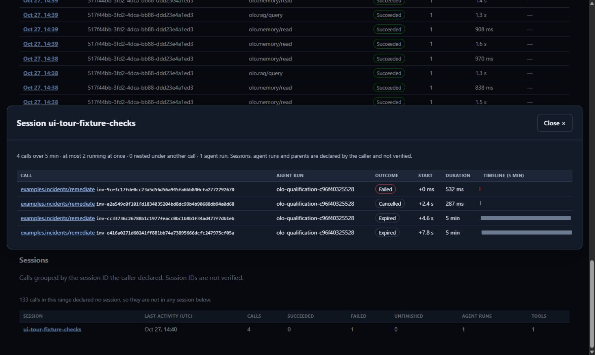

# Performance and capacity

OLO supports bounded service resources, directory caching, pooled local database
connections and diagnostic telemetry. These mechanisms do not establish a
general throughput, latency or HA guarantee. Measure the deployment you operate.

## Current mechanisms

| Area | Behavior | Operational boundary |
|---|---|---|
| Device pickup | Configurable check-in interval and jitter | Idle pickup can take an interval; deadlines and offline thresholds still apply |
| Directory cache | Bounded process-local cache; optional Redis/Valkey | Reuse checks the current database revision/generation; a cache never authorizes offline execution |
| SQLite | Connection pooling, WAL and durable synchronization | Single-node evaluation; not a substitute for external PostgreSQL qualification |
| Runtime | Separate liveness/readiness and dependency reconnection | Reconnection does not authorize replay of uncertain effects |
| Service resources | Compose/Helm CPU, memory and concurrency limits | Size against the actual workload, package executors and optional model/collector services |
| Diagnostics | Bounded buffers and rotated container logs | Diagnostic buffering has different durability from execution journals and audit |

See [Control configuration](../control-plane/configuration.md),
[shared cache settings](../deployment/shared-cache.md),
[runtime operation](../../apps/langgraph-runtime/README.md) and
[deployment prerequisites](../deployment/production.md).

## Measure before tuning

Record source/image versions, host hardware, database, network topology, model
provider, package versions, concurrency and request mix. Measure the complete
path: queue/pickup, current authorization, execution, target/provider latency and
result delivery. Report p50/p95/p99, errors, denied calls and resource saturation.

Use [Gateway performance verification](../gateway/performance.md) for its harness
and [repository checks](../testing/README.md) for correctness and isolation gates.
`SqliteReuseBenchmarkTest` measures local connection/commit overhead; it does not
measure application capacity. Model inference timings depend on model, context,
hardware and provider configuration and must be reported separately.

Never improve a benchmark by weakening current-authority checks, skipping durable
writes, expanding access, relaxing containment or replaying unknown operations.
Repeat the applicable denial/recovery checks after tuning. Recreate affected
containers explicitly when changing images or creation-time resource/log settings.

## Observe the deployment

Use [monitoring](../help/observability.md) for workflow collectors and ToolGate
metrics/traces. Monitor database contention, queue depth, resource bounds,
credential readiness and collector drops alongside latency. A trace or green
container alone is not proof of a completed business effect.

## Screenshots

### Tenant analytics and evidence

The configured debug console separates tool activity from Control-derived
operation evidence. This saved view explicitly has Insights collection disabled:
its evidence table is not a populated latency chart or a benchmark result.

The [capture inventory](../media/screenshots.json) records this view's source.
To obtain activity metrics, configure [Operator Insights](../control-plane/insights.md)
and inspect the actual workload and collection interval in your installation.

### Reading populated activity charts

This earlier Operator Insights capture illustrates calls by outcome, execution
duration buckets and busiest tools. The numbers belong to that saved evaluation
installation; they are not a current throughput or p95 guarantee.

Use the session timeline to examine the sequence of recorded calls alongside
aggregate charts. Neither a timeline nor a histogram establishes exactly-once
effects or independent target finality.

For collector dashboards, vendor trace views and setup, continue to
[monitoring screenshots](../help/observability.md#screenshots). Keep the
measurement procedure above alongside any real benchmark report.

[All illustrated capabilities](../media/README.md) · [Back to OLO](../../README.md#what-olo-supports)
