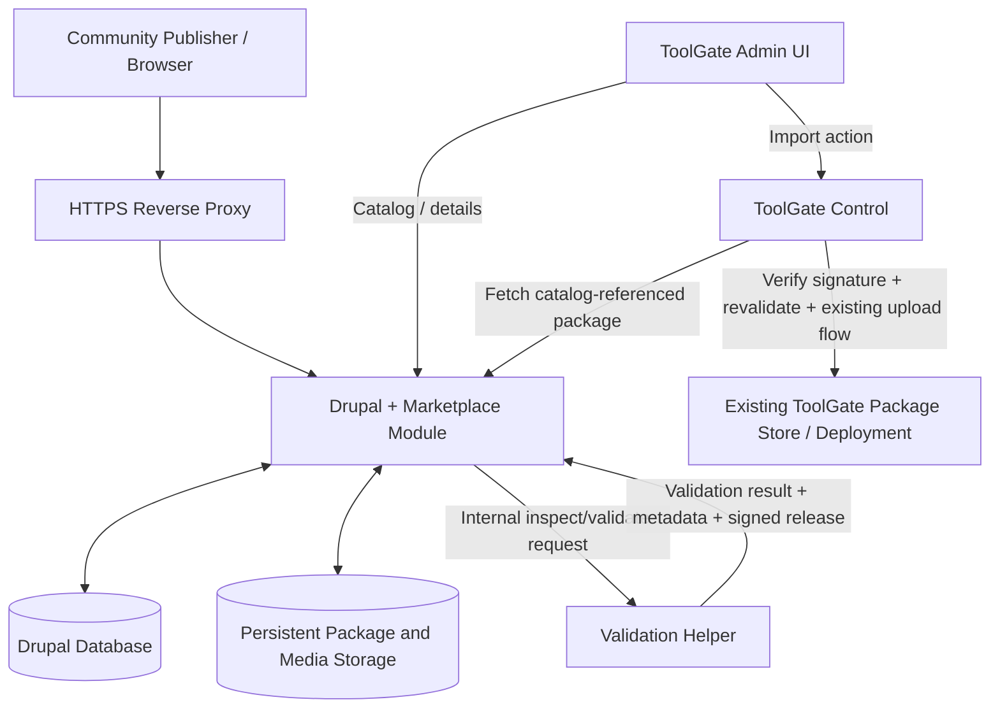
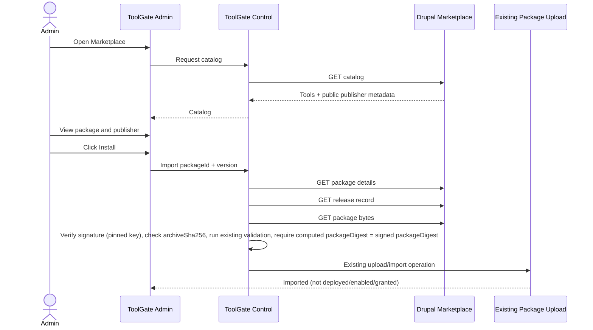

# ToolGate Marketplace v1 — Design Document

**Status:** Proposed implementation design  
**Version:** 1.1 (adds release signing and the fixes from design-review.md)  
**Marketplace base URL (configurable):** `https://olo-labs.duckdns.org`  
**Scope:** Upload → Validate → List → Consume  
**Source:** Simplified from `v1-plan.md`; 1.1 applies [design-review.md](design-review.md) and keeps signing (Rahul, 2026-10-12), with the subsequently agreed public publisher profiles and user-entered listing details. This document is a proposed design, not a claim about implemented ToolGate or Drupal APIs.

## 1. Objective

Deliver a small, publicly accessible marketplace where community members can register, maintain a public publisher profile, upload free `.tgpkg` packages, add descriptive information, and make structurally validated, Marketplace-signed packages available. ToolGate Admin should display the same public publisher and listing data and import packages using the existing ToolGate package/deployment flow.

**Definition of success:** A registered publisher uploads a valid package, sees its extracted metadata, adds marketplace descriptions, makes it available, and a ToolGate administrator discovers it in ToolGate Admin and imports it. The imported package is **not** automatically deployed, enabled, or granted access.

## 2. Decisions and boundaries

| Topic | v1 decision |
|---|---|
| Marketplace website, users, metadata, public API | Drupal and a small custom `toolgate_marketplace` module |
| Persistence | One relational database supported by the chosen Drupal distribution (MariaDB or PostgreSQL) and persistent private/public file volumes |
| Validation | One small Java helper service reusing Control's own `PackageArchive` validation (extracted to a shared library), with `toolgate validate` on a file as a second check; no package execution |
| Package format | Existing `.tgpkg`; preserve package bytes. Identity is `packageDigest` (SHA-256 of `CHECKSUMS.sha256`); `archiveSha256` is only for download integrity |
| Publisher identity | Drupal account + editable public publisher profile; ToolGate has no mirrored publisher accounts |
| Listing information | Validated technical metadata plus separate editable display metadata |
| Availability | Structurally validated package is signed by the helper (detached release record) and becomes public when the owner saves the listing |
| Signing | One Ed25519 Marketplace key, held only by the helper (secret mount); public key at `/.well-known/toolgate-marketplace-keys.json` and pinned in ToolGate Control |
| Namespaces | Package id prefix is bound to the publisher slug (`acme` owns `acme.*`) |
| ToolGate consumption | Read-only catalog/detail download APIs; ToolGate Control imports by trusted marketplace identifier, verifies the release signature, revalidates locally, and invokes existing upload process |
| Reverse proxy | Existing proxy if present; otherwise Caddy/Traefik |
| Search | Basic Drupal/DB queries; no dedicated search service |
| Versioning | Published package bytes are immutable; another upload requires a new version |
| Security claim | “Validated” means structurally valid, **not** malware-free, trusted, or publisher-verified |

### Explicitly out of scope

Publisher signatures, key hierarchies/PKI beyond one Marketplace key, dedicated Java Marketplace API, Redis, Elasticsearch, paid packages, advanced moderation/reviews/ratings, runtime sandboxing, malware certification, background retries/job orchestration, private marketplace subscriptions, automatic client updates, auto-deployment, and automatic tool permission grants.

Keep API payloads extensible but do not implement these features in v1.

## 3. Architecture



### Runtime components

1. **Drupal:** authentication, public profile editing, upload form, marketplace metadata, listing pages, downloads and JSON APIs.
2. **Database:** Drupal content, users, publisher profiles, package versions and validation status.
3. **Validation helper:** internal-only Java HTTP service (the `apps/marketplace-worker` scaffold) exposing inspection/validation and signing. It reuses Control's `PackageArchive` validation and holds the only copy of the signing key. It must never run package code.
4. **Reverse proxy:** publicly exposes only Drupal over TLS.

A standalone proxy container is optional if one is already deployed. The helper and database must not be reachable from the public internet.

### Integration assumptions to verify against the current repository

- `toolgate pack` produces `.tgpkg`, and `toolgate validate` can validate archives without execution.
- Technical metadata is found in `marketplace/listing.json` or extracted from `toolgate-package.json`; use the actual current schema rather than inventing fields.
- ToolGate Control has an existing server-package upload/import API and post-import deployment flow.
- ToolGate Admin has a Server packages page suitable for an Import from Marketplace entry point.

If a named command, manifest field, or API differs in the actual repository, adapt the implementation while preserving this architecture. Do not implement a parallel package system.

## 4. Data ownership and models

Drupal is the source of truth for all public marketplace content. ToolGate fetches snapshots for display and does not edit Drupal profiles.

### 4.1 Publisher profile

One public profile per Drupal account; use immutable internal IDs for relationships and a unique public slug for URLs.

| Field | Source | Rules |
|---|---|---|
| `publisherId` | Drupal | Stable internal identifier; public opaque ID allowed |
| `slug` | Publisher | Required, unique, URL-safe; changing it requires redirect or stable-ID lookup |
| `displayName` | Publisher | Required, escaped on output |
| `avatarUrl` | Publisher | Optional; safe uploaded image or approved image URL |
| `bio` | Publisher | Optional, sanitized text |
| `organization` | Publisher | Optional, unverified text |
| `websiteUrl`, `githubUrl`, `linkedinUrl` | Publisher | Optional, validated `https://` URLs |
| `country` | Publisher | Optional, public only when selected |
| `publicContactEmail` | Publisher | Optional, separate from private login email, explicit opt-in |
| `createdAt`, `updatedAt` | Drupal | System-managed |

**Privacy:** Never expose the login email by default, password hashes, internal roles, tokens, private upload paths, or other private Drupal account data. The UI must clearly indicate which fields are public. All unverified publisher claims are just publisher-provided information; do not label them “verified.”

### 4.2 Package and package version

Suggested conceptual data entities (implement as Drupal content entities or similarly maintainable fieldable entities):

**Package:** `packageId`, `ownerPublisherId`, `createdAt`, `updatedAt`.

**PackageVersion:** `packageId`, `version`, `status`, `uploadPath`, `publicPath`, `packageDigest`, `descriptorSetDigest`, `archiveSha256`, `sizeBytes`, `runtime`, `validatedManifestJson`, `releaseJson` (signed release record), `validationError`, `createdAt`, `validatedAt`, `publishedAt`, `delistedAt`, `delistReason`.

**MarketplaceListing:** bound to package/version or package as appropriate: `displayTitle`, `shortSummary`, `description`, `category`, `tags`, `repositoryUrl`, `documentationUrl`, `screenshots`, `licenseExpression`, `updatedAt`.

All package versions reference the stable publisher ID. Technical metadata, including package identity, runtime, tool descriptors and configuration requirements, is derived from the validated archive. User-editable marketplace fields must not override those technical values.

Add uniqueness constraints on `(packageId, version)` and ownership authorization on package edits. For v1, the package ID **prefix** (the part before the first `.`) must equal the uploader's publisher slug: publisher `acme` can publish `acme.notify` and `acme.crm`, nobody else can. Slugs are claimed transactionally and are unique. Reserve `olo`, `ololabs`, `toolgate` and `examples`; the PR #89 example packages (`examples.*`) are published by an OLO Labs account. Never infer ownership from the manifest's `publisher` text.

### 4.3 Statuses

```text
UPLOADED → VALIDATING → VALIDATED (private draft, signed) → AVAILABLE → DELISTED
                 └────→ REJECTED
```

- `UPLOADED`: stored privately, pending synchronous validation.
- `VALIDATING`: helper processing the submitted bytes.
- `VALIDATED`: valid and signed; only the owner sees it while completing the listing. Expires after 24 hours if not saved.
- `AVAILABLE`: listing saved; public listing and public download atomically finalized.
- `DELISTED`: taken down by the owner or an admin; hidden from the catalog and downloads, still returned by the detail endpoint with `delisted: true` so importers can see it was pulled.
- `REJECTED`: invalid; only the owner sees the explanation and private artifact policy applies.

For a basic v1, synchronous validation is acceptable if bounded by a short request timeout and package limits. If it times out, return a failure the user can retry; do not silently leave an indefinitely validating record. Avoid queued processing until there is a demonstrated need.

Published archive bytes and version identity cannot change. The owner may edit display-only metadata without repackaging; auditing timestamps suffice in v1. An administrative takedown switch is retained as an operational safety measure, not a full moderation workflow.

## 5. Publisher and upload user experience

### 5.1 Drupal navigation

- Marketplace Home: search/basic filter, package cards, publisher attribution.
- Tool Detail: package description, technical tools/configuration, versions, links, screenshot gallery if provided, publisher card, download.
- Publisher Profile: display name/avatar, bio, organization, links, public contact opt-in, list of published packages.
- My Profile: edit public profile separately from account security settings.
- My Packages: owned packages, upload action, validation outcome, edit listing.

### 5.2 Upload workflow

1. Authenticated account opens **My Packages → Upload Package**.
2. Drupal checks file extension and size (default **50 MB maximum**, configurable, and always below Control's 64 MiB upload limit), stores the upload in **private** storage, and creates an upload attempt.
3. Drupal calls the internal helper with the uploaded bytes or with an authenticated internal-only download route. The helper inspects the archive without executing its contents and, if it is valid, signs the release record (§6.1).
4. The helper returns normalized technical listing metadata and validation errors. Prefer `marketplace/listing.json` if supported and consistent with the canonical package manifest; otherwise fall back to `toolgate-package.json` and the tool descriptors for package ID/version/tools/settings. The Java SDK doesn't generate `listing.json` yet, so the fallback is the normal v1 path and is tested first. Treat content in both as untrusted text.
5. Drupal shows immutable extracted fields and an editable form containing: display title, short summary, Markdown/plain-text description, category, tags, repository URL, documentation URL, optional screenshots, and license where not already authoritatively declared.
6. Publisher saves. Server verifies the prefix/slug ownership and package/version uniqueness, binds the public publisher profile, stores the user-entered fields, and publishes the exact validated bytes and the `.release.json` as `AVAILABLE`.
7. Package appears immediately in the public marketplace and JSON catalog. Rejected packages do not appear or expose their uploaded bytes.

**Important:** Make the “validation passed” step and “complete listing/save” step explicit in the UI. A partially completed listing must not accidentally become public. Use a short-lived private draft or staging status if necessary, without introducing a generalized workflow engine.

### 5.3 User-added information and rendering

- Sanitize Markdown to a safe allowlist; do not render arbitrary user HTML/JS.
- Permit only safe `https://` links; escape output and add safe external-link attributes.
- Treat avatar and screenshots as image uploads with type/size/dimension validation; never accept executable formats as images.
- Track which values are **package-extracted** and which are **publisher-entered**.
- Show a disclaimer: “Publisher details are supplied by the publisher. Validation checks package format, not code safety.”

## 6. Package validation helper

### Endpoint (internal only)

`POST /inspect` — multipart upload of `.tgpkg` or a controlled internal file reference; returns a structured result.

```json
{
  "valid": true,
  "packageId": "acme.notify",
  "version": "0.1.0",
  "runtime": "java",
  "packageDigest": "sha256:<64 lowercase hex>",
  "descriptorSetDigest": "sha256:<64 lowercase hex>",
  "archiveSha256": "<64 lowercase hex>",
  "tools": [
    {"name": "notify.send", "title": "Send notification", "description": "Post a notification to the approved webhook", "effect": "NON_IDEMPOTENT"}
  ],
  "requiredSettings": [
    {"kind": "destination", "name": "WebhookHost", "description": "Host of the webhook receiver"},
    {"kind": "secret", "name": "WebhookApiKey", "description": "API key sent as X-Api-Key"},
    {"kind": "global", "name": "AllowedChannels", "type": "STRING", "default": "ops-alerts"},
    {"kind": "global", "name": "Source", "type": "STRING", "default": "toolgate"}
  ],
  "release": { "...": "signed release record, §6.1" },
  "errors": []
}
```

This JSON is the response contract. `requiredSettings` is built from each descriptor's `variables` (globals, secrets, claims) and `destinations` (`hostSetting`) in `packages/contracts/schemas/v2/descriptor.schema.json`; `kind` is one of `global`, `secret`, `destination`, `claim`. The values above are the real ones for `examples.notify`.

### Required checks (minimum safe baseline)

- File type/ZIP structure and maximum compressed size.
- Maximum total expanded size, number of entries, per-entry size and processing time; reject zip bombs.
- Reject absolute/traversal paths, symlinks and unsafe archive entries, duplicate normalized paths and invalid checksums.
- Required manifest and descriptor fields consistent with the supported ToolGate package format.
- Supported runtime only (the original plan specifies Java server tools for v1).
- `packageDigest` (SHA-256 of `CHECKSUMS.sha256`, as Control computes it) and `descriptorSetDigest` taken from the validator; `archiveSha256` computed from the exact original archive bytes.
- Validation runs Control's `PackageArchive` rules (for example, each Java tool has exactly one jar artifact), so anything listed is accepted by Control's upload. `toolgate validate` is run as a second check **only on a single regular file the helper wrote itself**, never on a directory: on a directory it compiles and runs the project's tests.
- No execution of uploaded bytecode, scripts, install hooks or MCP tools during validation.
- Worker runs as non-root with limited memory/CPU, read-only filesystem where practical, no Docker socket and minimal network access.

The helper should return a clear machine code and human-readable error for invalid uploads. A structurally valid package is not a safe or endorsed package.

### 6.1 Release signing

When validation passes, the helper signs a release record and returns it with the result. The package bytes are not changed; the record is a detached `.release.json` stored and served next to the `.tgpkg`.

```json
{
  "schema": "toolgate.marketplace.release/1",
  "marketplace": "https://olo-labs.duckdns.org",
  "packageId": "acme.notify",
  "version": "0.1.0",
  "packageDigest": "sha256:<64 lowercase hex>",
  "descriptorSetDigest": "sha256:<64 lowercase hex>",
  "archiveSha256": "<64 lowercase hex>",
  "publisherSlug": "acme",
  "signedAt": "2026-10-12T18:45:00Z",
  "keyId": "olo-marketplace-2026-1",
  "signature": "<base64 Ed25519 signature over the RFC 8785 canonical JSON of every field above except signature>"
}
```

- The key is generated once (a documented script), mounted into the helper as a secret, and never reaches Drupal, the database or Git.
- `GET /.well-known/toolgate-marketplace-keys.json` lists `{keyId, algorithm: "Ed25519", publicKey}` for current and retired keys.
- What the signature means: "this Marketplace validated these exact bytes for this publisher slug". It is **not** a safety review and grants no authority in ToolGate.
- Rotation in v1 is manual: add the new key to the keys file and to each ToolGate's pinned keys, then switch the helper. Old releases stay valid under their `keyId`.

### 6.2 Version compatibility

There are three separate questions, each answered from data that already exists.

**A. Can this ToolGate run this package?** The manifest already declares it (`packages/contracts/schemas/v2/package.schema.json`):

| Manifest field | Meaning | Compared with |
|---|---|---|
| `compatibility.contractsVersion` (required) | Contract set the package was built against | Control's contract set (`packages/contracts/VERSION`, 1.0.0 today): same major required |
| `compatibility.minimumToolHostVersion` | Oldest Tool Host that can run it | `version` each Tool Host reports at registration (`ToolHostRegistration`) |
| `compatibility.minimumClientVersion` | Oldest endpoint client, for client tools (not in v1) | Client version |
| `sdk.protocol` | Tool protocol range the runtime speaks | Tool Host `protocol` range: must overlap |
| `sdk.descriptorGeneration` | Descriptor format generation | Generations Control accepts |
| `runtimes[].language` + `version` | For example Java 17 | Runtimes the target Tool Hosts provide |

- The **helper** extracts these into a `compatibility` block on every version's listing and detail response. It rejects an upload only if a field is missing or malformed, never because of a particular ToolGate.
- The **website** shows them on each version ("Needs Tool Host 0.10 or later, Java 17, contracts 1.x").
- **Control decides** compatibility for itself, because only it knows its own versions and its Tool Hosts. The Marketplace never filters for a ToolGate.
  - In the console, each version is marked compatible or not, with the reason. **Install** is offered for the newest compatible version, not simply the newest version.
  - At import, Control rejects a contracts major it doesn't support, a descriptor generation it doesn't accept, or a protocol range with no overlap.
  - At deploy, it refuses Tool Hosts below `minimumToolHostVersion` or without the runtime. If no host qualifies, the deploy fails with the reason.
  - These checks go into Control's existing upload and deploy path, not only the Marketplace import. Today Control does not check them (the schema says "checked at enable", but no code reads `compatibility`), so manual uploads are covered too.

**B. Is a new package version compatible with the previous one?** Semantic versioning, checked by the helper against the previous `AVAILABLE` version of the same package (tool-sdk plan §8.3):
- Removing a tool, adding a required input, removing an input or output field, or narrowing an input type needs a **major** bump.
- Adding a tool or an optional input needs at least a **minor** bump.
- Anything else can be a patch.
- A bump smaller than the diff requires is rejected, with the diff shown.
- The detail response carries `apiChange: none|compatible|breaking`, so an admin updating in ToolGate sees what a new version changes before importing it.

**C. Is the Marketplace API compatible with this ToolGate?**
- The API version is in the path (`/api/toolgate/v1/`) and the release record carries `schema: toolgate.marketplace.release/1`.
- Within v1, changes are additive only: new fields, never renamed or removed ones. Control ignores fields it doesn't know.
- A breaking change ships as `/api/toolgate/v2/`, with v1 kept for at least two ToolGate minor releases.
- Control rejects a release record whose `schema` it doesn't know, rather than guessing.

## 7. Public catalog and publisher API

All read endpoints expose only `AVAILABLE` packages, except that the detail endpoint also answers for `DELISTED` versions with `delisted: true` and no download. Catalog items are **per package**, showing the latest available version. All response objects include stable IDs, version and public URL fields. Use pagination even if the first release has only a few packages; a simple `page`/`limit` convention is sufficient.

| Method | Endpoint | Function |
|---|---|---|
| GET | `/api/toolgate/v1/catalog?page=1&limit=20&q=webhook` | Search/list available packages with publisher summaries |
| GET | `/api/toolgate/v1/tools/{id}` | One package with all its available versions (newest first) |
| GET | `/api/toolgate/v1/tools/{id}/{version}` | Complete package technical/listing metadata plus publisher public profile and the release record |
| GET | `/api/toolgate/v1/tools/{id}/{version}/package` | Download exact validated archive bytes (`Cache-Control: public, max-age=31536000, immutable`) |
| GET | `/api/toolgate/v1/tools/{id}/{version}/release` | The signed `.release.json` |
| GET | `/api/toolgate/v1/media/{id}` | Avatars, icons and screenshots by opaque id, size-capped, `image/png` or `image/jpeg` only |
| GET | `/.well-known/toolgate-marketplace-keys.json` | Public signing keys |
| GET | `/api/toolgate/v1/publishers/{slug}` | Public publisher profile and available packages |

### Example catalog response

```json
{
  "page": 1,
  "limit": 20,
  "total": 1,
  "items": [
    {
      "packageId": "acme.notify",
      "version": "0.1.0",
      "title": "Webhook Notify",
      "summary": "Webhook notification tools",
      "category": "Notifications",
      "tags": ["webhook", "integration"],
      "runtime": "java",
      "validationStatus": "VALIDATED_STRUCTURE",
      "signed": true,
      "publisher": {
        "id": "pub_123",
        "slug": "acme",
        "displayName": "Acme Developer",
        "organization": "Acme Labs",
        "avatarUrl": "https://olo-labs.duckdns.org/files/profile/acme.png",
        "profileUrl": "https://olo-labs.duckdns.org/publishers/acme"
      },
      "detailsUrl": "https://olo-labs.duckdns.org/api/toolgate/v1/tools/acme.notify/0.1.0"
    }
  ]
}
```

### Example detail response

```json
{
  "packageId": "acme.notify",
  "version": "0.1.0",
  "title": "Webhook Notify",
  "summary": "Webhook notification tools",
  "description": "Tools to send notifications to configured webhooks.",
  "category": "Notifications",
  "tags": ["webhook", "integration"],
  "repositoryUrl": "https://github.com/example/webhook-notify",
  "documentationUrl": "https://example.org/webhook-docs",
  "screenshots": [],
  "license": "MIT",
  "runtime": "java",
  "tools": [{"name": "notify.send", "title": "Send Notification", "description": "Send a webhook notification"}],
  "requiredSettings": [
    {"kind": "destination", "name": "WebhookHost"},
    {"kind": "secret", "name": "WebhookApiKey"},
    {"kind": "global", "name": "AllowedChannels", "type": "STRING", "default": "ops-alerts"},
    {"kind": "global", "name": "Source", "type": "STRING", "default": "toolgate"}
  ],
  "packageDigest": "sha256:<64 lowercase hex>",
  "archiveSha256": "<64 lowercase hex>",
  "compatibility": {
    "contractsVersion": "1.0.0",
    "minimumToolHostVersion": "0.10.0",
    "protocol": {"min": 2, "max": 2},
    "descriptorGeneration": 1,
    "runtimes": [{"language": "java", "version": "17"}]
  },
  "apiChange": "none",
  "delisted": false,
  "releaseUrl": "https://olo-labs.duckdns.org/api/toolgate/v1/tools/acme.notify/0.1.0/release",
  "publisher": {
    "id": "pub_123",
    "slug": "acme",
    "displayName": "Acme Developer",
    "bio": "Open-source integration tools.",
    "organization": "Acme Labs",
    "websiteUrl": "https://example.org",
    "githubUrl": "https://github.com/example",
    "linkedinUrl": null,
    "publicContactEmail": null,
    "profileUrl": "https://olo-labs.duckdns.org/publishers/acme"
  },
  "downloadUrl": "https://olo-labs.duckdns.org/api/toolgate/v1/tools/acme.notify/0.1.0/package"
}
```

The sample identities and links above are illustrative. Do not seed them as real community identities.

### API rules

- Use consistent JSON error codes (`NOT_FOUND`, `INVALID_PACKAGE`, `UNAVAILABLE`, `SERVER_ERROR`).
- Escape/encode path components; never derive filesystem paths directly from user-supplied IDs.
- Public responses must exclude drafts, rejected uploads and private account fields.
- Add modest request rate limits and download protections at the reverse proxy/application layer.
- Use appropriate cache headers; invalidate cached catalog and profile data after edits.
- Provide CORS only if a genuine browser-cross-origin integration needs it; ToolGate Control should request server-to-server.

## 8. ToolGate Admin consumer design

### 8.1 UI

Add **Marketplace** to ToolGate Admin (or an **Import from Marketplace** entry on the existing Server packages page).

- Images: the console's Content-Security-Policy is `img-src 'self'`, so the browser never loads Marketplace images directly. Control proxies `/api/toolgate/v1/media/{id}` through its own origin with the same origin allowlist, size cap and timeout as package fetch. Do not loosen the console CSP.
- Catalog cards/table: icon if provided, title, summary, version, runtime, category, publisher display name/avatar, and **Install** button.
- Tool Detail panel: description, tools, required settings, repository/docs links, version and SHA-256 digest.
- Publisher panel: public avatar, bio, organization, public links, public contact (if opted in), **View public profile** link.
- Import confirmation: “Community package, signed by the Marketplace after structural validation. The signature proves where it came from, not that it is safe. Review its settings and permissions before deploying.”
- Install outcome: show imported package in the existing package-management screen; no duplicate lifecycle management.

### 8.2 Import sequence



### 8.3 Consumer controls

- Control has `TOOLGATE_CONTROL_MARKETPLACE_ENABLED`, `TOOLGATE_CONTROL_MARKETPLACE_BASE_URL` and `TOOLGATE_CONTROL_MARKETPLACE_KEYS` (pinned public keys). These are environment-owned settings, so a configuration import can't redirect the fetch origin or swap keys.
- Fetch only from administrator-configured marketplace origin; do **not** accept arbitrary URLs as package fetch targets.
- Resolve download paths returned from catalog only if HTTPS and same trusted origin; disallow redirect to untrusted/internal hosts, enforce timeouts and size limits.
- Fetch bytes through Control (not directly in browser). Verify the release signature against a pinned key, check `archiveSha256`, run the existing validation, and require the `packageDigest` Control computes to equal the signed one. Any mismatch rejects the import.
- The signature proves the bytes are what the Marketplace validated for that publisher slug, so a compromised web server can't swap packages without the helper's key. It does not prove the code is safe. Treat marketplace bytes as untrusted executable artifacts.
- Import requires Super Admin, the same check as the existing upload (`ServerPackages.upload`), and the audit event records the Marketplace origin, package id, version, publisher slug and `keyId`.
- Import creates a normal package entry; separate existing steps remain necessary to configure secrets, deploy, enable, and grant Agent Group access.
- Do not store an independent copy of publisher profiles as a second source of truth; display fetched public metadata and optionally cache it briefly.

## 9. Security and privacy baseline

The following are not v2 features; they are essential defenses for an internet-facing upload service:

1. Authenticated uploading with basic registration abuse controls (email verification/rate limit; CAPTCHA optional).
2. Explicit package and expanded archive limits and no execution during inspection.
3. Private staging of rejected/unfinished uploads; public download only after successful validation and listing save.
4. CSRF protection and permission checks on Drupal account/profile/package mutation routes.
5. Safe text/Markdown rendering and image upload validation.
6. No private user account fields in public APIs.
7. HTTPS; helper/database internal-only; secrets in environment/secret mounts, not in Git.
8. Import origin allowlist, SSRF protections, release signature verification against pinned keys, checksum check and local revalidation in ToolGate.
9. Admin emergency delisting/takedown capability for malicious or illegal submissions.
10. Log package ID, publisher ID, version, validation result and import outcome without logging credentials or secret values.

With signing, a compromise of Drupal, its database or file storage can change display metadata or delist packages, but can't make ToolGate import altered bytes. A compromise of the helper's key can; keep the helper internal-only and the key out of backups that Drupal can read. Signing is not a code review: do not market the system as a trusted software supply-chain registry.

## 10. Deployment and configuration

Suggested repository layout (adapt to the actual monorepo):

```text
marketplace/                   # isolated; will move to its own repo with olo-toolgate as a submodule
  TOOLGATE_SRC                 # ".." today, "toolgate" after the split; the only link to ToolGate code
  drupal/                      # Drupal project, custom module, theme/config
  helper/                      # Java validation + signing service (own Gradle build)
  seed/                        # builds and collects the example packages for bring-up
  deploy/compose.yaml, .env.example, Caddyfile
  scripts/, ci/, docs/
```

Layout, isolation rules and example seeding are specified in [implementation-prompt.md](implementation-prompt.md).

Suggested runtime configuration:

```dotenv
MARKETPLACE_BASE_URL=https://olo-labs.duckdns.org
MARKETPLACE_MAX_PACKAGE_MB=50
MARKETPLACE_MAX_EXPANDED_MB=200
MARKETPLACE_VALIDATION_TIMEOUT_SECONDS=30
MARKETPLACE_DB_NAME=toolgate_marketplace
MARKETPLACE_DB_USER=toolgate_marketplace
MARKETPLACE_HELPER_URL=http://helper:8080
MARKETPLACE_SIGNING_KEY_FILE=/run/secrets/marketplace_signing_key
MARKETPLACE_SIGNING_KEY_ID=olo-marketplace-2026-1
TOOLGATE_CONTROL_MARKETPLACE_ENABLED=true
TOOLGATE_CONTROL_MARKETPLACE_BASE_URL=https://olo-labs.duckdns.org
TOOLGATE_CONTROL_MARKETPLACE_KEYS=olo-marketplace-2026-1:<base64 public key>
```

The `TOOLGATE_CONTROL_*` names follow Control's existing convention (for example `TOOLGATE_CONTROL_CLIENT_CHECKIN_MS`); the `MARKETPLACE_*` names are new. Define real DB passwords, Drupal hash salt and helper authentication using `.env`/secret management without committing credentials. The exact Compose configuration should match the chosen Drupal/database image and deployment conventions.

### Docker Compose expectations

- Database health check and persistent data volume.
- Drupal persistent private/public files, reproducible Composer-built image and enabled custom module.
- Helper deployed on an internal network without host port publishing; non-root and bounded resources.
- TLS proxy if one is not already available; only HTTP/HTTPS public.
- Simple `docker compose up -d` quickstart, first-install Drupal bootstrap and initial admin creation documented.
- Restart persistence and a documented backup/restore process for DB and uploaded package files.

## 11. Error handling

| Scenario | Expected behavior |
|---|---|
| Invalid `.tgpkg` or manifest | Reject upload, show actionable message, no public listing |
| Package exceeds limit | Reject before processing |
| Helper timeout/unavailable | Show retryable failure; never publish unvalidated bytes |
| Duplicate package ID/version | Reject; explain version immutability |
| Publisher attempts editing another user's package | Return authorization error |
| Metadata save fails | Keep package private; no half-published catalog record |
| Public package file missing | Do not return stale downloadable listing; raise operational error |
| ToolGate marketplace unavailable | Show unavailable state; existing imported tools continue working |
| Bad or unknown-key signature, hash or `packageDigest` mismatch, or failed local import validation | Reject import; do not deploy |
| Signing fails in the helper | Upload fails with a retryable error; nothing becomes public unsigned |
| Publisher updates profile | Drupal changes immediately; ToolGate reflects it on refresh/short cache expiry |
| Admin delists package | Remove catalog/download access while retaining audit and local ToolGate installs untouched; the detail endpoint shows `delisted: true` so ToolGate can flag it |

For publication, first store and hash the validated archive, write the final public artifact safely, verify accessibility/digest, and only then mark `AVAILABLE`. Reconcile or clean orphaned files on failures. Package bytes remain immutable after availability.

## 12. Tests and acceptance criteria

### Minimum automated tests

- User can register, log in, edit public profile and opt in/out of public contact information.
- Unauthorized users cannot modify publisher profiles or packages.
- Valid `.tgpkg` inspection extracts expected technical fields (use actual ToolGate fixture files).
- Malformed package, checksum error, traversal entry and decompression-limit violations are rejected.
- Publisher can add title, summary, description, tags and links; technical identifiers remain immutable.
- Available tools render correctly in Drupal catalog, detail page and publisher profile page.
- Catalog/detail/profile APIs return consistent public information, never private account data.
- ToolGate marketplace view displays owner public profile plus manually entered listing fields.
- Install imports into existing Control package flow and requires separate deployment/permissions.
- Package tampering, forged or unknown-key signatures, unsafe redirects and non-allowlisted origins are rejected.
- The helper never passes a directory to `toolgate validate`, and a package Control would reject (for example a Java tool without exactly one jar) is rejected at upload.
- An upload whose id prefix is not the publisher's slug, or uses a reserved prefix, is rejected.
- Rejected and unfinished packages cannot be publicly downloaded.
- Data survives container restart; marketplace downtime does not affect already imported runtime tools.

### v1 end-to-end demo

1. Publisher registers and completes profile.
2. Publisher (slug `examples`, an OLO Labs account) uploads `examples/java-tools/webhook-notify` packed as `webhook-notify-0.1.0.tgpkg`. (`log-insights` has no source on main and is not a seed package until fixed.)
3. Validation succeeds and technical metadata appears.
4. Publisher enters summary, Markdown description, tags, documentation URL and source repository.
5. Package appears on Drupal homepage and publisher page.
6. Open the ToolGate Admin Marketplace: the same package and the same public publisher information are visible.
7. Select **Install**; Control downloads the package and release record, verifies the signature, checks hashes, revalidates and imports through existing package-upload logic.
8. Admin can proceed with the standard configure/deploy/enable/grant steps.
9. A rejected package is not listed; a changed profile appears on both UIs after refresh.

## 13. Phased implementation within v1

1. **Foundation:** Drupal Compose deployment, database/files, custom module skeleton and publisher profile.
2. **Publishing:** authenticated upload, helper inspection and signing (with Control's `PackageArchive` extracted to a shared library), key generation script, metadata form, availability state and catalog pages.
3. **Public API:** catalog, detail, publisher and package download endpoints; sanitized fields.
4. **ToolGate integration:** Control fetch/import with signature verification and the existing validator, image proxy, and Admin Marketplace view.
5. **Release:** integration tests, clean-install quickstart, security checks, docs and a real package demonstration.

Each phase must remain independently testable; do not add v2 infrastructure to complete v1.

## 14. Deferred v2 enhancements

- Publisher signatures (for example Sigstore from CI), automated key rotation and HSM/KMS-held keys.
- Asynchronous validation queues, retries and worker scaling.
- More runtime/package types where supported by ToolGate.
- Verified publishers and package provenance.
- Community moderation, reviews, ratings and advisories.
- Paid/private packages and entitlement workflows.
- Elasticsearch/Redis where scale justifies them.
- Package analytics, update notifications and opt-in automatic upgrades.
- Expanded installer policies and richer enterprise access controls.

## 15. Final guardrails for implementation agents

**Prefer existing code and contracts.** Inspect the current repository, package manifest schema, validator CLI and existing Control upload route before implementing adapters. Do not assert these interfaces exist until confirmed. Do not invent new backend services, package runtimes, signing schemes beyond §6.1, or permission systems. Keep Drupal as publisher/listing source of truth and ToolGate as consumer. All community metadata is untrusted display content; all packages remain untrusted executable artifacts despite structural validation.
